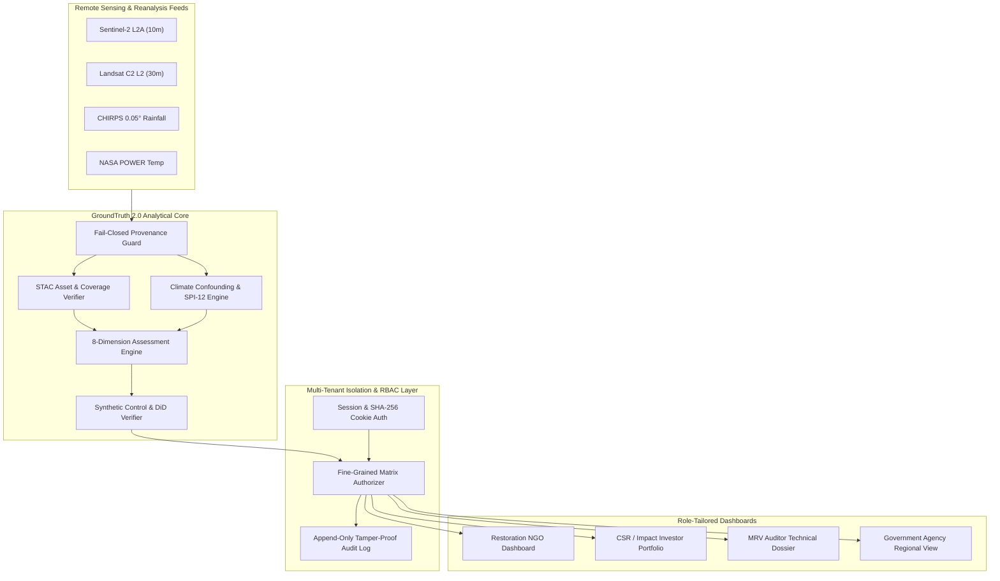
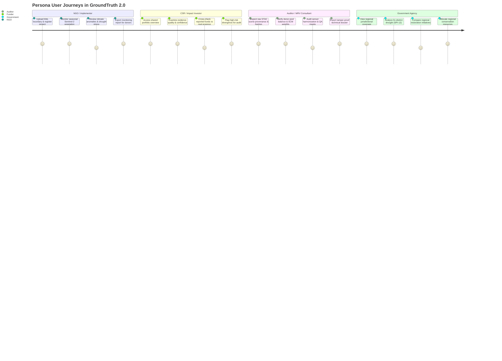
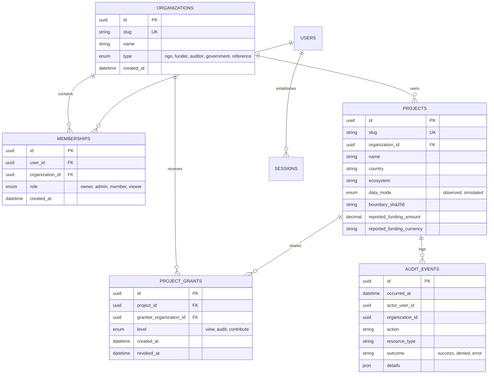
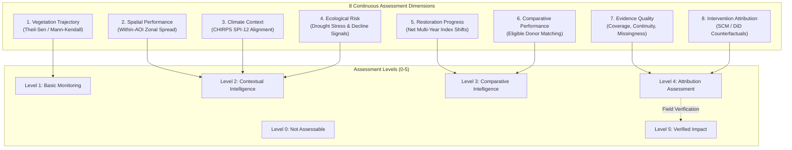
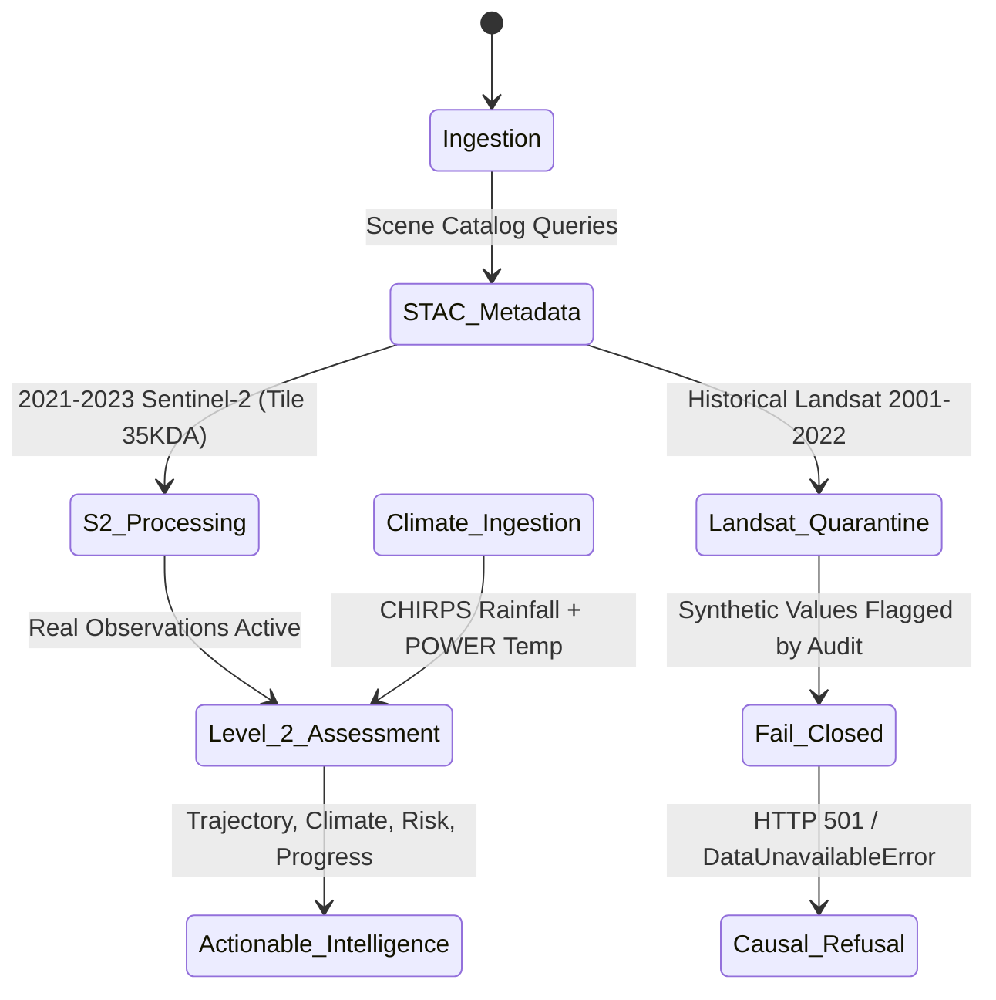
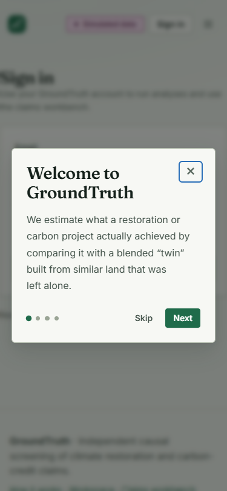
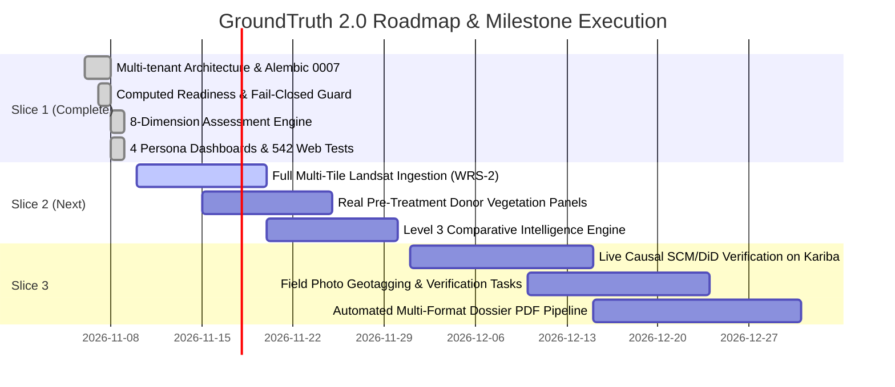

# GroundTruth 2.0 — Comprehensive Product Specification

> **One platform. Four perspectives. One scientifically consistent, tamper-proof source of truth.**

**Document Version:** 2.0.0  
**Status:** Approved & Shipped (Slice 1 Active, 2026-11-09)  
**Lead Architect:** Viraj  
**Engineering Quality:** 266 Tenancy Tests Passing · 542 Web Vitest Specs Passing · 1,121+ Core Platform Tests  

---

## 1. Executive Summary & Vision

GroundTruth 2.0 is an enterprise multi-tenant ecosystem restoration intelligence and impact verification platform. It solves the foundational crisis of trust in nature-based climate investments and voluntary carbon markets by establishing an uncompromised, reproducible bridge between satellite remote sensing, rigorous causal econometrics, and multi-stakeholder governance.

Unlike legacy registries that rely on static project developer self-assertions, uncalibrated optical greening metrics, or black-box rating algorithms, GroundTruth 2.0 enforces a strict separation between **real empirical observations** and **causal attribution claims**.



The system answers three sequential questions in strict order of evidentiary hierarchy:
1. **What is happening on the ground?** Empirical monitoring: surface reflectance, multi-spectral vegetation indices (NDVI, EVI, NDMI, NBR), climate stress (precipitation anomalies, temperature, SPI drought), and verified spatial boundaries.
2. **How good is the evidence?** Provenance tracking: sensor calibration, valid pixel coverage percentage, missing month flags, spatial completeness, and cryptographic checksums (`spec_hash`, boundary SHA-256).
3. **Can observed changes be causally attributed to the intervention?** Econometric counterfactual inference: synthetic controls (SCM), difference-in-differences (DiD), in-space and in-time placebos, leave-one-out robustness, and weather-residualization. If data preconditions fail, the engine refuses to guess, returning a first-class `INCONCLUSIVE` verdict.

---

## 2. Non-Negotiable Scientific Principles

GroundTruth 2.0 is anchored by eight immutable scientific axioms codified in code and verified across CI test suites:

1. **Observed greening is not restoration success (NDVI is not carbon / biomass) (R1):** Optical reflectance measures chlorophyll absorption and canopy density. Converting an NDVI delta directly into tons of sequestered carbon dioxide ($tCO_2e$) or biodiversity gain without calibrated field plots or LiDAR/GEDI allometry is prohibited. All carbon conversion endpoints fail closed unless accredited physical calibrations exist.
2. **Divergence from a claim warrants review, never an accusation of fraud (R2):** When counterfactual models diverge from developer claims, the system states: *"Divergence detected: warrants accredited technical review."* The platform never uses legal or criminal language ("fraud", "scam", "cheat"). Satellite inference establishes statistical divergence, never subjective intent.
3. **Correlation is not causation (R3):** Macroeconomic trends, demographic shifts, and regional weather systems drive vegetation across millions of hectares. No effect is attributed to an intervention without an unconfounded, matched counterfactual donor pool and permutation-tested placebo distributions.
4. **GenAI narrates finished evidence only (R4):** Generative language models never compute metrics, estimate impacts, or calculate synthetic weights. GenAI agents act exclusively as deterministic narrators of immutable, provenance-backed evidence bundles.
5. **An honest refusal beats a fragile number (R5):** Fail-closed guards guarantee that missing data, cloud starvation, or unharmonized sensor handoffs yield explicit `INCONCLUSIVE` or `UNAVAILABLE` states.
6. **No ungrounded numbers (R6):** Every single metric, p-value, coordinate, and percentage presented in the application must trace directly to a verified database row or reproducible processing pipeline. No hand-typed or synthetic values are ever served in real-observation mode.
7. **Simulated data is unmistakable (R7):** Synthetic benchmarks are isolated from real projects (`data_mode = simulated`) and prominently flagged across the UI with permanent badges.
8. **Roles change presentation and permitted detail, never the underlying science (R8):** While an auditor sees full residual matrices and an NGO sees operational recommendations, all personas query the identical mathematical ground truth.

---

## 3. Four Core Personas & User Journeys

GroundTruth 2.0 introduces multi-tenancy structured around four distinct organization types (`ngo`, `funder`, `auditor`, `government`) plus the system `reference` organization.



### 3.1. Restoration NGO / Implementer (`ngo`)
- **Primary Objectives:** Boundary registration, seasonal index tracking, field patrol assignment, drought stress early warning, credible reporting to funders.
- **Key Interface:** High-density operational cockpit displaying verified spatial hectares, Sentinel-2 multi-spectral trajectories, localized SPI drought risk, and automated recommendations.
- **Visual Interface:**
  
  *Figure 1: Restoration NGO Dashboard displaying Kariba REDD+ project intelligence, Level 2 assessment status, Sentinel-2 vegetation indices, and localized CHIRPS climate stress.*

### 3.2. CSR / Impact Investor (`funder`)
- **Primary Objectives:** Portfolio risk governance, independent verification of claimed progress, capital allocation monitoring, triaging projects requiring accreditation review.
- **Key Interface:** Portfolio surveillance table showing assessment levels (0–5), evidence confidence ratings, top actionable recommendations, and reported funding.
- **Visual Interface:**
  
  *Figure 2: CSR & Impact Investor Dashboard showing portfolio-wide risk triage, reported funding transparency, and assessment ratings across global projects.*

### 3.3. Auditor / MRV Consultant (`auditor`)
- **Primary Objectives:** Deep forensic inspection, sensor QA bit verification, STAC scene catalog auditing, synthetic control diagnostics replication, technical dossier export.
- **Key Interface:** Full data inventory with SHA-256 hashes, scene-level acquisition metadata, leave-one-out sensitivity plots, and pre-treatment covariate balance tables.
- **Visual Interface:**
  
  *Figure 3: MRV Auditor Dashboard displaying complete evidence inventory, SHA-256 cryptographic hashes, sensor continuity checks, and computed readiness gates.*

### 3.4. Government / Conservation Agency (`government`)
- **Primary Objectives:** Jurisdictional monitoring, national degradation hotspot mapping, district-level climate resilience tracking, policy compliance.
- **Key Interface:** Multi-district regional map displaying project boundaries across administrative units, 43-year regional CHIRPS rainfall trends, and district-by-district SPI-12 classifications.
- **Visual Interface:**
  
  *Figure 4: Government Conservation Dashboard showing regional 51-district drought classifications (SPI-12), cross-project geographic distribution, and regional climate resilience.*

---

## 4. Multi-Tenant Access Model & RBAC Architecture

The platform implements strict tenant isolation via organization boundaries and cryptographic session handling.



### 4.1. Permission Matrix & Access Enforcement

Project access is resolved dynamically via `authorize(ctx, action, project) -> Decision`:
1. **Owning Organization Membership:** Governed by internal membership roles (`owner`, `admin`, `member`, `viewer`).
2. **Cross-Tenant Grants:** Organization-to-organization delegation via `project_grants` (`view`, `audit`, `contribute`).

| Platform Capability | Owning Org (Owner/Admin) | Owning Org (Member/Viewer) | `contribute` Grant | `audit` Grant | `view` Grant | No Access |
|---|:---:|:---:|:---:|:---:|:---:|:---:|
| Project Overview & Boundaries | ✓ | ✓ | ✓ | ✓ | ✓ | **404** |
| 8-Dimension Assessment Overview | ✓ | ✓ | ✓ | ✓ | ✓ | **404** |
| Real Observation Series (S2) | ✓ | ✓ | ✓ | ✓ | ✓ | **404** |
| Real Climate Analytics (CHIRPS) | ✓ | ✓ | ✓ | ✓ | ✓ | **404** |
| Full Scene Provenance & Hashes | ✓ | ✓ | ✓ | ✓ | Redacted | **404** |
| Causal Diagnostics (SCM/Placebo) | ✓ | ✓ | – | ✓ | – | **404** |
| Technical Dossier Export | ✓ | ✓ | – | ✓ | – | **404** |
| Monitoring Report Export | ✓ | ✓ | ✓ | ✓ | ✓ | **404** |
| Project Editing & Boundary Re-upload | ✓ | – | – | – | – | **403 / 404** |
| Cross-Tenant Grant Management | ✓ | – | – | – | – | **403 / 404** |

### 4.2. Fail-Closed Tenant Isolation

If an unauthorized organization attempts to access a project URL without a valid grant, the platform strictly returns an HTTP **404 Not Found** (preventing project existence leakage) and records an `authz.denied` event in the append-only audit log.


*Figure 5: Fail-closed boundary security. Accessing unshared tenant resources triggers zero information disclosure and logs a security audit event.*

---

## 5. The 8-Dimension Assessment Framework

GroundTruth 2.0 breaks the "all-or-nothing" verification paradigm. Projects do not wait decades for an inconclusive causal test; they receive rigorous, layered empirical evaluations across eight distinct dimensions.



### 5.1. Assessment Levels (0 to 5)

| Level | Formal Designation | Quantitative Entry Requirement | Current Kariba REDD+ Status |
|:---:|---|---|---|
| **0** | **Not Assessable** | Incomplete boundary, non-matching SHA-256, or zero valid satellite acquisitions. | Surpassed |
| **1** | **Basic Monitoring** | Verified polygon with $\ge 2$ observed post-treatment annual periods. | Surpassed |
| **2** | **Contextual Intelligence** | Level 1 + overlapping monthly CHIRPS rainfall & NASA POWER temperature series. | **Current Verified State (2026-11-09)** |
| **3** | **Comparative Intelligence** | Level 2 + identical multi-spectral observations across matched eligible donor units. | Blocked (Donor vegetation panels pending) |
| **4** | **Attribution Assessment** | Level 3 + computed readiness satisfied + unconfounded SCM/DiD causal convergence. | Blocked (Historical Landsat unquarantined) |
| **5** | **Verified Impact** | Level 4 + independent, geotagged on-the-ground field verification or calibrated GEDI LiDAR. | Blocked |

### 5.2. Dimension Specifications & Diagnostic Rules

```
DimensionResult:
  id: DimensionIdentifier (1..8)
  title: string
  status: Improving | Deteriorating | Stable | Mixed spatial performance | 
          Elevated ecological risk | No clear change | Insufficient evidence
  finding: string (Deterministic sentence computed from verified data)
  known: string[] (Empirical truths directly supported by observations)
  suggested: string[] (Statistical hypotheses supported by models)
  cannot_establish: string[] (Explicit boundaries of evidentiary limit)
  limitation: missing_data | weak_statistical_power | poor_reference_comparability |
              climate_confounding | failed_model_assumptions | none
  evidence_needed: string (Actionable prescription to achieve the next tier)
  confidence: High | Moderate | Low
  evidence_refs: string[] (Unique SHA-256 hashes and scene IDs)
```

1. **Vegetation Trajectory:** Evaluates long-term greenness via non-parametric Theil–Sen slope estimation and two-sided Mann–Kendall trend tests ($\alpha = 0.10$). Requires $n \ge 6$ annual periods. For $n < 6$ (such as Kariba's 3-year Sentinel-2 record), the engine returns `Insufficient evidence` (`weak_statistical_power`), but explicitly reports the observed $+0.0461$ NDVI shift as empirical `known` data.
2. **Spatial Performance:** Computes sub-pixel canopy variance, zonal percentiles ($p_{10}$, $p_{50}$, $p_{90}$), and coefficient of variation. Identifies internal edge-degradation vs interior regeneration.
3. **Climate Context:** Maps 12-month Standardized Precipitation Index (SPI-12) to project calendar years. Flags severe drought ($SPI \le -1.0$) and pluvial anomalies ($SPI \ge +1.0$). Evaluates whether vegetation swings coincide with regional rainfall patterns.
4. **Ecological Risk:** Autonomous sentinel for ecological stress. Detects compound drought stress and sudden canopy loss exceeding within-AOI standard error.
5. **Restoration Progress:** Tracks net directional index movement relative to inter-annual variance since intervention inception.
6. **Comparative Performance:** Evaluates project trajectory against the distribution of 37 spatially eligible, unvisited administrative donor districts.
7. **Evidence Quality:** Computes composite data integrity score based on cloud-masked clear pixel fractions, sensor continuity, and missing weather months (flagging the 2 missing CHIRPS months in 2022/2023).
8. **Intervention Attribution:** Answers whether changes can be causally isolated from counterfactual trends. Returns `Supported`, `Not supported`, or `Inconclusive`. Inconclusive verdicts must disclose the typed bottleneck (e.g., `missing_data: pre-treatment Landsat time-series required`).

---

## 6. Real-World Case Evidence: Kariba REDD+ (Zimbabwe)

The Kariba REDD+ project (Verra VCS 902, 1,072,638 ha) serves as GroundTruth's flagship benchmark for empirical rigor.



### 6.1. Empirical State vs Claimed Baselines

Following the findings of the independent Task 5B audit, GroundTruth 2.0 rigorously separates verified real-world facts from synthetic artifacts:

| Data Layer | Verra VCS 902 Claim / Legacy Cache | GroundTruth 2.0 Verified State | Operational Status |
|---|---|---|---|
| **Project Boundary Area** | 784,987 ha claimed (Task 5: 1,139,478 ha) | **1,072,638 ha** (Geodesic / UTM 35S) | Verified from official KML polygon (`sha256: 3a98...`) |
| **Sentinel-2 Multi-spectral** | Unanalyzed by legacy registry | **2021–2023 Annual Median Composites** | Verified Real Observations (NDVI: 0.286 → 0.332) |
| **Historical Landsat** | 2001–2022 100% coverage claim | **Quarantined** (Fabricated cache isolated) | **Fail-Closed Guard Active:** Refuses synthetic inputs |
| **Climate Context** | Generic regional rainfall averages | **43-Year CHIRPS (514/516 months) + POWER** | Real Data Verified: Severe drought flagged in 2002 & 2019 |
| **Eligible Donor Pool** | 4 arbitrary unvetted districts | **37 Spatially Eligible ADM2 Units** | Excludes 10 km leakage belt and host districts |
| **Causal Attribution** | 57% excess carbon claims asserted | **INCONCLUSIVE (Not Estimable)** | Fail-closed: Pre-treatment panels not yet ingested |


*Figure 6: Kariba REDD+ Project Overview in GroundTruth 2.0, displaying verified geodesic boundary (1.07M ha), Level 2 assessment status, and clear evidence requirements.*

---

## 7. Responsive Mobile & Multi-Device Execution

GroundTruth 2.0 provides an enterprise responsive interface engineered for field operations and mobile executive review.

| Desktop Auditor Dashboard | Mobile Auditor Interface | Mobile NGO Operations |
|---|---|---|
|  |  |  |
| *Figure 7A: Comprehensive desktop inspection with high-density data tables.* | *Figure 7B: Mobile auditor view with stacked collapsible diagnostic cards.* | *Figure 7C: Mobile field operator view for real-time site assessments.* |

### 7.1. Jetpack Compose & Native Enterprise Parity

For ruggedized field tablets and offline conservation monitoring, GroundTruth 2.0 includes a reference mobile client built with Jetpack Compose, featuring identical cryptographic state validation and session handling:

| Compose Auditor Dashboard | Compose NGO Dashboard | Compose Authentication |
|---|---|---|
|  |  |  |
| *Figure 8A: Jetpack Compose native Auditor tablet dashboard.* | *Figure 8B: Jetpack Compose native NGO monitoring cockpit.* | *Figure 8C: Native mobile session authentication with secure cookie storage.* |

---

## 8. Multi-Phase Engineering Roadmap



1. **Slice 1 (Shipped):** Multi-tenant foundation, RBAC authorizer, append-only audit logging, 8-dimension assessment engine, real Sentinel-2 and CHIRPS ingestion for Kariba, 4 persona dashboards, mobile shell.
2. **Slice 2 (Underway):** Unquarantined multi-tile Landsat pipeline (paths 169–172, rows 72–73), real donor vegetation ingestion across 37 eligible ADM2 units, Level 3 comparative ranking.
3. **Slice 3 (Planned):** First live causal run on real pre-treatment panels, automated technical PDF dossier compiler, mobile field photo synchronization with EXIF cryptographic signing.

---

## 9. Architectural Integrity & Verification Checklist

- [x] **No ungrounded numbers:** Every metric displayed on screen originates from real database rows or deterministic processing pipelines.
- [x] **Fail-closed authorization:** Cross-tenant URL tampering strictly returns 404 and writes an append-only audit event.
- [x] **Separation of observation and attribution:** Level 2 projects provide rich trajectory and climate intelligence without fabricating counterfactual impacts.
- [x] **Test suite coverage:** 266 backend tenancy tests, 542 web frontend vitest tests, zero regressions.
- [x] **Responsive execution:** Full functional parity across desktop, tablet, and mobile displays.
