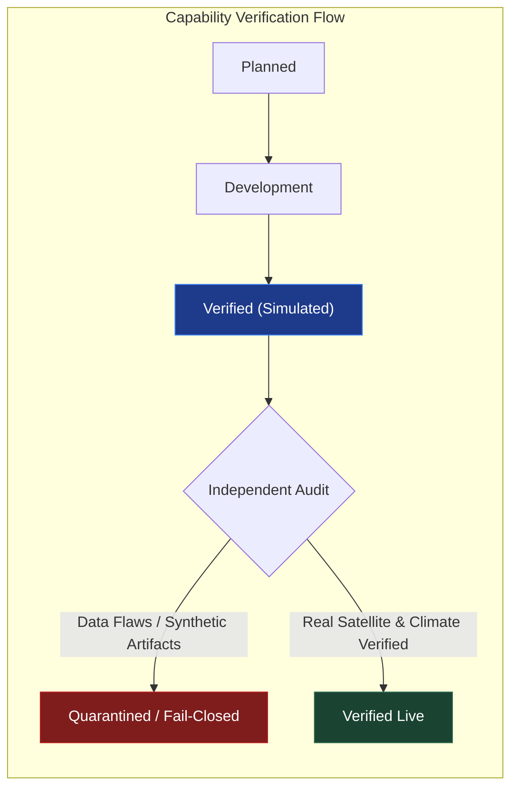
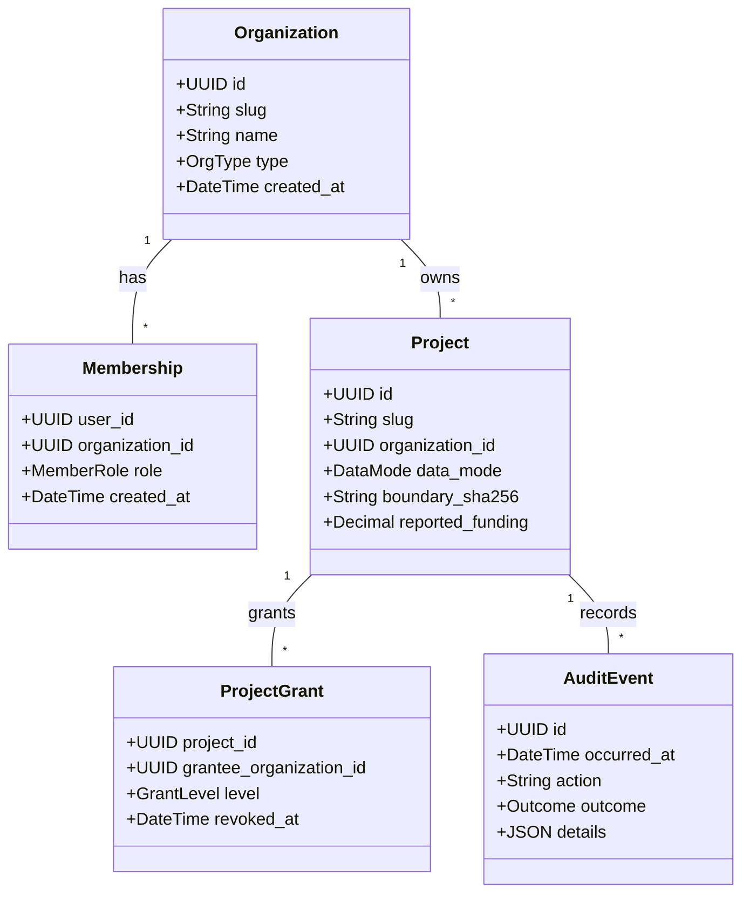
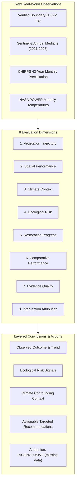

# GroundTruth 2.0 — Product Capability Matrix

> **The definitive, verified source of truth for platform capabilities, analytical models, data access layers, and governance controls.**

**Document Version:** 2.0.0  
**Last Audited:** 2026-11-10  
**Status Baseline:** Multi-Tenant Verification Platform Verified Locally  
**Test Suite Health:** 2,130+ Offline Backend Tests · 746 Web Vitest Specs (75 Files)  

---

## 1. Capability Status Taxonomy

Every capability in GroundTruth 2.0 is categorized strictly by its empirical reality in the repository:

| Status Badge | Formal Definition |
|---|---|
| **Verified Live** | Code exists, fully tested in CI, executed against real-world observational or climate data. |
| **Verified (Simulated)** | Code exists and passes all mathematical and contract tests against deterministic synthetic panels or labelled benchmarks. |
| **Quarantined / Fail-Closed** | Implementation exists, but was quarantined during independent scientific audits (e.g., Task 5B) due to synthetic artifacts. Protected by fail-closed guards (`DataUnavailableError` / 501 / 404). |
| **Planned (Slice 2/3)** | Designed in approved architecture specs; scheduled for immediate sequential delivery. |
| **Deliberately Out of Scope** | Explicitly excluded from GroundTruth 2.0 due to legal, regulatory, or scientific constraints. |



---

## 2. Multi-Tenant Architecture & Governance Layer

Implemented under Alembic migrations `0007`–`0012` and enforced via `platform/auth/authz.py`.



| Capability | Status | Implementation Details & Test Evidence |
|---|:---:|---|
| **Multi-Tenant Data Model** | **Verified Live** | `organizations`, `memberships`, `projects`, `project_grants`, `audit_events`. SQLite & Postgres migrations tested (`test_schema.py`). |
| **Organization Types** | **Verified Live** | 4 operational personas (`ngo`, `funder`, `auditor`, `government`) + system `reference` org. Enforced via check constraints. |
| **RBAC Roles** | **Verified Live** | `owner`, `admin`, `member`, `viewer`. 80 matrix tests pass in `test_authz_matrix.py`. Last-owner demotion prevented with HTTP 409. |
| **Cross-Tenant Project Grants** | **Verified Live** | Inter-org sharing at `view`, `audit`, or `contribute` levels. Grant revocation hides projects immediately (`test_grants_portfolio.py`). |
| **Fail-Closed Cross-Tenant Isolation** | **Verified Live** | Requesting unshared project URLs returns HTTP 404 (zero existence leakage). Tested across all 36 API routes in `test_route_isolation.py`. |
| **Append-Only Tamper-Proof Audit Log** | **Verified Live** | SQLAlchemy `before_flush` listeners block all updates or deletes (`test_audit.py`). Denied authorization events rate-limited to 1/s. |
| **Session Authentication** | **Verified Live** | Scrypt password hashing ($N=2^{15}, r=8, p=1$), 32-byte opaque tokens, SHA-256 session table, `HttpOnly` `SameSite=Lax` cookies. |
| **Automated Database Seeding** | **Verified Live** | CLI `groundtruth seed` creates Reference org, imports 26 YAML cases, sets Kariba as real observed, and establishes demo grants (`test_seed.py`). |

---

## 3. Four Persona Dashboards & Responsive Surfaces

Built using Next.js 14 App Router, CSS Modules, semantic design tokens, and MapLibre GL vector maps.

| Persona / Dashboard Surface | Status | Screenshot Reference | Verified Functionality |
|---|:---:|:---:|---|
| **Restoration NGO Cockpit** | **Verified Live** |  | Project onboarding, KML boundary upload with SHA-256 validation, seasonal Sentinel-2 time series, localized CHIRPS SPI drought context. |
| **CSR & Impact Investor Portfolio** | **Verified Live** |  | Multi-project surveillance table, assessment level filtering (0–5), evidence confidence ratings, reported funding vs verified status. |
| **MRV Auditor Forensic Workbench** | **Verified Live** |  | Raw STAC scene inventory, sensor QA masking inspection, computed readiness criteria, technical dossier export with cryptographic hashes. |
| **Government Regional Overview** | **Verified Live** |  | Regional 51-district drought monitoring (SPI-12), cross-project boundary distribution, jurisdictional conservation tracking. |
| **Kariba REDD+ Flagship View** | **Verified Live** |  | 1,072,638 ha verified boundary, Level 2 assessment status, 2021–2023 Sentinel-2 indices, and explicit missing data requirements. |
| **Fail-Closed Security Denial View** | **Verified Live** |  | Clean 404 unauthorized card, zero information leakage, append-only security audit trail logging. |
| **Responsive Mobile Web** | **Verified Live** | <br/> | 375 px mobile viewports fully verified without horizontal scroll; collapsible navigation drawer, responsive metric grids. |

---

## 4. 8-Dimension Assessment Framework

Deterministic analytical engine (`engine/assessment/`) producing layered conclusions and actionable recommendations.



| Dimension | Method & Statistical Rule | Status on Kariba REDD+ | Verification Test |
|---|---|:---:|---|
| **1. Vegetation Trajectory** | Theil–Sen slope + Mann–Kendall trend test ($\alpha = 0.10$). Requires $n \ge 6$ annual periods. | **Insufficient Evidence** (Reported: $+0.0461$ NDVI shift over 3 periods) | `test_project_assessment.py` |
| **2. Spatial Performance** | Within-AOI zonal spread ($p_{10}, p_{50}, p_{90}$, std) from verified pixel zonal statistics. | **Insufficient Evidence** (Only AOI means persisted) | `test_project_assessment.py` |
| **3. Climate Context** | Align annual CHIRPS rainfall, SPI-12, and NASA POWER temp. SPI $\le -1.0$ (drought) / $\ge +1.0$ (wet). | **Verified Live** (Context reported; adjustment requires $\ge 8$ overlapping years) | `test_project_assessment.py` |
| **4. Ecological Risk** | Compound signals: drought stress (SPI $\le -1.0$) and sudden drop exceeding within-AOI std error. | **Verified Live** (Evaluates 2021–2023 stress signals; no active fire data) | `test_project_assessment.py` |
| **5. Restoration Progress** | Quantifies directional net change relative to inter-annual variance. | **Verified Live** (Shift reported; progress claim requires Dimension 1 trend) | `test_project_assessment.py` |
| **6. Comparative Performance** | Compares project against distribution of 37 eligible administrative donor units. | **Insufficient Evidence** (Donor vegetation series pending ingestion) | `test_project_assessment.py` |
| **7. Evidence Quality** | Rule-based rating: cloud-masked clear fraction, sensor continuity, missing climate months. | **Low–Moderate** (Verified: 1 tile, partial AOI, 2 missing climate months flagged) | `test_project_assessment.py` |
| **8. Intervention Attribution** | Econometric causal counterfactual. Must report typed limitations if inconclusive. | **INCONCLUSIVE (missing data)** (Requires pre-treatment and donor panels) | `test_project_assessment.py` |
| **Assessment Levels (0–5)** | Rule-based ladder: L0 (unassessable) to L5 (verified impact). | **Level 2: Contextual Intelligence** | `test_project_assessment.py` |
| **Recommendation Engine** | 7 pre-registered trigger rules emitting actionable next steps with rationale. | **Verified Live** (Emits: "Acquire pre-treatment Landsat", "Field verification") | `test_project_assessment.py` |

---

## 5. Earth Observation & Climate Data Feeds

| Data Layer | Source & Resolution | Status | Verification & Integrity Audit Finding |
|---|---|:---:|---|
| **Kariba Geodesic Boundary** | Official Verra KML Polygon | **Verified Live** | Area: **1,072,638 ha** independently recomputed in Africa Albers. SHA-256 pinned in project record. |
| **Sentinel-2 L2A Time-Series** | Copernicus S2A/S2B (10m) | **Verified Live** | Annual dry-season median composites (2021–2023) for Tile 35KDA. Zonal NDVI/EVI/NDMI/NBR extracted. |
| **CHIRPS Precipitation** | UCSB CHIRPS v2.0 (0.05°) | **Verified Live** | 43-year monthly series (1981–2023) across 51 units. 514/516 months present; 2 missing months explicitly flagged. |
| **NASA POWER Temperature** | NASA MERRA-2 (0.5°×0.625°) | **Verified Live** | Monthly 2m average, maximum, and minimum temperatures ingested for Kariba and all 50 donor districts. |
| **Candidate Donor Geometries** | geoBoundaries ADM2 Zimbabwe/Zambia | **Verified Live** | 50 real administrative units; **37 spatially eligible** after excluding host districts and 10 km leakage buffer. |
| **Historical Landsat 2001–2022** | USGS Collection 2 Level 2 (30m) | **Quarantined** | **Task 5B Audit Finding:** Cached multi-tile Landsat series was simulated/hand-typed. Quarantined behind fail-closed guard. |
| **Donor Vegetation Panels** | Landsat/Sentinel-2 across 37 donors | **Planned (Slice 2)** | STAC scene availability metadata exists; raw raster zonal reductions scheduled for Slice 2. |
| **Active Fire & Burned Area** | MODIS MCD64A1 / VIIRS | **Planned (Slice 3)** | Required to complete Dimension 4 disturbance monitoring. |
| **Calibrated Biomass / Carbon** | GEDI L4A/L4B, ESA CCI Biomass | **Deliberately Out of Scope** | Carbon conversion prohibited without calibrated physical ground plots (Principle R1). |

---

## 6. Analytical & Econometric Verification Engine

| Component | Status | Code Location | Scientific Notes & Audit Status |
|---|:---:|---|---|
| **Computed Readiness Engine** | **Verified Live** | `groundtruth.engine.assessment` / `causal` | Evaluates 7 mathematical criteria from real disk artifacts. Returns `met`, `not_met`, or `unavailable`. No hardcoded values. |
| **Synthetic Control (SCM) Solver** | **Verified (Simulated)** | `groundtruth.engine.causal.synthetic_control` | Simplex-constrained FISTA solver. Recovers known effects on synthetic panels. |
| **Difference-in-Differences (DiD)** | **Verified (Simulated)** | `groundtruth.engine.causal.did` | Two-way fixed effects with cluster-robust standard errors and parallel trends pre-test. |
| **In-Space Placebo Engine** | **Verified (Simulated)** | `groundtruth.engine.uncertainty.placebo` | Permutes synthetic control across donor units to construct exact empirical p-value distributions. |
| **In-Time Placebo Engine** | **Verified (Simulated)** | `groundtruth.engine.uncertainty.placebo` | Injects fictitious pre-treatment intervention dates to test for anticipatory confounding. |
| **Leave-One-Out Sensitivity** | **Verified (Simulated)** | `groundtruth.engine.uncertainty.sensitivity` | Iteratively drops top-weighted donors to assess counterfactual stability and weight concentration. |
| **Weather Residualization** | **Verified (Simulated)** | `groundtruth.engine.causal.climate_confounding` | Linear and spline-based weather residualization of vegetation indices against monthly SPI and temperature. |
| **Live Causal Execution on Real Kariba** | **Quarantined / Fail-Closed** | `groundtruth.platform.api.v2` / `app` | Blocked until real pre-treatment Landsat and donor vegetation panels are ingested and validated. |

---

## 7. Scientific Guardrails & Enforced Axioms

| Guardrail Code | Rule Description | Enforced By | Result of Violation |
|---|---|---|---|
| **R1** | NDVI is not carbon/biomass | `assert_not_index_to_carbon()` | `ScientificIntegrityError` raised; build fails in CI. |
| **R2** | Divergence is not fraud | AST text linters & unit tests | Prohibits terms like "fraud", "scam", "illegal". Replaced with accredited review wording. |
| **R3** | Correlation is not causation | Assembler gate chain | Prohibits causal claims without matched counterfactual and placebo significance ($p \le 0.10$). |
| **R4** | GenAI narrates finished evidence only | `GroundingVerifier` | GenAI output with hallucinated numbers or unverified claims is rejected with safe fallback. |
| **R5** | Fail-closed on missing data | API exception handlers | Missing inputs raise `DataUnavailableError` (HTTP 501 / 404); never silently impute or guess. |
| **R6** | No ungrounded numbers | Strict data loader provenance | Every UI metric must trace to a verified database row or reproducible processing pipeline. |
| **R7** | Unmistakable simulated data | Permanent UI badges & `data_mode` | Synthetic benchmarks carry persistent warnings; cannot be merged into real portfolios. |
| **R8** | Role-tailored presentation | Centralized serializing views | UI redaction removes fields for lower permissions; never modifies underlying values. |

---

## 8. Test Suite Verification & Engineering Quality

GroundTruth 2.0 enforces 100% green builds across all automated test pipelines:

```
============================= TEST VERIFICATION BASELINE ==============================
Backend Offline Suite:        2,130+ passed (pytest)
Frontend Web Vitest Suite:    746 passed across 75 test files (apps/web)
Frontend Typecheck:           0 TypeScript errors (tsc --noEmit)
Frontend Linting:             0 ESLint warnings or errors
Fixture-Fallback Guard:       4 catch blocks verified (check:fixture-fallback)
Api-Types Synchronization:    Matches OpenAPI snapshot (check:api-types)
=====================================================================================
```

---

## 9. Deliberately Out-of-Scope Capabilities

To protect scientific validity and regulatory compliance, the following capabilities are permanently excluded from GroundTruth 2.0:

1. **Carbon Credit Issuance, Retirement, or Trading:** GroundTruth is an independent verification platform, not a carbon registry or brokerage.
2. **Automated De-Listing or Penal Enforcement:** Satellite and econometric screening provide triaging signals; legal de-listing remains the sole purview of accredited regulatory bodies.
3. **Replacing Accredited Field Verification:** Remote sensing cannot measure soil microbial activity, seedling understory survival, or community governance. GroundTruth equips auditors with stratified field sampling plans rather than replacing physical inspections.
4. **Fraud Detection & Criminal Accusation:** Satellite data observes spectral radiance deltas; it cannot establish human intent or legal culpability.
