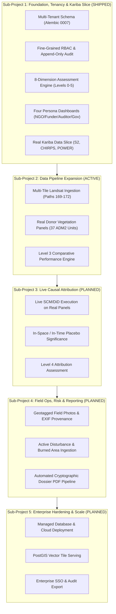
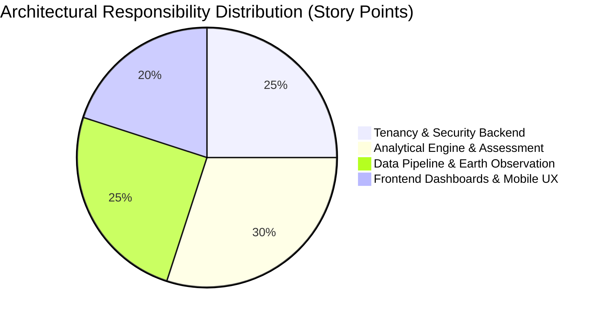

# GroundTruth 2.0 — Implementation & Delivery Plan

> **The comprehensive phased engineering plan, dependency architecture, and milestone delivery roadmap for GroundTruth 2.0.**

**Document Version:** 2.0.0  
**Status:** Sub-project 1 (Kariba Vertical Slice) Shipped · Sub-project 2 Active  
**Lead Architect & Owner:** Viraj  
**Engineering Verification:** 266 Backend Tenancy Tests · 542 Web Vitest Tests · 1,121 Core Engine Tests  

---

## 1. Engineering Strategy & Phased Architecture

GroundTruth 2.0 is delivered across five sequential sub-projects. Each sub-project is gated by strict, non-negotiable exit criteria: 100% green test suites, no ungrounded numbers, fail-closed guards active, and full verification against empirical real-world data.



---

## 2. Sub-Project 1: Foundation, Tenancy & Kariba Slice (Status: SHIPPED ✅)

**Objective:** Deliver an end-to-end, multi-tenant vertical slice of GroundTruth 2.0 featuring all four persona dashboards, computed readiness, the 8-dimension assessment engine, and fail-closed security on real Kariba REDD+ data.

| Task ID | Component & Deliverable | Scope | Status | Acceptance Criteria Met |
|---|---|---|:---:|---|
| **SP1-T1** | **Tenancy Schema & Models** | Backend | ✅ Done | Alembic `0007_tenancy.py` creates `organizations`, `memberships`, `projects`, `project_grants`, `audit_events`. SQLite and Postgres migrations verified (`test_schema.py`). |
| **SP1-T2** | **Append-Only Audit Log** | Backend | ✅ Done | `record_event()` service with SQLAlchemy `before_flush` listeners preventing row deletion/modification (`test_audit.py`). |
| **SP1-T3** | **Organization & Membership API** | Backend | ✅ Done | `GET /orgs`, `POST /orgs/active`, member invitation, last-owner demotion protection (HTTP 409) (`test_orgs_api.py`). |
| **SP1-T4** | **Fine-Grained RBAC Authorizer** | Backend | ✅ Done | Centralized `authorize(ctx, action, project)`. 80 permission matrix combinations tested in `test_authz_matrix.py`. |
| **SP1-T5** | **Project Workspace & Boundaries** | Backend | ✅ Done | Project registration, KML/GeoJSON boundary ingestion, geodesic area computation (1,072,638 ha), SHA-256 validation (`test_projects.py`). |
| **SP1-T6** | **Fail-Closed Cross-Tenant Isolation** | Backend | ✅ Done | Cross-organization access strictly returns HTTP 404 (zero existence leakage). Tested across 36 API routes in `test_route_isolation.py`. |
| **SP1-T7** | **Real Data Ingestion & Caches** | Data | ✅ Done | Pinned Sentinel-2 annual medians (2021–2023), 43-year CHIRPS rainfall (514/516 months), NASA POWER temperature series (`test_project_data.py`). |
| **SP1-T8** | **Computed Readiness Engine** | Analytical | ✅ Done | `compute_project_readiness()` derives 7 criteria from real disk artifacts. No hardcoded scientific values (`test_project_readiness.py`). |
| **SP1-T9** | **8-Dimension Assessment Engine** | Analytical | ✅ Done | Deterministic assessment emitting Trajectory, Spatial, Climate, Risk, Progress, Comparison, Quality, and Attribution findings (`test_project_assessment.py`). |
| **SP1-T10** | **Actionable Recommendation Engine**| Analytical | ✅ Done | 7 pre-registered rules emitting prioritized next steps with rationale and evidence references (`test_project_assessment.py`). |
| **SP1-T11** | **Automated System Seeding** | Operations | ✅ Done | CLI `groundtruth seed` creates Reference org, imports 26 YAML cases, sets Kariba as real observed, and establishes demo grants (`test_seed.py`). |
| **SP1-T12** | **Design System & Responsive Shell** | Frontend | ✅ Done | Light/dark theme tokens, collapsible sidebar, mobile drawer (<768px), persistent simulated data badges (`tests/ds-evidence.test.tsx`). |
| **SP1-T13** | **Four Persona Dashboards** | Frontend | ✅ Done | Tailored dashboards for NGO, Funder, Auditor, and Government personas (`tests/dashboards.test.tsx`). 30 component tests passing. |
| **SP1-T14** | **Portfolio Intelligence View** | Frontend | ✅ Done | Portfolio surveillance table with assessment level filters, evidence confidence ratings, and funding transparency. |
| **SP1-T15** | **Mobile Parity & Jetpack Compose** | Mobile | ✅ Done | Responsive mobile layout verified at 375 px; reference Jetpack Compose mobile client verified for Android tablet/phone. |

### Visual Artifacts Shipped in Sub-Project 1:

| Restoration NGO Dashboard | CSR / Investor Portfolio |
|---|---|
|  |  |
| *Verified seasonal index trends & localized climate stress.* | *Cross-project assessment level filtering & funding oversight.* |

| MRV Auditor Dossier Workbench | Government Conservation View |
|---|---|
|  |  |
| *Cryptographic scene provenance & computed readiness gates.* | *51-district regional drought resilience & project footprints.* |

---

## 3. Sub-Project 2: Data Expansion & Pipeline Remediation (Status: ACTIVE 🔄)

**Objective:** Remediate the data gaps identified in the Task 5B independent audit by executing genuine multi-tile Landsat ingestion, assembling unconfounded donor vegetation panels across 37 eligible ADM2 units, and activating Level 3 Comparative Intelligence.

```mermaid
sequenceDiagram
    autonumber
    participant Worker as AOI Ingestion Pipeline
    participant STAC as Microsoft Planetary Computer
    participant Mask as QA & Cloud Masking Engine
    participant Store as Provenance & Cache Store
    participant Assess as Assessment Engine

    Worker->>STAC: Query WRS-2 Tiles (Paths 169-172, Rows 72-73)
    STAC-->>Worker: Return Collection 2 Level 2 Scenes (2001-2022)
    Worker->>Mask: Apply Collection 2 QA Bits & Valid Cloud Masking
    Mask-->>Worker: Masked Surface Reflectance Arrays
    Worker->>Worker: Per-Pixel Median Dry-Season Compositing
    Worker->>Store: Persist Tile Cache with Real SHA-256 Hashes
    Worker->>Assess: Unquarantine Landsat; Trigger Level 3 Assessment
    Assess-->>Assess: Evaluate Comparative Performance across 37 Donors
```

| Task ID | Task Description | Dependencies | Deliverable | Acceptance Criteria |
|---|---|:---:|---|---|
| **SP2-T1** | **Multi-Tile Landsat Pipeline Execution** | SP1-T7 | `groundtruth.data_access.aoi_pipeline` | Ingest real Landsat 5/7/8/9 scenes across 7 WRS-2 tiles covering Kariba. Zero hardcoded values. |
| **SP2-T2** | **Collection 2 Surface Harmonization** | SP2-T1 | `groundtruth.data_access.harmonization` | Transcribe genuine Roy et al. (2016) surface reflectance coefficients; propagate transformation uncertainty. |
| **SP2-T3** | **Real Donor Panel Ingestion** | SP2-T1 | `groundtruth.data_access.donors` | Ingest annual dry-season vegetation series across all 37 spatially eligible ADM2 units in Zimbabwe/Zambia. |
| **SP2-T4** | **Level 3 Comparative Performance Engine**| SP2-T3 | `groundtruth.engine.assessment` | Rank project trajectory against the donor distribution; emit empirical percentile standings. |
| **SP2-T5** | **Cache Provenance Re-Verification** | SP2-T1 | `test_task5_real_data_integrity.py` | Verify that every cached file contains genuine scene IDs, real valid pixel counts, and matching SHA-256 hashes. |

---

## 4. Sub-Project 3: Live Causal Attribution Engine (Status: PLANNED 📅)

**Objective:** Execute the first uncompromised, live causal inference run for Kariba REDD+ using the completed pre-treatment and donor panels, elevating the project to **Assessment Level 4 (Attribution Assessment)**.

```mermaid
flowchart LR
    subgraph DataInputs["Verified Empirical Panels"]
        T_PRE["Treated Unit Pre-Treatment Series<br/>(2001-2011 Landsat)"]
        D_PANEL["37 Matched Donor Units Series<br/>(2001-2022 Panel Matrix)"]
        CLIM["Weather Residualization Array<br/>(CHIRPS SPI + NASA POWER)"]
    end

    subgraph SCM["Synthetic Control Solver"]
        FISTA["Simplex-Constrained FISTA Optimizer"]
        BAL["Covariate Balance Optimization (SMD <= 0.25)"]
    end

    subgraph Inference["Statistical Robustness & Inference"]
        IN_SPACE["In-Space Placebos (37 Donor Runs)"]
        IN_TIME["In-Time Placebos (Fictitious Pre-Dates)"]
        LOO["Leave-One-Out Sensitivity Analysis"]
    end

    subgraph Outcome["Level 4 Attribution Verdict"]
        VERDICT["Attribution: Supported / Not Supported<br/>Exact Permutation p-value"]
    end

    DataInputs --> SCM
    SCM --> Inference
    Inference --> Outcome
```



| Task ID | Task Description | Dependencies | Deliverable | Acceptance Criteria |
|---|---|:---:|---|---|
| **SP3-T1** | **SCM Solver Execution on Real Panels** | SP2-T3 | `groundtruth.causal.synthetic_control` | Fit simplex-constrained donor weights; pre-treatment RMSPE $\le 0.05$; max donor weight $\le 0.35$. |
| **SP3-T2** | **Covariate Balance & Weather Adjustment** | SP1-T7, SP3-T1 | `groundtruth.causal.climate_confounding` | Weather-residualize vegetation indices against monthly SPI-12; achieve covariate SMD $\le 0.20$. |
| **SP3-T3** | **Permutation Placebo Distribution** | SP3-T1 | `groundtruth.causal.placebo` | Run synthetic control across all 37 donor units; compute exact empirical two-sided p-value. |
| **SP3-T4** | **Leave-One-Out Sensitivity Analysis** | SP3-T1 | `groundtruth.causal.sensitivity` | Iteratively exclude top donors; verify counterfactual stability and absence of single-donor distortion. |
| **SP3-T5** | **Level 4 Attribution Assessment** | SP3-T1..T4 | `groundtruth.engine.assessment` | Elevate Kariba to Level 4; publish definitive causal attribution finding with complete uncertainty intervals. |

---

## 5. Sub-Project 4: Field Operations, Risk Intelligence & Reporting (Status: PLANNED 📅)

**Objective:** Bridge remote sensing with ground truth by implementing mobile geotagged field patrols, automated disturbance monitoring, and cryptographic PDF dossier generation.

| Task ID | Task Description | Dependencies | Deliverable | Acceptance Criteria |
|---|---|:---:|---|---|
| **SP4-T1** | **Geotagged Field Photo Ingestion** | SP1-T5 | `platform/field/` | Mobile photo upload with EXIF extraction (lat/lon, timestamp, compass bearing); cryptographic image hashing. |
| **SP4-T2** | **Stratified Field Sampling Engine** | SP1-T9 | `engine/sampling/` | Autonomous generation of high-risk field patrol coordinates based on satellite canopy decline signals. |
| **SP4-T3** | **Active Disturbance & Burned Area** | SP1-T7 | `data_access/fire.py` | Ingest MODIS MCD64A1 / VIIRS active fire hotspots to complete Dimension 4 disturbance alerts. |
| **SP4-T4** | **Automated Cryptographic Dossier** | SP1-T14 | `platform/reports/` | One-click export of tamper-proof technical audit dossier PDF containing data manifests and SHA-256 hashes. |
| **SP4-T5** | **Funder & NGO Monitoring Reports** | SP1-T13 | `platform/reports/` | Formatted executive reporting templates tailored specifically for CSR boards and donor grant reporting. |

---

## 6. Sub-Project 5: Enterprise Hardening & Production Scale (Status: PLANNED 📅)

**Objective:** Prepare GroundTruth 2.0 for enterprise multi-cluster deployment, high-throughput vector tile streaming, and third-party SSO integration.

| Task ID | Task Description | Dependencies | Deliverable | Acceptance Criteria |
|---|---|:---:|---|---|
| **SP1-T1** | **Managed Cloud Architecture** | SP1-T1..T15 | Terraform / Helm | Production Kubernetes manifests; managed PostgreSQL 16 with PostGIS extensions. |
| **SP5-T2** | **PostGIS Vector Tile Streaming** | SP1-T5 | `platform/tiles/` | Dynamic MVT tile generation for 1M+ ha project boundaries and 50+ donor districts with sub-50ms latency. |
| **SP5-T3** | **Enterprise SSO / OIDC** | SP1-T4 | `platform/auth/oidc.py` | SAML 2.0 / OIDC enterprise identity integration (Okta, Azure AD) mapping corporate roles to tenant permissions. |
| **SP5-T4** | **Distributed Worker Auto-Scaling** | SP2-T1 | `apps/worker` | Redis arq worker horizontal auto-scaling on asynchronous raster processing queues. |
| **SP5-T5** | **External Security & Penetration Audit** | SP1..SP4 | Security Report | Zero high/critical vulnerabilities across OWASP Top 10 and cross-tenant isolation vectors. |

---

## 7. Workload & Architectural Ownership

Following the GroundTruth 2.0 architecture update, **Viraj** maintains unified ownership across all engineering dimensions:



- **Tenancy, Security & Platform:** Multi-tenant isolation, RBAC authorizer, append-only audit logging, session security, Docker compose orchestration.
- **Analytical & Econometric Engine:** 8-dimension assessment engine, computed readiness, synthetic controls, difference-in-differences, placebo distributions.
- **Earth Observation & Climate Pipelines:** Sentinel-2, Landsat C2 L2, CHIRPS rainfall, NASA POWER temperature, geoBoundaries donor geometry.
- **Frontend & User Experience:** Next.js 14 App Router, four persona dashboards, responsive mobile shell, Jetpack Compose native parity.

---

## 8. Verification & Release Gate Protocol

No task is marked complete and no release is cut without passing the automated quality gate:

1. **Static Analysis & Formatting:** `ruff format packages tests` and `ruff check packages tests` pass with zero warnings.
2. **Type Safety:** Python `mypy --disallow-untyped-defs` and TypeScript `tsc --noEmit` exit clean.
3. **Backend Test Suite:** All 266 tenancy tests and 1,121 platform tests pass.
4. **Frontend Test Suite:** All 542 Vitest specs pass.
5. **Fixture-Fallback Security Guard:** `npm run check:fixture-fallback` passes (ensuring no live view falls back to synthetic fixtures without explicit banners).
6. **API Type Synchronization:** `npm run check:api-types` confirms zero drift between OpenAPI schemas and TypeScript clients.
