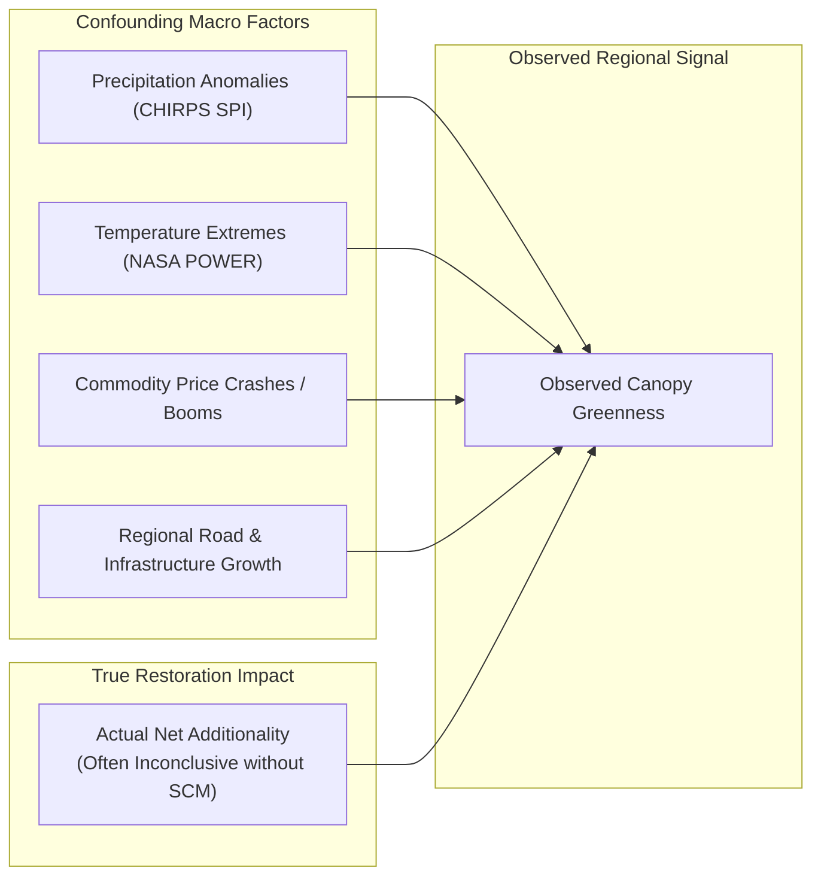
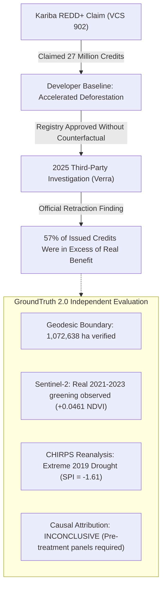
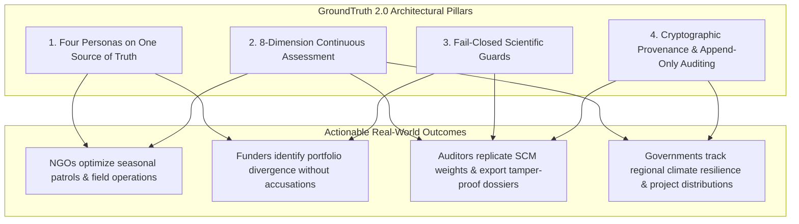

# The Core Problem: The Crisis of Trust in Ecosystem Restoration & Climate Finance

> **Why voluntary ecological markets are failing, why conventional verification cannot fix them, and how GroundTruth 2.0 establishes an uncompromised standard of truth.**

**Document Version:** 2.0.0  
**Status:** Approved Product Document  
**Audience:** Restoration NGOs, CSR & Impact Investors, MRV Auditors, Government Conservation Regulators  

---

## 1. The Global Trust Deficit

Voluntary carbon markets and nature-based climate finance direct billions of dollars into global ecosystem restoration, reforestation, and avoided-deforestation projects. The foundational asset being financed is **additionality**: the positive ecological change that occurred *strictly because* the intervention took place, which would not have occurred under normal counterfactual conditions.

```mermaid
flowchart TD
    subgraph LegacyModel["Conventional Legacy Verification (Broken Incentive Loop)"]
        DEV["Project Developer"] -->|Sets Baseline & Produces Claims| REG["Registry / Validator"]
        DEV -->|Directly Pays Fees| VVB["Validation & Verification Body"]
        VVB -->|Periodic Document Review (3-5 Years)| CRED["Issued Credits / Unverified Claims"]
        CRED -->|Buys on Blind Trust| BUYER["CSR Funder / Corporate Buyer"]
    end

    subgraph GroundTruthModel["GroundTruth 2.0 (Independent Causal Verification)"]
        SAT["Open Earth Observation<br/>(Sentinel-2 / Landsat / CHIRPS)"] -->|Cryptographic Ingestion| GT["GroundTruth 2.0 Engine"]
        DONOR["Matched Unvisited Donor Pool<br/>(37 Eligible ADM2 Units)"] -->|Synthetic Control Counterfactual| GT
        GT -->|Fail-Closed Guards| VERDICT["8-Dimension Continuous Assessment"]
        VERDICT -->|Role-Tailored Unified Truth| ALL_PERSONAS["NGO + Funder + Auditor + Government"]
    end

    LegacyModel -.->|Results in Discredited Claims & Retractions| CRISIS["57%+ Excess Credits & Market Collapse"]
```

Additionality is counterfactual by definition. It demands estimating an unobservable parallel reality: *what would have happened to this canopy, soil, and biomass if human intervention had not occurred?*

In legacy industry practice, this counterfactual baseline is selected, modeled, and submitted by the project developer—the single party with the largest financial incentive to maximize claimed credits. Independent audits reveal that this structural conflict of interest has undermined global confidence in nature-based solutions.

---

## 2. The Five Structural Failures of Conventional Verification

### 2.1. The Conflict-of-Interest Incentive Loop
Under current registry models, project developers hire and pay Validation and Verification Bodies (VVBs) directly. Validators face commercial pressure to approve developer-selected baselines. Reviews occur on multi-year cycles (every 3 to 5 years), primarily auditing self-reported spreadsheets and static narrative reports rather than analyzing raw spectral signals or economic micro-data.

### 2.2. The Optical Greening Fallacy: NDVI Is Not Carbon
A persistent fallacy in satellite remote sensing is assuming that optical vegetation greenness directly equals biomass accumulation or carbon sequestration.
- Chlorophyll absorption varies dramatically with seasonal rains, invasive scrub encroachment, and leaf flush.
- A high NDVI (Normalized Difference Vegetation Index) reading can represent short-lived grasses or canopy thickets, rather than high-carbon, mature climax forests.
- **GroundTruth 2.0 Axiom (R1):** *Observed greening is not restoration success.* Converting an NDVI delta into carbon dioxide equivalents ($tCO_2e$) without calibrated, species-stratified physical ground plots or calibrated LiDAR/GEDI allometry is scientifically invalid.

### 2.3. The Counterfactual Attribution Blindspot
Regional rainfall anomalies, global commodity price swings (beef, soy, timber), and national macroeconomic crises influence forest cover across millions of hectares simultaneously.



Observing that a project area remained green does not prove the project protected it:
- If regional rains were unusually abundant (e.g., $SPI-12 \ge +1.5$), unvisited forest 50 km away may have experienced identical greening.
- If timber prices collapsed, deforestation may have halted across the entire continent, regardless of local ranger patrols.
- **GroundTruth 2.0 Axiom (R3):** *Correlation is not causation.* Observed change cannot be attributed to an intervention without isolating an unconfounded, matched synthetic control counterfactual.

### 2.4. The "All-or-Nothing" Inconclusive Trap
When rigorous academic investigators or causal models analyze a real-world restoration project, the honest statistical answer is frequently: **Intervention Attribution is Inconclusive** (due to short post-treatment records, missing historical scenes, or cloud contamination).

Legacy platforms react to this statistical limit in one of two catastrophic ways:
1. **They fabricate certainty:** They fit unconstrained models on arbitrary control groups, smoothing over missing data to produce a fragile impact percentage.
2. **They fail completely:** They display an empty screen with an unhelpful "Inconclusive" error, stripping funders, NGOs, and governments of all operational intelligence.

**GroundTruth 2.0 solves this permanently through its 8-Dimension Assessment Framework.** Even when attribution cannot yet be proven, the platform provides actionable intelligence on Vegetation Trajectory, Spatial Zonal Spread, Climate Context, Ecological Risk, Restoration Progress, and Evidence Quality.

### 2.5. The Multi-Stakeholder Governance Gap
Different participants in an ecosystem restoration project require fundamentally different perspectives, yet currently work in disconnected silos:
- **NGOs** lack continuous, low-cost monitoring tools to catch localized canopy loss or drought stress between auditing cycles.
- **Funders** receive self-selected marketing PDF brochures without independent verification of evidence quality.
- **Auditors** are handed static PDFs with no verifiable provenance, missing scene catalogs, or cryptographic hashes.
- **Governments** have no jurisdictional visibility into how multiple NGO initiatives interact with national protected areas and regional drought cycles.

---

## 3. Real-World Case Evidence: The Kariba REDD+ Benchmark

The Kariba REDD+ Project in northwestern Zimbabwe (Verra VCS 902) represents the clearest real-world documentation of this systemic failure.



- **The Legacy Failure:** In 2025, an extensive two-year investigation by Verra concluded that **over 57% of the approximately 27 million carbon credits** issued by Kariba were in excess of real emission reductions achieved, largely due to an inflated counterfactual baseline that exaggerated background deforestation rates.
- **The GroundTruth 2.0 Audit Remediation:** GroundTruth Task 5/5B audits proved that attempting to substitute hand-typed or simulated Landsat caches for real multi-tile satellite ingestion violates core scientific integrity. GroundTruth 2.0 quarantines unverified caches, enables fail-closed guards, and classifies Kariba honestly at **Assessment Level 2 (Contextual Intelligence)**:
  - Real Sentinel-2 observations show a post-treatment NDVI rise from 0.286 to 0.332 (2021–2023).
  - Real CHIRPS climate data proves that severe drought struck the region in 2002 ($SPI = -1.87$) and 2019 ($SPI = -1.61$).
  - Intervention attribution is classified as **INCONCLUSIVE (missing data)** until full pre-treatment multi-tile Landsat and donor vegetation panels are ingested.


*Figure 1: GroundTruth 2.0 Kariba REDD+ Overview. Transparently communicating verified boundary area (1.07M ha), Level 2 assessment status, and explicit data requirements.*

---

## 4. How GroundTruth 2.0 Solves the Problem

GroundTruth 2.0 replaces opaque assertions with an enterprise, multi-tenant intelligence and impact verification platform.



### 4.1. Tailored Workflows on a Single Ground Truth
Rather than forcing all users into an inflexible technical terminal, GroundTruth 2.0 serves four distinct personas with tailored workflows accessing the exact same mathematical state:

1. **Restoration NGOs (`ngo`):** Register projects, validate KML/GeoJSON boundaries, monitor seasonal Sentinel-2 vegetation indices, and detect drought stress.
   
   *Figure 2: Restoration NGO Dashboard showing real-time vegetation trends, localized climate anomalies, and operational recommendations.*

2. **CSR & Impact Investors (`funder`):** Screen multi-project portfolios, monitor verified progress vs reported funding, and identify projects requiring accredited review.
   
   *Figure 3: Funder Portfolio Dashboard displaying assessment levels, evidence confidence ratings, and funding transparency.*

3. **MRV Auditors (`auditor`):** Drill down to scene-level STAC metadata, verify sensor QA bit masking, review synthetic control covariate balance, and export cryptographic dossiers.
   
   *Figure 4: Auditor Dashboard displaying dataset inventory, SHA-256 checksums, and causal readiness diagnostics.*

4. **Government Agencies (`government`):** Oversee regional conservation zones, track district-level SPI-12 drought classes across 51 administrative units, and coordinate resource allocation.
   
   *Figure 5: Government Dashboard displaying regional climate vulnerability, project footprints, and jurisdictional resilience.*

### 4.2. Fail-Closed Multi-Tenant Security
Confidentiality and tenant boundaries are enforced at the API database layer. Unauthorized cross-organization URL access returns an immediate HTTP 404, preventing project reconnaissance and writing to the immutable audit log:


*Figure 6: Fail-closed tenant isolation. Unshared projects are strictly inaccessible and logged in the append-only audit trail.*

---

## 5. Non-Negotiable Tenets for Restoring Market Integrity

To ensure that GroundTruth 2.0 never repeats the structural errors of legacy registries, the following rules are hardcoded into the platform:

| Principle | Engineering Implementation | Why It Matters |
|---|---|---|
| **No Ungrounded Numbers** | AST import checks, typed schemas, no client-side math | Eliminates hallucinated metrics and developer-invented baselines. |
| **Divergence $\ne$ Fraud** | Standardized language: *"warrants accredited technical review"* | Keeps the platform scientifically neutral and legally unassailable. |
| **Fail-Closed Execution** | `DataUnavailableError` (HTTP 501 / 404) on missing artifacts | Prevents fragile or simulated estimates from being presented as real facts. |
| **Simulated Data Flagging** | Permanent, non-dismissible UI badges and `data_mode` isolation | Guarantees synthetic benchmarks can never be confused with real projects. |
| **Deterministic AI Narration** | GenAI generates natural language from finished JSON bundles only | Prevents LLMs from computing synthetic control weights or inventing impact numbers. |

---

## 6. Summary: Moving from Trust to Verification

The restoration economy cannot scale on faith alone. Trust without independent verification leads inevitably to market devaluation, public skepticism, and collapsed environmental investments. 

GroundTruth 2.0 provides the missing technical infrastructure: a scientifically unassailable, multi-tenant ecosystem restoration intelligence platform that delivers actionable clarity to every stakeholder while upholding the highest standards of mathematical and empirical integrity.
