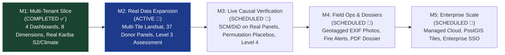
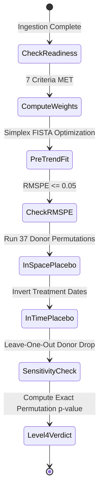
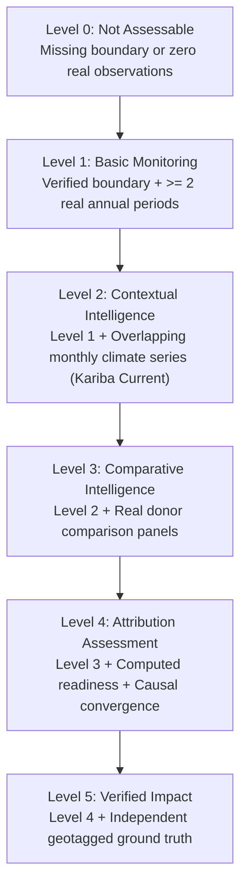

# GroundTruth 2.0 — Strategic Roadmap & Milestone Details

> **Milestone-gated engineering roadmap for GroundTruth 2.0: moving from vertical slice verification to planetary-scale ecosystem intelligence.**

**Document Version:** 2.0.0  
**Current Milestone Status:** M1 (Foundation & Multi-Tenant Slice) Complete · M2 (Data Expansion) Active  
**Lead Architect:** Viraj  
**Verification Baseline:** 266 Tenancy Tests · 542 Web Vitest Tests · 1,121 Platform Unit Tests  

---

## 1. Roadmap Overview & Strategic Horizon

GroundTruth 2.0 transitions from single-case causal research into an enterprise-grade, multi-tenant ecosystem restoration intelligence and impact verification platform. Progress is measured strictly by verifiable exit criteria—never by estimated percentage completion or subjective milestones.

---

## 2. Milestone Details & Verification Gates

### Milestone 1: Multi-Tenant Architecture & Kariba Vertical Slice (M1) — COMPLETE ✅

**Goal:** Establish the enterprise multi-tenant foundation, fine-grained RBAC authorization, append-only audit logging, 8-dimension assessment engine, and deliver four complete persona dashboards verified against real Kariba REDD+ data.

- [x] **Database Schema & Tenancy:** Alembic `0007_tenancy.py` creating `organizations`, `memberships`, `projects`, `project_grants`, `audit_events`.
- [x] **Append-Only Audit Trail:** Tamper-proof logging with SQLAlchemy `before_flush` listeners preventing modification or deletion.
- [x] **Fine-Grained RBAC Authorizer:** Centralized `authorize()` function covering 80 matrix test combinations.
- [x] **Fail-Closed Isolation:** Unauthorized project URL queries return HTTP 404 (zero information leakage); verified across 36 endpoints.
- [x] **Verified Kariba Geodesic Boundary:** Ingested official Verra KML polygon; recomputed 1,072,638 ha in Africa Albers; pinned SHA-256.
- [x] **Real Post-Treatment Satellite Data:** Annual median Sentinel-2 NDVI/EVI/NDMI/NBR composites (2021–2023) for Tile 35KDA.
- [x] **Real Climate Ingestion:** 43-year monthly CHIRPS rainfall (514/516 months) and NASA POWER temperature across Kariba and 50 donor districts.
- [x] **Computed Readiness Engine:** Evaluates 7 mathematical criteria from real disk artifacts; zero hardcoded inputs.
- [x] **8-Dimension Assessment Engine:** Layered deterministic findings across Trajectory, Spatial, Climate, Risk, Progress, Comparison, Quality, and Attribution.
- [x] **Actionable Recommendation Engine:** 7 pre-registered rules emitting prioritized next steps with rationale.
- [x] **Four Tailored Persona Dashboards:** Responsive interfaces for NGO, Funder, Auditor, and Government personas.
- [x] **Mobile Shell & Jetpack Compose:** Verified at 375 px mobile viewport; reference native Android Compose client verified.

**Exit Criterion Met:** 
> Seeded users across NGO, Funder, Auditor, and Government sign into isolated tenant workspaces and view real Kariba intelligence at **Assessment Level 2 (Contextual Intelligence)**. 266 tenancy tests and 542 web tests pass in CI.

| Shipped Milestone Artifacts: |
|---|
|  *Restoration NGO Dashboard: Real Sentinel-2 greening & localized SPI drought stress.* |
|  *CSR Funder Dashboard: Cross-project surveillance table & funding transparency.* |
|  *MRV Auditor Dashboard: Cryptographic scene provenance & computed readiness.* |
|  *Government Dashboard: Regional 51-district drought resilience (SPI-12).* |

---

### Milestone 2: Planetary Data Expansion & Pipeline Remediation (M2) — ACTIVE 🔄

**Goal:** Resolve the data limitations identified in the Task 5B independent audit by executing genuine multi-tile Landsat ingestion across the Kariba AOI, assembling real donor vegetation panels across 37 eligible ADM2 units, and unlocking **Assessment Level 3 (Comparative Intelligence)**.

- [ ] **Multi-Tile Landsat Ingestion:** Process genuine USGS Collection 2 Level 2 surface reflectance across 7 WRS-2 tiles (Paths 169–172, Rows 72–73) covering the full 1.07M ha AOI from 2001 to 2022.
- [ ] **Surface Reflectance Cross-Sensor Harmonization:** Transcribe verified Roy et al. (2016) surface reflectance coefficients for ETM+ (Landsat 7) to OLI (Landsat 8); propagate transformation uncertainty into evidence bundles.
- [ ] **Real Pre-Treatment Donor Panels:** Extract annual dry-season vegetation indices across all 37 spatially eligible ADM2 units in Zimbabwe and Zambia.
- [ ] **Level 3 Comparative Performance Engine:** Activate Dimension 6 comparative rankings, positioning Kariba's trajectory against the distribution of unvisited donor districts.
- [ ] **Cache Provenance Validation:** Assert that all cached files contain genuine STAC scene IDs, real valid pixel counts, and matching SHA-256 hashes.

**Exit Criterion:**
> Kariba reaches **Assessment Level 3 (Comparative Intelligence)** on fully unquarantined, verified multi-tile Landsat data and real donor panels. Automated cache verification tests pass with zero simulated inputs.

---

### Milestone 3: Econometric Causal Attribution & Permutation Inference (M3) — SCHEDULED 📅

**Goal:** Execute the first live, mathematically uncompromised causal verification of Kariba REDD+ against its 37-district counterfactual pool, elevating the project to **Assessment Level 4 (Attribution Assessment)**.

- [ ] **Simplex-Constrained SCM Solver:** Fit synthetic control weights via FISTA optimizer; achieve pre-treatment $RMSPE \le 0.05$ and max donor weight $\le 0.35$.
- [ ] **Weather-Residualized DiD:** Run two-way fixed effects difference-in-differences with cluster-robust standard errors residualized against monthly CHIRPS SPI.
- [ ] **In-Space Permutation Placebos:** Estimate counterfactual paths across all 37 donor units to construct the exact empirical null distribution.
- [ ] **In-Time Placebos:** Inject false pre-treatment intervention dates (2006, 2008) to verify that the model does not detect spurious pre-treatment divergence.
- [ ] **Leave-One-Out Sensitivity:** Sequentially remove top-weighted donor districts to confirm that the attribution verdict is not driven by any single comparison unit.
- [ ] **Level 4 Attribution Assessment:** Publish the definitive attribution finding (`Supported`, `Not supported`, or `Inconclusive`) with comprehensive confidence intervals.

**Exit Criterion:**
> GroundTruth issues an official causal attribution verdict for Kariba REDD+ supported by a reviewed, reproducible technical evidence bundle and an empirical permutation p-value.

---

### Milestone 4: Field Operations, Risk Sentinels & Autonomous Dossiers (M4) — SCHEDULED 📅

**Goal:** Complete the multi-stakeholder loop by connecting remote sensing with on-the-ground field patrols, real-time fire disturbance alerts, and automated cryptographic dossier reporting.

- [ ] **Mobile Geotagged Field Patrols:** Enable field rangers to upload ground photos with cryptographic EXIF metadata (GPS coordinates, elevation, timestamp, lens bearing).
- [ ] **Stratified Sampling Coordinator:** Automatically generate priority patrol coordinates where satellite imagery detects localized canopy degradation.
- [ ] **Active Disturbance Monitoring:** Integrate MODIS MCD64A1 and VIIRS active fire hotspots into Dimension 4 (Ecological Risk).
- [ ] **Automated Cryptographic Dossier Generator:** Compile complete project evidence into a PDF technical dossier containing all dataset manifests, scene IDs, and SHA-256 hashes.
- [ ] **Tailored Executive PDF Reports:** Automated export of specialized monitoring reports for NGOs and portfolio impact summaries for CSR investors.

**Exit Criterion:**
> An NGO field team uploads a geotagged ground observation matching a remote sensing alert, and an auditor exports a cryptographically signed PDF dossier that validates the entire chain.

---

### Milestone 5: Enterprise Hardening & Production Cloud Deployment (M5) — SCHEDULED 📅

**Goal:** Scale GroundTruth 2.0 to support enterprise conservation portfolios across thousands of global restoration projects with high-throughput vector tile rendering.

- [ ] **Managed Cloud Architecture:** Production Kubernetes deployment manifests with automated horizontal worker auto-scaling.
- [ ] **PostGIS Vector Tile Pipeline:** Stream multi-gigabyte project boundaries and donor polygons as dynamic Mapbox Vector Tiles (MVT) with $< 50\text{ms}$ latency.
- [ ] **Enterprise Identity (SSO / OIDC):** Integrate SAML 2.0 / OIDC (Okta, Azure AD) mapping enterprise directory groups directly to GroundTruth tenant roles.
- [ ] **Global Case Expansion:** Onboard 50+ additional real restoration projects across South America, Southeast Asia, and Sub-Saharan Africa.
- [ ] **External Security & Penetration Audit:** Commission third-party penetration testing to verify tenant isolation and cryptographic integrity.

**Exit Criterion:**
> A multi-cluster production environment hosting 50+ verified restoration projects across 100+ tenant organizations, passing independent penetration testing with zero critical findings.

---

## 3. The 6-Level Verification Maturity Model

GroundTruth 2.0 structures project maturity into six explicit, rule-based levels:

---

## 4. Priority Classifications & Delivery Sequence

| Priority | Milestones | Strategic Rationale |
|---|:---:|---|
| **P0 (Critical Path)** | **M1, M2, M3** | Without real data ingestion and econometric causal inference, the platform cannot verify ecological additionality. |
| **P1 (Operational Completeness)** | **M4** | Bridges remote sensing models with on-the-ground operational reality and provides accredited auditors with exportable proof. |
| **P2 (Enterprise Scale)** | **M5** | Scales infrastructure to support global conservation registries and institutional CSR portfolios. |

---

## 5. Permanent Scope Boundaries

To maintain scientific validity and regulatory compliance, the following capabilities will **never** be incorporated into GroundTruth 2.0:

1. **Carbon Credit Issuance or Brokerage:** GroundTruth verifies impact; it does not issue, retire, or trade financial instruments.
2. **Automated De-Listing or Enforcement:** Satellite screening informs regulatory triage; legal de-listing remains with accredited bodies.
3. **Replacing Accredited Field Auditing:** Satellites cannot inspect soil microbes or seedling survival; the platform directs auditors to high-risk zones rather than replacing physical inspections.
4. **Fraud Detection & Criminal Accusation:** Satellite data observes biophysical change; it cannot establish human intent or legal culpability.
