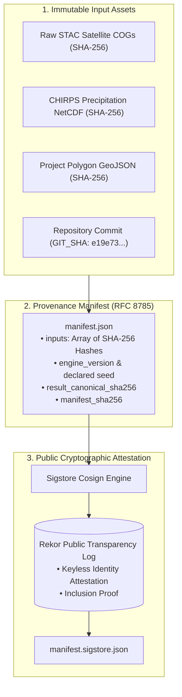

# Evidence Provenance & Cryptographic Verification

**Package**: `packages/groundtruth/src/groundtruth/provenance/`  
**Standards**: RFC 8785 (Canonical JSON), SHA-256 Digest Chains, Sigstore Cosign (Keyless OIDC), DVC Data Versioning.

In GroundTruth 2.0, an evidence bundle is cryptographically bound to its raw input datasets, sensor masks, and analytical code commits.




---

## 1. Provenance Manifest Architecture

The provenance manifest cryptographically locks the result JSON to its inputs:
- `result.canonical_sha256`: SHA-256 digest computed across canonical JSON (lexicographically sorted keys, no whitespace).
- `inputs`: Map of input file paths to their individual SHA-256 content digests.
- `engine_version`: Engine git commit and semver release.
- `seed`: Declared pseudo-random number generator seed.
- `manifest_sha256`: Digest computed over all preceding fields.

```bash
# Build provenance manifest from result bundle and inputs
python -m groundtruth.provenance build result.json \
    --input data/processed/climate.json \
    --input data/processed/sentinel2.zarr \
    --seed 20260101 \
    --out manifest.json

# Independently verify manifest integrity
python -m groundtruth.provenance verify manifest.json result.json \
    --input data/processed/climate.json \
    --input data/processed/sentinel2.zarr
```

---

## 2. Keyless Attestation with Sigstore Cosign

GroundTruth 2.0 signs verification bundles using keyless OpenID Connect (OIDC) identities via Sigstore Cosign:

```bash
# Sign manifest using ambient GitHub Actions workflow identity
python -m groundtruth.provenance sign manifest.json --bundle manifest.sigstore.json

# Verify signature against GitHub repository identity
python -m groundtruth.provenance verify-sig manifest.json \
    --bundle manifest.sigstore.json \
    --identity-regexp 'https://github.com/GroundTruth/.*'
```

Container images deployed to production are signed with GitHub Container Registry (GHCR) attestations, including CycloneDX Software Bills of Materials (SBOMs) to defend against supply-chain tampering.
