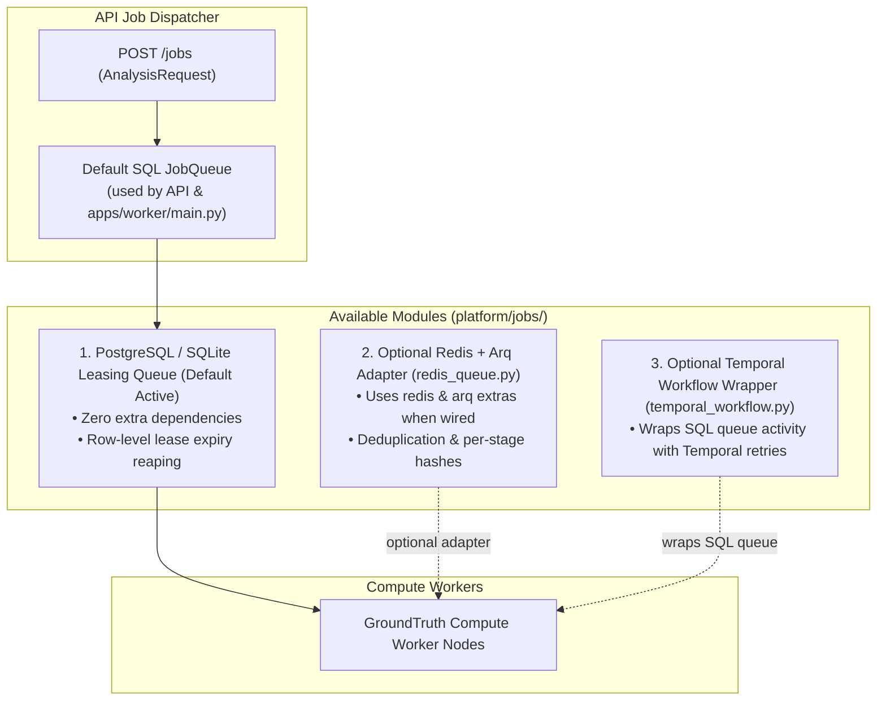

# Asynchronous Queue Backends

**Package**: `packages/groundtruth/src/groundtruth/platform/jobs/`  
**Supported Engines**: SQL Row-Lease Queue (default active backend), Optional Redis + Arq (`platform.jobs.redis_queue`), Optional Temporal Durable Workflows (`platform.jobs.temporal_workflow`).

GroundTruth 2.0 defaults to its SQL row-lease queue (`JobQueue` in `apps/worker/main.py`) and also includes optional `redis_queue` and `temporal_workflow` modules implementing comparable job lifecycle contracts (`claim`, `heartbeat`, `cancel`, `status`, `complete`).

---

## 1. Queue Backend Comparison Matrix

| Backend | Availability | Primary Module | Extra Dependencies | Status |
| :--- | :--- | :--- | :--- | :--- |
| **SQL Leasing Queue** | Default active (`apps/api`, `apps/worker`) | `platform.jobs.queue` | `sqlalchemy` | Active default in Compose, Helm, and local runs |
| **Redis + Arq Adapter** | Optional (wire-in helper) | `platform.jobs.redis_queue` | `redis`, `arq` (`[queue]`) | Implemented & unit-tested; not auto-selected by default worker |
| **Temporal Workflow** | Optional wrapper over SQL queue | `platform.jobs.temporal_workflow` | `temporalio` (`[queue]`) | Implemented & unit-tested; requires dedicated Temporal worker entrypoint |

---

## 2. Optional Redis + Arq Streaming Details

When wired in via `RedisJobQueue` (`groundtruth[queue]`):
- **Deduplication**: In-flight requests with identical `spec_hash` are deduplicated (`gt:spec:<spec_hash>`) to avoid redundant computation.
- **Result Caching**: Completed runs are checked via `from_cache` before queuing compute.
- **Stage Tracking**: Live progress stages (`claim`, `data`, `engine`, `record`) are stored in the job hash (`gt:job:<run_id>`); frontend clients consume live updates over SSE (`GET /jobs/{run_id}/events`) and polling (`GET /jobs/{run_id}`).
- **Scientific Refusal Contract**: A gate refusal is marked **`succeeded`** with `result_state="refused"`, ensuring the UI renders a first-class refusal state rather than a system crash.
