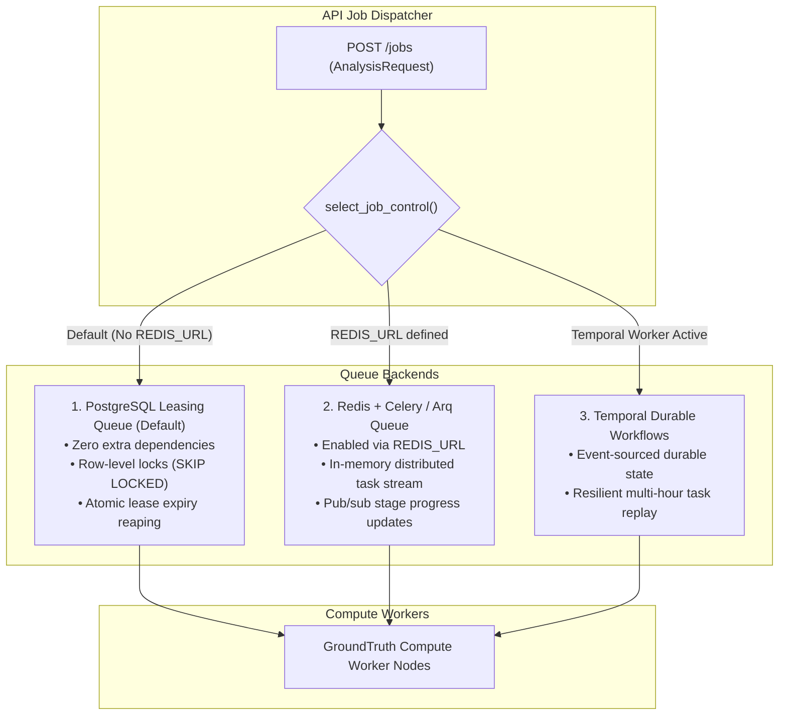

# Asynchronous Queue Backends

**Package**: `packages/groundtruth/src/groundtruth/platform/jobs/`  
**Supported Engines**: PostgreSQL Row-Lease Queue, Redis + Celery / Arq, Temporal Durable Workflows.

GroundTruth 2.0 supports three interchangeable queue backends, sharing identical job lifecycle contracts (`claim`, `heartbeat`, `cancel`, `status`, `complete`).

---

## 1. Queue Backend Comparison Matrix

| Backend | Selection Mechanism | Primary Module | Extra Dependencies | Best Used For |
| :--- | :--- | :--- | :--- | :--- |
| **PostgreSQL Table Queue** | Default (unset `REDIS_URL`) | `platform.jobs.queue` | `psycopg` / `sqlalchemy` | Local development, single-instance deployments, zero-infra overhead |
| **Redis + Celery / Arq** | `REDIS_URL` defined | `platform.jobs.redis_queue` | `redis`, `arq`, `celery` | Production scale-out with real-time UI stage progress streaming |
| **Temporal Workflow** | Temporal client initialized | `platform.jobs.temporal_workflow` | `temporalio` | Long-running multi-day regional batch verifications |

---

## 2. Redis + Arq Streaming Architecture

When `REDIS_URL` is set, GroundTruth 2.0 routes job submissions through `RedisJobQueue`:
- **Deduplication**: In-flight requests with identical `spec_hash` are deduplicated to avoid redundant computation.
- **Result Caching**: Completed runs are checked via `from_cache` before queuing compute.
- **Stage Streaming**: Live progress events (`claim`, `data_access`, `masking`, `engine`, `record`) are broadcast over Redis pub/sub to frontend WebSocket clients.
- **Scientific Refusal Contract**: A gate refusal is marked **`succeeded`** with `result_state="refused"`, ensuring the UI renders a first-class refusal state rather than a system crash.
