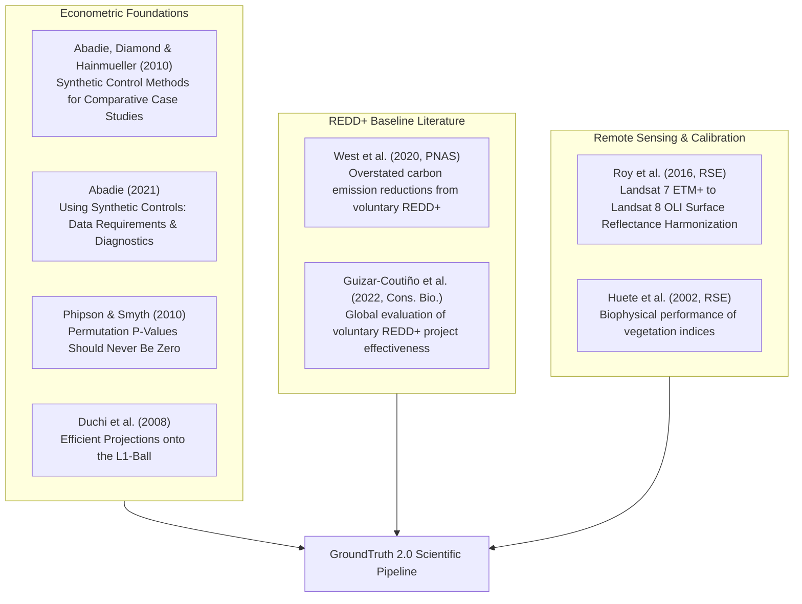

# Scientific Research & Methodology Notes

**Focus**: Econometric Causal Inference, Satellite Remote Sensing, Climate Confounding, Carbon Accounting Literature.

This directory documents the scientific foundations of GroundTruth 2.0, synthesizing published econometric literature, remote sensing methodologies, and findings from independent technical audits.

---

## 1. Core Scientific Bibliography

1. **Abadie, A., Diamond, A., & Hainmueller, J. (2010)**. *Synthetic Control Methods for Comparative Case Studies: Estimating the Effect of California's Tobacco Control Program*. Journal of the American Statistical Association, 105(490), 493–505.
   - *Core insight*: Constraining donor weights to the unit simplex ($w_j \ge 0, \sum w_j = 1$) prevents ungrounded extrapolation outside the convex hull of real observations.
2. **Abadie, A. (2021)**. *Using Synthetic Controls: Feasibility, Data Requirements, and Methodological Aspects*. Journal of Economic Literature, 59(2), 391–425.
   - *Core insight*: Formalized diagnostics including pre-treatment RMSPE, out-of-sample prediction bounds, and leave-one-out sensitivity.
3. **Phipson, B., & Smyth, G. K. (2010)**. *Permutation P-values Should Never Be Zero: Calculating Exact P-values When Permutations Are Randomly Drawn*. Statistical Applications in Genetics and Molecular Biology, 9(1).
   - *Core insight*: Using the $(1 + k) / (1 + B)$ formulation eliminates spurious zero p-values in finite permutation suites.
4. **Duchi, J., Shalev-Shwartz, S., Singer, Y., & Chandra, T. (2008)**. *Efficient Projections onto the L1-Ball for Learning in High Dimensions*. ICML '08.
   - *Core insight*: $O(J \log J)$ deterministic projection algorithm onto the probability simplex used inside the FISTA solver.
5. **West, T. A. P., et al. (2020)**. *Overstated carbon emission reductions from voluntary REDD+ projects in the Brazilian Amazon*. PNAS, 117(39), 24188–24194.
   - *Core insight*: Empirical verification showing voluntary projects consistently over-issue credits due to inflated baseline deforestation counterfactuals.
6. **Roy, D. P., et al. (2016)**. *Characterization of Landsat-7 to Landsat-8 reflective wavelength and normalized difference vegetation index continuity*. Remote Sensing of Environment, 185, 57–70.
   - *Core insight*: Mathematical transformation coefficients bridging ETM+ and OLI multi-spectral bands and surface NDVI.

---

## 2. Independent Audit Remediation & Findings (Task 5/5B)

The independent technical audit of Task 5/5B reinforced critical scientific realities for GroundTruth 2.0:

1. **Pre-Treatment Baseline Verification**: Historical Landsat 5/7 raster stacks cannot be replaced by simulated constants. In the absence of completed whole-AOI multi-tile raster extraction and verified sensor harmonization, the causal attribution verdict must be honestly reported as:
   $$\text{Attribution Verdict: } \mathbf{INCONCLUSIVE} \text{ (not estimable from available real data)}$$
2. **Fail-Closed Gate Operation**: GroundTruth 2.0 strictly refuses to serve simulated data under real-data labels. If STAC retrieval or cloud masking coverage falls below 95%, the system raises `DataUnavailableError` (HTTP 501).
3. **Real Kariba Baseline**: The verified spatial geometry of Kariba REDD+ (VCS 902) spans $1,072,638\text{ ha}$. Spatial screening identifies 50 candidate ADM2 districts, of which 37 are strictly eligible (13 excluded due to 10 km leakage belt buffers and host district contamination).

---

## 3. Open Scientific Research Frontiers

1. **Mega-Scale Interventions ($>1,000,000\text{ ha}$)**: When an intervention unit spans over one million hectares (e.g., Kariba REDD+), finding uncontaminated, ecologically comparable donor districts within the same biome becomes challenging. Research is ongoing into sub-district synthetic matching and micro-watershed donor units.
2. **Multi-Decadal Cross-Calibration**: Evaluating interventions established prior to 2005 requires bridging Landsat 5 TM, Landsat 7 ETM+, Landsat 8 OLI, and Sentinel-2 MSI across varying solar angles, atmospheric models, and sensor degradations.
3. **Direct Allometric Biomass Integration**: Bridging the gap between surface reflectance indices (NDVI/EVI) and carbon stock ($\text{tCO}_2\text{e}$) without violating scientific integrity requires coupling GEDI spaceborne LiDAR canopy height profiles with localized wood density allometry.
