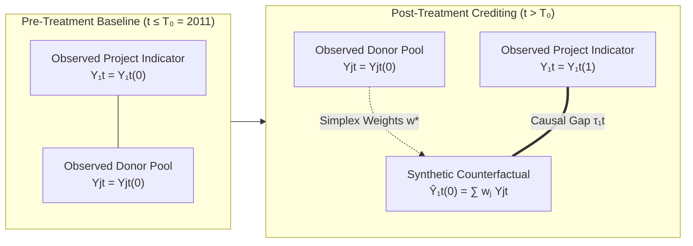
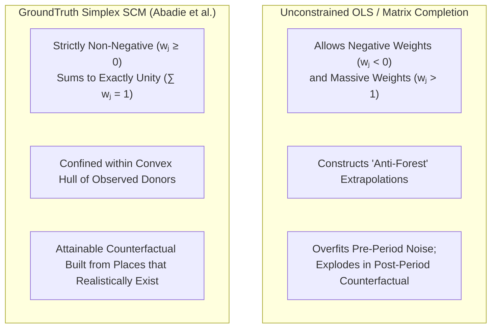
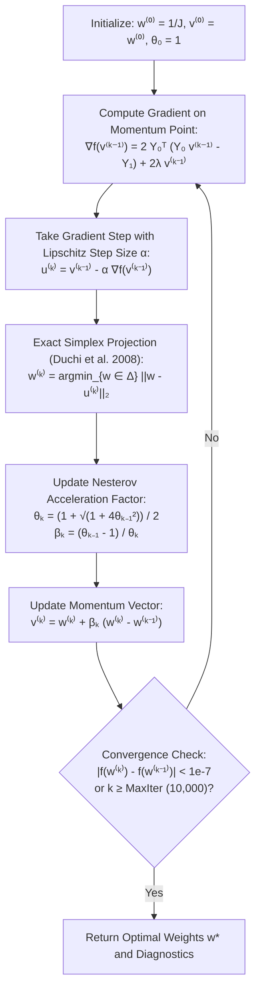
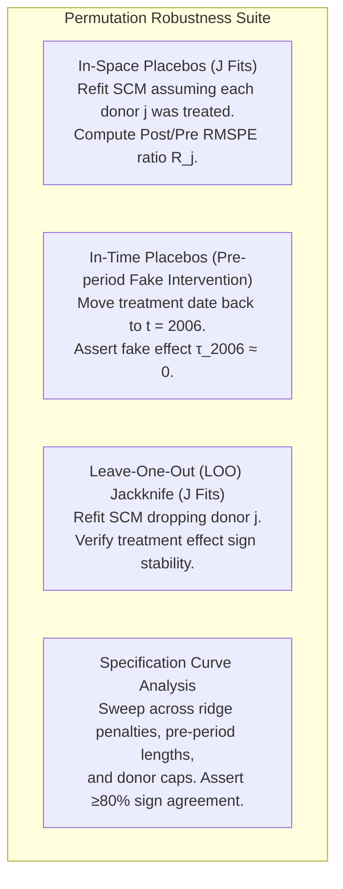
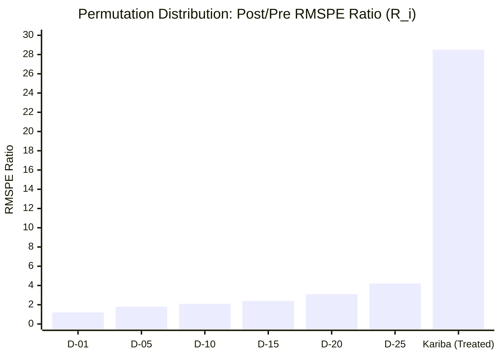
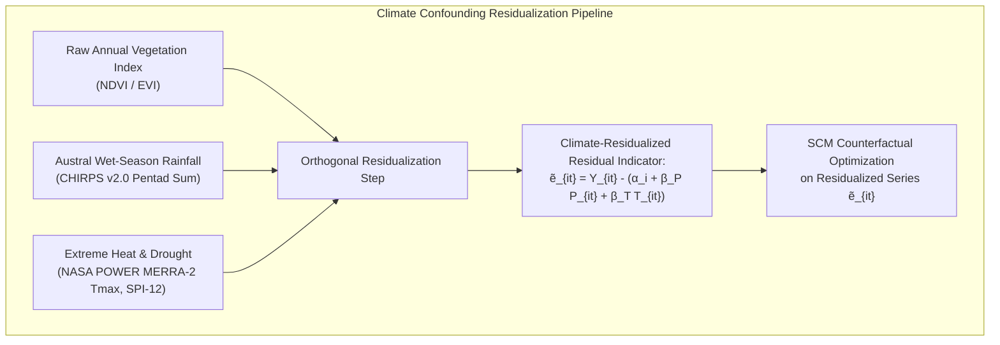
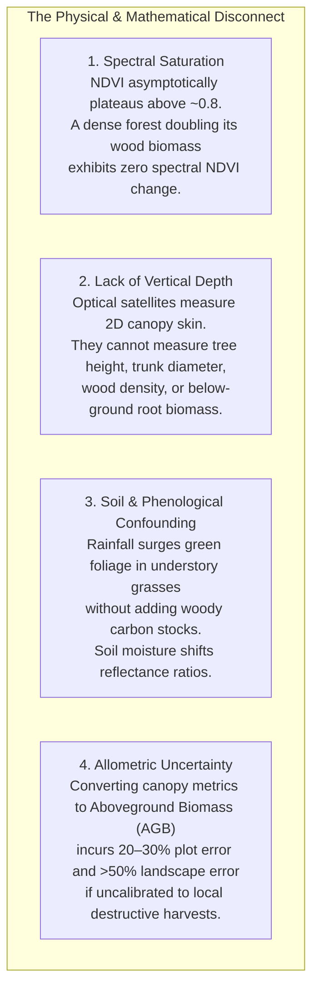
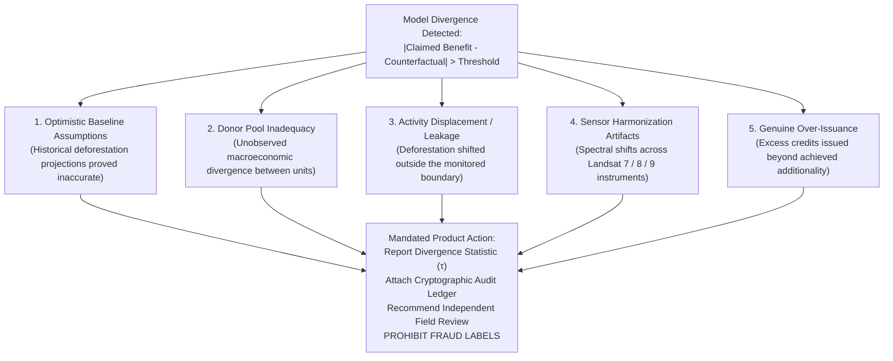

# Causal Inference & Econometric Foundations

> **Non-Negotiable Core Principle**: *An observed change in a satellite time series is not a causal effect, an index is not carbon, and model divergence is not fraud. When empirical prerequisites are not met, GroundTruth fails closed with an INCONCLUSIVE verdict.*

```
   ┌─────────────────────────────────────────────────────────────────────────────┐
   │                          CAUSAL INFERENCE TAXONOMY                          │
   ├───────────────────────────────────┬─────────────────────────────────────────┤
   │  Estimand                         │ Attributable Treatment Effect (τ)       │
   │  Primary Estimator                │ Simplex Synthetic Control Method (SCM) │
   │  Secondary Cross-Check            │ Difference-in-Differences (DiD)         │
   │  Inference Framework              │ Permutation Placebo Distribution (RMSPE)│
   │  Sensitivity Analysis             │ Leave-One-Out (LOO) + Specification Curve│
   │  Physical Boundary                │ assert_not_index_to_carbon (P1 Guard)  │
   └───────────────────────────────────┴─────────────────────────────────────────┘
```

---

## 1. The Causal Estimand & Potential Outcomes Framework

Under the Rubin Causal Model, let unit $i = 1$ denote the treated ecological project (e.g., Kariba REDD+, VCS 902), observed across discrete annual periods $t \in \{1, \dots, T\}$. The project initiates crediting at period $T_0 + 1$ (for Kariba, $T_0 = 2011$, with crediting commencing July 1, 2011).

Units $i \in \{2, \dots, J + 1\}$ represent an untreated donor pool of candidate administrative districts outside the project boundary and its leakage buffer.

For any unit $i$ and period $t$, define the potential outcomes:
- $Y_{it}^{(1)}$: The ecological indicator value if unit $i$ receives the intervention at $t > T_0$.
- $Y_{it}^{(0)}$: The potential ecological indicator value if unit $i$ had **never** received the intervention.

The observed indicator is:

$$Y_{it} = D_{it} Y_{it}^{(1)} + (1 - D_{it}) Y_{it}^{(0)}$$

where $D_{it} = 1$ if $i = 1$ and $t > T_0$, and $D_{it} = 0$ otherwise.



The fundamental problem of causal inference is that $Y_{1t}^{(0)}$ is strictly unobservable for $t > T_0$. The estimand of interest is the **Average Treatment Effect on the Treated (ATT)** across the post-treatment evaluation horizon:

$$\tau_{1t} = Y_{1t}^{(1)} - Y_{1t}^{(0)}, \qquad \bar{\tau}_{\text{post}} = \frac{1}{T - T_0} \sum_{t=T_0+1}^T \tau_{1t}$$

---

## 2. Synthetic Control Method (SCM)

GroundTruth estimates $Y_{1t}^{(0)}$ as an optimal, data-driven weighted combination of untreated donor districts:

$$\hat{Y}_{1t}^{(0)} = \sum_{j=2}^{J+1} w_j Y_{jt}$$

The weight vector $\mathbf{w}^* = [w_2, \dots, w_{J+1}]^T$ is determined by solving the constrained convex optimization problem over the pre-treatment baseline ($t = 1, \dots, T_0$):

$$\mathbf{w}^* = \arg\min_{\mathbf{w}} \sum_{t=1}^{T_0} \left( Y_{1t} - \sum_{j=2}^{J+1} w_j Y_{jt} \right)^2 + \lambda_{\text{ridge}} \|\mathbf{w}\|_2^2$$

subject to the strict **unit simplex constraints**:

$$w_j \ge 0 \quad \forall j \in \{2, \dots, J+1\}, \qquad \sum_{j=2}^{J+1} w_j = 1$$

### Why Simplex Constraints Matter



The simplex constraint prevents extrapolation. An unconstrained regression could achieve a lower pre-treatment RMSPE by assigning $w_{\text{Gokwe}} = +3.2$ and $w_{\text{Choma}} = -2.2$, creating an imaginary baseline. The simplex ensures that every counterfactual value $\hat{Y}_{1t}^{(0)}$ is a real, physically plausible ecosystem state bounded by the minimum and maximum of the observed donor pool:

$$\min_{j} Y_{jt} \le \hat{Y}_{1t}^{(0)} \le \max_{j} Y_{jt} \quad \forall t$$

If the project's pre-treatment trajectory lies outside the convex hull of its donors, no simplex weighting can fit it. Rather than masking this discrepancy with an unconstrained intercept, GroundTruth flags `hull_level_excess` and returns an `INCONCLUSIVE` verdict.

### Numerical Optimization via FISTA

GroundTruth solves the constrained simplex quadratic program using the **Fast Iterative Shrinkage-Thresholding Algorithm (FISTA)** with Nesterov accelerated momentum and exact Euclidean projection onto the $L_1$ simplex via Duchi et al. (2008).



### Identification of Weights When $J > T_0$

When the number of candidate donor districts $J$ exceeds the length of the pre-treatment baseline $T_0$ (e.g., $J = 28$ core donors vs. $T_0 = 11$ pre-treatment years for Kariba), the linear system is underdetermined.

While the counterfactual trajectory $\hat{\mathbf{Y}}_{1}^{(0)}$ and the estimated treatment effect $\hat{\tau}$ remain mathematically well-determined and stable, the specific allocation of weights among collinear donors is non-unique.

GroundTruth reports `fit.weights_identified = False` whenever $J > T_0$ and issues a formal evidence warning. The platform forbids presenting a single non-unique weight vector as the definitive counterfactual comparison set.

---

## 3. Difference-in-Differences (DiD) Cross-Check

To provide full methodological transparency, GroundTruth fits a standard two-way fixed effects Difference-in-Differences model alongside SCM:

$$\hat{\tau}_{\text{DiD}} = \left( \bar{Y}_{\text{project}, \text{post}} - \bar{Y}_{\text{project}, \text{pre}} \right) - \left( \bar{Y}_{\text{donors}, \text{post}} - \bar{Y}_{\text{donors}, \text{pre}} \right)$$

### Pre-Trend Slope Divergence Diagnostic

DiD requires the **Parallel Trends Assumption**:

$$\mathbb{E}\left[ Y_{1t}^{(0)} - Y_{1, T_0}^{(0)} \right] = \mathbb{E}\left[ Y_{0t}^{(0)} - Y_{0, T_0}^{(0)} \right] \quad \forall t > T_0$$

Because this counterfactual condition cannot be observed, GroundTruth tests its pre-treatment empirical analogue:

$$\beta_{\text{project}} = \text{OLS}(Y_{1t} \sim t), \quad \beta_{\text{donors}} = \text{OLS}(\bar{Y}_{\text{donors}, t} \sim t), \qquad t \in \{1, \dots, T_0\}$$

$$\Delta_{\text{slope}} = \beta_{\text{project}} - \beta_{\text{donors}}$$

The cumulative implied bias over the post-treatment window is:

$$\text{Bias}_{\text{parallel}} = \Delta_{\text{slope}} \times (T - T_0)$$

If $|\text{Bias}_{\text{parallel}}| \ge |\hat{\tau}_{\text{DiD}}|$, the parallel trends assumption is rejected as unviable, and DiD is classified as misspecified.

### Standard Errors via Wild Cluster Bootstrap

Spatial correlation across neighboring rural districts violates independent and identically distributed (i.i.d.) assumptions. GroundTruth implements cluster-robust standard errors (CR1) clustered at the administrative/provincial level.

When the number of clusters is small ($G < 12$), asymptotic standard errors are severely downward-biased. GroundTruth executes a **Wild Cluster Bootstrap** with Webb six-point weights:

$$v_g \in \left\{ -\sqrt{\frac{3}{2}}, -1, -\sqrt{\frac{1}{2}}, \sqrt{\frac{1}{2}}, 1, \sqrt{\frac{3}{2}} \right\}$$

and Rademacher two-point weights ($v_g \in \{-1, +1\}$) for $G \ge 12$, preserving valid coverage even with sparse spatial clusters.

---

## 4. Permutation Inference & Placebo Distributions

Because ecological additionality verification involves a single treated jurisdiction ($N=1$), asymptotic Gaussian hypothesis testing is fundamentally invalid. GroundTruth relies exclusively on exact permutation inference (Abadie et al., 2010; Phipson & Smyth, 2010).



### In-Space Placebos & RMSPE Ratio

For every unit $i \in \{1, \dots, J+1\}$ (the project and each of the $J$ donors), the model fits an independent SCM counterfactual using the remaining $J$ units as the comparison pool.

> **Crucial Invariant**: When fitting a placebo model for donor $j$, **the true treated unit (Kariba) is strictly excluded from the donor pool**. Including the project inside a placebo pool would contaminate the placebo's counterfactual with the actual treatment effect, invalidating the null distribution.

The test statistic is the post-to-pre Root Mean Squared Prediction Error ratio:

$$R_i = \frac{\sqrt{\frac{1}{T - T_0} \sum_{t=T_0+1}^T \left(Y_{it} - \hat{Y}_{it}^{(0)}\right)^2}}{\sqrt{\frac{1}{T_0} \sum_{t=1}^{T_0} \left(Y_{it} - \hat{Y}_{it}^{(0)}\right)^2}}$$

The empirical one-sided permutation p-value is computed via the Phipson–Smyth (2010) formula:

$$p_{\text{perm}} = \frac{1 + \sum_{j=2}^{J+1} \mathbb{I}\left(R_j \ge R_1\right)}{1 + J}$$



### The Sample-Size Permutation Floor

If Kariba's ratio $R_1$ exceeds all $J$ placebos in the pool, the numerator is $1 + 0 = 1$. The resulting p-value is:

$$p_{\text{floor}} = \frac{1}{1 + J}$$

For Kariba's 28 core donor districts:

$$p_{\text{floor}} = \frac{1}{1 + 28} = \frac{1}{29} \approx 0.0345$$

GroundTruth enforces in code that a reported p-value cannot be claimed as $p = 0.000$ or conflated with continuous statistical significance. If the confidence threshold is $\alpha = 0.01$ and $p_{\text{floor}} = 0.0345$, the gate explicitly warns that the design lacks the statistical power to reject the null at that confidence level.

---

## 5. Climate Confounding Control & Residualization

In semi-arid Miombo and Mopane dry forests, canopy greenness and leaf-area index are overwhelmingly driven by precipitation during the Austral wet season (November through April).



### The Two Major Climate Shocks at Kariba
1. **2002 Extreme Drought (Pre-Treatment)**: Calendar-year rainfall dropped to $450\text{ mm}$ (baseline mean: $694\text{ mm}$), producing an extreme drought index of $\text{SPI-12} = -1.72$.
2. **2019 Regional Drought (Post-Treatment)**: Precipitation dropped to $412\text{ mm}$, yielding $\text{SPI-12} = -1.52$.

Without climate residualization, an unadjusted estimator would:
- Interpret the 2002 baseline drought as evidence of severe historical deforestation.
- Interpret the 2019 drought as project management failure or baseline collapse.

GroundTruth extracts continuous 43-year monthly precipitation from CHIRPS v2.0 and temperature from NASA POWER MERRA-2, allowing orthogonal residualization before synthetic control fitting.

---

## 6. Non-Negotiable Principle: "NDVI Is Not Carbon"

A core pillar of GroundTruth's scientific integrity is the explicit refusal to convert spectral vegetation indices directly into carbon credit quantities without site-calibrated, error-propagated allometric models.



### The Unit Conversion Guard
GroundTruth's contract layer enforces strict unit gating:

```python
# groundtruth/contracts/units.py
def assert_not_index_to_carbon(from_unit: Unit, to_unit: Unit) -> None:
    """Fail-closed guard preventing direct spectral-to-carbon conversions."""
    if from_unit.is_spectral_index() and to_unit.is_carbon_mass():
        raise UnitConversionError(
            f"Illegal conversion: Cannot convert spectral index {from_unit} "
            f"directly to carbon mass {to_unit}. NDVI is not carbon."
        )
```

Whenever a developer's claim is expressed in metric tonnes of carbon dioxide equivalent ($\text{tCO}_2\text{e}$) while satellite observations are in spectral reflectance units ($\Delta\text{NDVI}$), GroundTruth refuses to fabricate an over-issuance percentage. The system issues an **`INCONCLUSIVE`** verdict with the formal rationale:

> *"The claimed benefit is expressed in carbon units (tCO2e), whereas the empirical observation is a canopy spectral index (NDVI). Because no site-calibrated biomass allometry is validated for this ecosystem, these quantities are not commensurable."*

---

## 7. Non-Negotiable Principle: "Model Divergence Is Not Fraud"

When GroundTruth estimates a counterfactual trajectory that diverges substantially from a project developer's registered baseline, the platform **never accuses the project of fraud or misconduct**.



The system contract `VerdictLabel` strictly prohibits defamatory labels. Acceptable values are:
- `VERIFIED_ADDITIONAL`: Statistically significant positive causal divergence.
- `DIVERGENT_FROM_CLAIM`: Statistically significant gap between claim and counterfactual.
- `INCONCLUSIVE`: Insufficient evidence, missing pre-treatment series, or uncalibrated units.
- `NO_ADDITIONALITY_DETECTED`: Estimated causal effect indistinguishable from zero.

---

## 8. Identifying Assumptions & Failure Modes

| Assumption | Formal Statement | How It Fails in Tropical Forestry | GroundTruth Pipeline Mitigation |
| :--- | :--- | :--- | :--- |
| **SUTVA (No Interference)** | $Y_{it}^{(d)} = Y_{it}$ for all $d$; no treatment spillover. | Deforestation displaced into neighboring donor districts (leakage). | 20 km outward spatial buffer exclusion of all adjacent districts. |
| **Convex Hull Support** | $\mathbf{Y}_1 \in \text{conv}(\mathbf{Y}_0)$; project spanned by donors. | Project is steeper, wetter, or more remote than any comparison district. | Pre-treatment convex hull gating (`hull_level_excess` $\le 0.10$ SD). |
| **No Anticipation** | $Y_{1t}^{(0)} = Y_{1t}$ for all $t \le T_0$; no pre-treatment action. | Project developers initiate protection during project validation phase. | In-time placebo pseudo-shock testing at pre-treatment midpoint. |
| **Structural Stability** | Relationship between donors and project holds post-treatment. | Macroeconomic shock, currency collapse, or civil strife hits one nation. | Leave-one-out sensitivity testing and multi-country donor stratification. |
| **Measurement Invariance** | $Y_{it}$ represents identical physical quantity across time. | Instrumental band shift during Landsat 7 $\rightarrow$ Landsat 8 transition (2013). | Surface reflectance harmonization (Roy et al. 2016) and fail-closed guards. |

---

## 9. Current Kariba Assessment Status: Level 2 Contextual Intelligence

Applying this rigorous framework to the Kariba REDD+ validation target:


1. **Observed Post-Treatment Data**: Genuine Sentinel-2 Level-2A 10m surface reflectance (2021–2023) across Kariba forest parcels.
2. **Observed Climate Covariates**: 43-year continuous monthly rainfall from CHIRPS v2.0 (1981–2023, 514/516 months) and NASA POWER temperature.
3. **Observed Spatial Geometry**: 1,072,638 ha geodesic project boundary; 50 candidate ADM2 donor districts in Zambia and Zimbabwe (37 spatially eligible, 28 core uncontaminated).
4. **Missing Historical Panel**: Real, cloud-masked, multi-tile Landsat surface reflectance rasters for 2001–2011 have not been reduced into a pre-treatment outcome matrix for Kariba and its donors (the 5B cache was fabricated and quarantined).
5. **Fail-Closed Execution**: In `REAL_OBSERVATIONS` mode, `earth_engine_access()` refuses execution and returns **HTTP 501 / `DataUnavailableError`**.
6. **Scientific Verdict**: **`INCONCLUSIVE / NOT ESTIMABLE`**. GroundTruth refuses to manufacture a synthetic number when real pre-treatment observations are absent.

---

## 10. References

1. **Abadie, A., Diamond, A., & Hainmueller, J. (2010)**. *Synthetic Control Methods for Comparative Case Studies: Estimating the Effect of California's Tobacco Control Program*. JASA, 105(490), 493–505.
2. **Abadie, A. (2021)**. *Using Synthetic Controls: Feasibility, Data Requirements, and Methodological Aspects*. Journal of Economic Literature, 59(2), 391–425.
3. **Beck, A., & Teboulle, M. (2009)**. *A Fast Iterative Shrinkage-Thresholding Algorithm for Linear Inverse Problems*. SIAM Journal on Imaging Sciences, 2(1), 183–202.
4. **Duchi, J., Shalev-Shwartz, S., Singer, Y., & Chandra, T. (2008)**. *Efficient Projections onto the L1-Ball for Learning in High Dimensions*. ICML.
5. **Phipson, B., & Smyth, G. K. (2010)**. *Permutation P-values Should Never Be Zero: Calculating Exact P-values When Permutations Are Randomly Drawn*. Stat. Appl. Genet. Mol. Biol., 9(1).
6. **Roy, D. P. et al. (2016)**. *Characterization of Landsat-7 to Landsat-8 Reflectance Alignment and Harmonization*. Remote Sensing of Environment, 185, 57–70.
