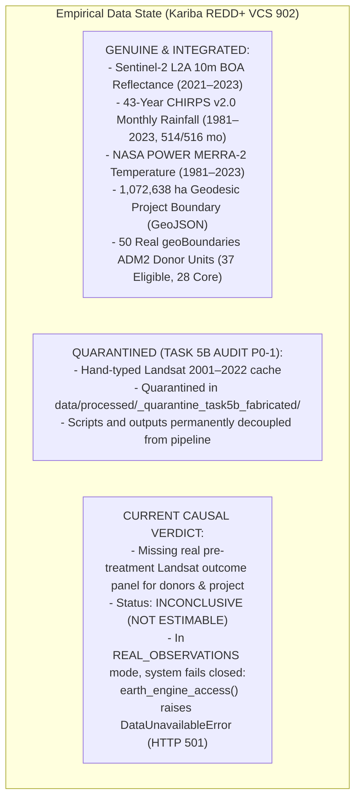
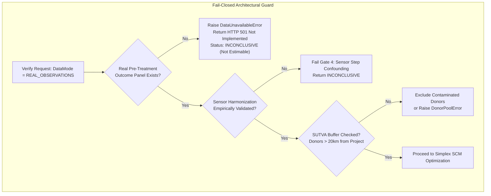
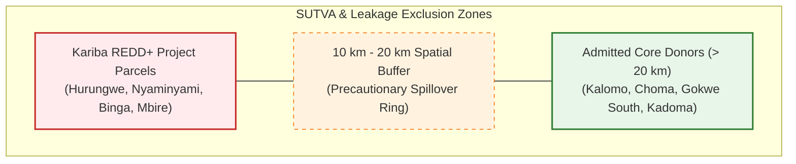
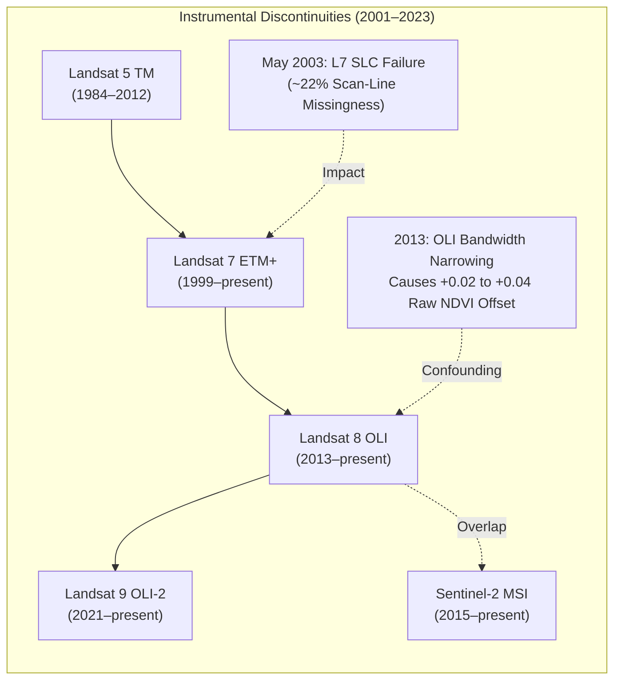

# Limitations, Assumptions & Fail-Closed Guardrails

> **Core Transparency Invariant**: *A verification platform that conceals its own methodological boundaries is demanding the blind trust it claims to replace. GroundTruth publishes its engineering constraints, measurement bounds, and current empirical limits without compromise.*

```
   ┌─────────────────────────────────────────────────────────────────────────────┐
   │                          OPERATIONAL BOUNDARIES                             │
   ├───────────────────────────────────┬─────────────────────────────────────────┤
   │  Current Real-Data Causal Status  │ INCONCLUSIVE / NOT ESTIMABLE            │
   │  Fail-Closed Engine Status        │ ACTIVE (HTTP 501 / DataUnavailableError)│
   │  Quarantined Artifacts            │ Task 5B Fabricated Cache Quarantined    │
   │  Verified Real Assets             │ Sentinel-2 (2021–23), CHIRPS, POWER     │
   │  Donor Eligibility                │ 50 Mapped, 37 Eligible, 28 Core         │
   │  Physical Guard                   │ assert_not_index_to_carbon (P1 Guard)   │
   └───────────────────────────────────┴─────────────────────────────────────────┘
```

---

## 1. Current State of Real-World Data Implementation

Following the Independent Task 5B Audit (`docs/audits/INDEPENDENT_TASK_5B_AUDIT.md`), GroundTruth maintains complete scientific honesty regarding what is genuinely integrated versus what remains unbuilt or quarantined.



### Explicit Inventory of Built vs. Unbuilt Components

| Component / Capability | Status | Reality & Limitation |
| :--- | :---: | :--- |
| **Real Sentinel-2 Observations** | **`INTEGRATED`** | Genuine ESA Sentinel-2 L2A BOA reflectance (2021–2023) processed over Kariba forest tile 36LTH. |
| **Real Climate Covariates** | **`INTEGRATED`** | 43-year continuous monthly CHIRPS rainfall (514/516 months; 2022-07 and 2023-12 honestly flagged as missing). NASA POWER T2M/Tmax/Tmin. |
| **Real Project & Donor Boundaries** | **`INTEGRATED`** | 1,072,638 ha Kariba boundary (`_KML_902.kml`); 50 real geoBoundaries ADM2 candidate donor districts. |
| **Historical Landsat Pre-Treatment Panel** | **`UNAVAILABLE`** | Pre-treatment rasters across WRS-2 paths 169–172 not yet reduced to series. Task 5B fabricated cache is quarantined. |
| **Real-Data Econometric Attribution** | **`HALTED`** | Evaluates to `INCONCLUSIVE / NOT ESTIMABLE`. System raises `DataUnavailableError` / HTTP 501 in `REAL` mode. |
| **Biomass-to-Carbon Conversion** | **`FORBIDDEN`** | Blocked by `assert_not_index_to_carbon`. No validated local destructive allometry parameters shipped. |
| **Synthetic Benchmark Replay** | **`TESTING ONLY`** | Deterministic fixture for CI/CD and offline testing; strictly labeled `SIMULATED DATA` on all UI surfaces. |

---

## 2. Methodological & Econometric Limitations



### 2.1 The Estimate Is on a Spectral Index, Not Carbon Mass
The single largest scientific limitation in Earth-observation verification is that optical satellites observe two-dimensional canopy reflectance, not stored carbon mass.
- **Spectral Saturation**: NDVI asymptotically compresses above 0.82 in mature Miombo and tropical forest. A forest that accumulates significant core wood biomass shows near-zero index change.
- **Moisture Confounding**: Wet years trigger vigorous understory grass growth, elevating NDVI without contributing to woody biomass stocks.
- **No Below-Ground Visibility**: Optical sensors cannot observe root biomass or soil organic carbon, which represent over 40% of carbon stocks in dry woodland biomes.

### 2.2 Spatial Resolution Floor
Annual composites at 10m to 30m resolution cannot resolve:
- Degradation caused by selective illegal logging or fuelwood gathering that removes individual trees beneath a continuous canopy.
- Projects below approximately **1,000 hectares**. The Mikoko Pamoja mangrove case (~117 ha) is deliberately included as an intentional negative control: returning `INCONCLUSIVE` is the required behavior, proving the platform refuses sub-resolution cases.

### 2.3 The Donor Pool Dictates the Counterfactual
Every causal estimate is strictly conditional on the admitted comparison pool:
- Selecting different administrative districts or expanding the search radius changes the synthetic control weights $\mathbf{w}^*$.
- To mitigate researcher degrees of freedom, GroundTruth enforces pre-registered eligibility rules: 20 km leakage buffer, target ecoregion matching, and pre-2000 protected status exclusions.



### 2.4 Administrative Districts as Units of Analysis
In GroundTruth (ADR-011), donors are administrative districts (ADM2) intersected with baseline forest masks:
- District boundaries follow rivers, roads, and historical settlement corridors that correlate with deforestation pressure.
- Consequently, donor units are not exchangeable in the ideal manner of randomized trials. Matching on road distance, slope, and population density mitigates but does not eliminate this structural confounding.

### 2.5 Correlated Units and the Permutation Floor
Neighboring districts in Zimbabwe and Zambia share national economic policies, currency volatility, and regional drought patterns.
- Spatial cross-correlation reduces the effective degrees of freedom below the raw count of 28 core donors.
- Under permutation inference, the theoretical minimum attainable p-value with $J$ donors is $1 / (1 + J)$. With 28 donors, the minimum p-value is **$0.0345$**. The design cannot achieve $p < 0.01$, and claims of higher statistical significance are mathematical artifacts.

### 2.6 Weight Non-Identification ($J > T_0$)
With $J = 28$ core donors and $T_0 = 11$ pre-treatment years, the linear system is underdetermined. Multiple weight combinations can reproduce the pre-treatment trajectory. GroundTruth flags `fit.weights_identified = False` and warns that individual donor weights cannot be interpreted as unique causal contributions.

---

## 3. Remote Sensing & Measurement Limitations



### 3.1 Sensor Transitions and Structural Steps
- **Landsat 7 to Landsat 8 (2013)**: Landsat 8 OLI features narrower spectral response functions in the Red and NIR bands than Landsat 7 ETM+. This induces a raw positive step in NDVI ($+0.02$ to $+0.04$) that coincides exactly with the early crediting period of Kariba (2011–2018). Unharmonized estimators will falsely attribute this instrumental shift to project success.
- **Landsat 7 SLC-Off (Post-May 2003)**: The Scan Line Corrector failure creates ~22% missing scan lines per scene. GroundTruth strictly masks these as `NaN` without spatial interpolation; however, this reduces the valid pixel count in pre-treatment composites.

### 3.2 Cloud Masking and Tropical Monsoons
During the cloudy wet season (November–April), optical imagery is heavily occluded. GroundTruth restricts analysis to the dry season (July–October); however, this limits observations to deciduous dry canopy states and cannot capture wet-season growth surges.

### 3.3 Fire and Burn Scars
Fire is an endemic ecological process in Zambezian Miombo woodlands. A late dry-season wildfire produces a massive, localized drop in NDVI and NBR that mimics catastrophic deforestation, even though Miombo rootstocks rapidly regenerate during subsequent rains.

---

## 4. What GroundTruth Must Never Be Used For

To prevent misuse, the platform contract and legal disclaimers explicitly forbid the following applications:

```
   ┌─────────────────────────────────────────────────────────────────────────────┐
   │                          PROHIBITED APPLICATIONS                            │
   ├─────────────────────────────────────────────────────────────────────────────┤
   │  1. Alleging Fraud or Criminal Misconduct                                   │
   │     Divergence between a baseline and a counterfactual triggers technical   │
   │     review, not legal condemnation.                                         │
   ├─────────────────────────────────────────────────────────────────────────────┤
   │  2. Automated De-Listing or Contract Termination                            │
   │     No carbon project may be stripped of registry accreditation solely on   │
   │     an unvalidated satellite screening estimate.                            │
   ├─────────────────────────────────────────────────────────────────────────────┤
   │  3. Carbon Credit Pricing or Commercial Arbitrage                           │
   │     GroundTruth is an independent verification platform, not an exchange,  │
   │     rating agency, or financial derivative pricing tool.                    │
   ├─────────────────────────────────────────────────────────────────────────────┤
   │  4. Replacing In-Situ Ground Plot Inventory                                 │
   │     Satellites cannot replace physical allometric forestry plots, soil core │
   │     sampling, or indigenous community tenure consultations.                 │
   └─────────────────────────────────────────────────────────────────────────────┘
```

---

## 5. Security & Access Boundaries

GroundTruth enforces strict tenant isolation and role-based access control across all four operational personas:


- **Cryptographic Separation**: Audit tokens and organization IDs are cryptographically verified at the API gateway. Unauthorized cross-organization data access requests are rejected with HTTP 403 Forbidden.
- **Audit Traceability**: Every evaluation run generates an immutable, content-addressed SHA-256 hash verifying that no parameters, boundaries, or weights were tampered with during generation.
