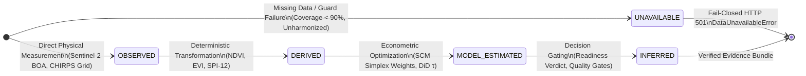
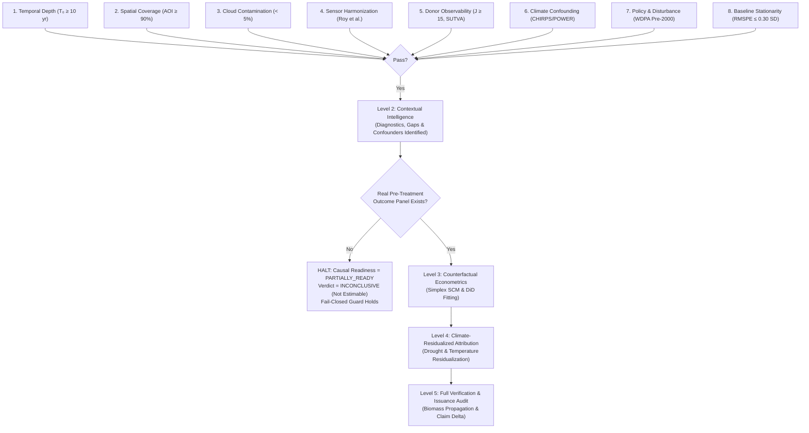
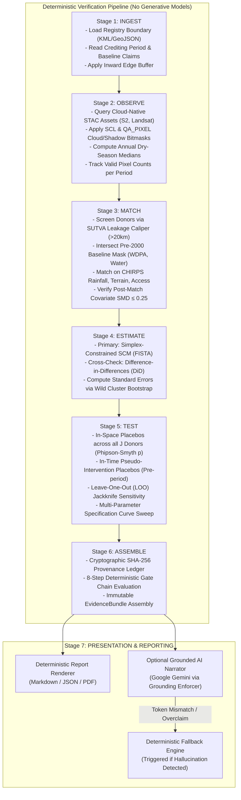
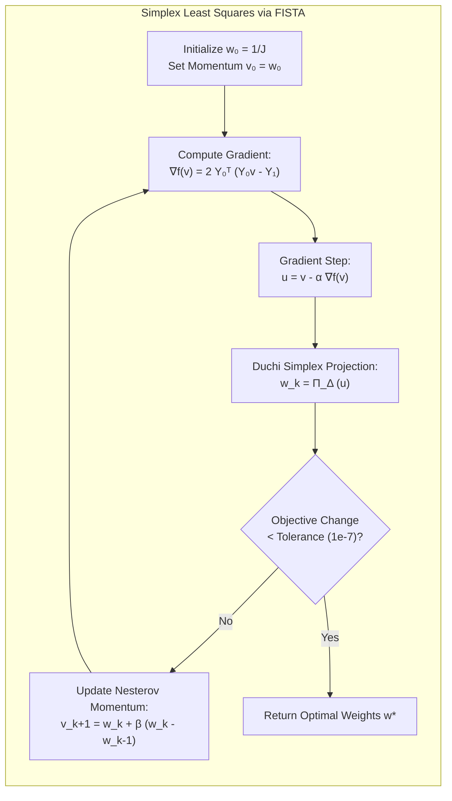
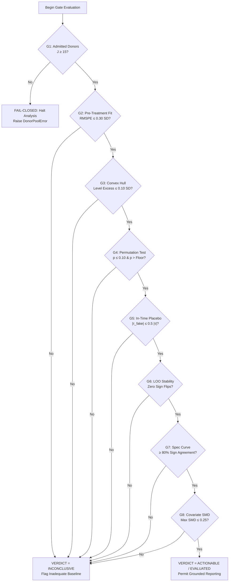
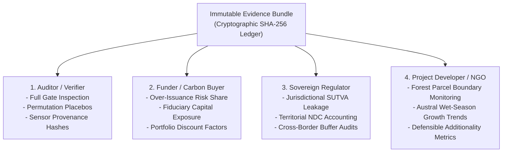

# GroundTruth 2.0 — Scientific Methodology & Verification Pipeline

> **Core Scientific Rule**: *Observed ecological change is not automatically evidence of restoration success, and correlation is not causal attribution. Preserve the INCONCLUSIVE verdict whenever the empirical evidence does not support attribution.*

```
   ┌─────────────────────────────────────────────────────────────────────────────┐
   │                          NON-NEGOTIABLE PRINCIPLES                          │
   ├───────────────────────────────────┬─────────────────────────────────────────┤
   │  1. Observed Change ≠ Causal Effect│ Macroeconomic, climate, and border      │
   │                                   │ shocks move forests across regions.     │
   ├───────────────────────────────────┼─────────────────────────────────────────┤
   │  2. NDVI ≠ Carbon                 │ Spectral reflectance saturates, lacks   │
   │                                   │ vertical depth, and tracks moisture.    │
   ├───────────────────────────────────┼─────────────────────────────────────────┤
   │  3. Model Divergence ≠ Fraud      │ Baselines fail for innocent and         │
   │                                   │ structural reasons; review, don't accuse│
   ├───────────────────────────────────┼─────────────────────────────────────────┤
   │  4. Fail-Closed Guards            │ If data is missing or unharmonized,     │
   │                                   │ refuse with HTTP 501 / DataUnavailable. │
   └───────────────────────────────────┴─────────────────────────────────────────┘
```

---

## 1. The Fundamental Causal Problem in Ecosystem Verification

When a restoration initiative or voluntary carbon project (such as Kariba REDD+, VCS 902) claims ecological additionality or avoided emissions, traditional verification assesses:

$$\Delta_{\text{naive}} = Y_{\text{project}, \text{post}} - Y_{\text{project}, \text{pre}}$$

where $Y$ represents an ecological indicator (e.g., NDVI, EVI, canopy height).

### Why Before-and-After Differencing Fails

This naive differencing conflates the project intervention with every confounding macro-trend:
1. **Climatic Cycles**: Southern African rainfall fluctuates via El Niño Southern Oscillation (ENSO). A drought year (such as Kariba's 2002 SPI-12 = $-1.72$ or 2019 SPI-12 = $-1.52$) depresses greenness regardless of protection; an above-average wet year (2010 rainfall) elevates greenness across the Zambezi Basin.
2. **Economic & Commodity Shifts**: Regional timber and charcoal prices, currency devaluations, and road construction drive clearing patterns across whole provinces.
3. **Regional Conflict & Displacement**: Population movements displace agricultural pressure across district borders.

```
Naive Differencing (Confounded):
Project Before ───(Macro Trends + Climate Shocks + True Effect)───► Project After
                 ▲                                               ▲
                 └────────────── Impossible to Separate ─────────┘

Causal Identification (GroundTruth):
Project Pre ──────(Identical Regional Trends)─────► Project Post (Observed)
                                                           ▲
                                                     True Causal Effect (τ)
                                                           ▼
Synthetic Control Pre ──(Identical Regional Trends)──► Synthetic Control Post (Counterfactual)
```

GroundTruth replaces naive differencing with formal econometric causal identification. The estimand is the **relative gap** between what actually occurred inside the intervention boundary versus what would have occurred had the intervention never taken place:

$$\tau_{1t} = Y_{1t}^{(1)} - Y_{1t}^{(0)}, \qquad t > T_0$$

where $Y_{1t}^{(1)}$ is observed by satellite Earth observation, and $Y_{1t}^{(0)}$ is the unobserved counterfactual synthesized from a strictly non-contaminated donor pool of untreated regional units.

---

## 2. The 5-State Evidence Model

Every observation, metric, and parameter in GroundTruth is tagged with a formal evidence state (`groundtruth.contracts.evidence.EvidenceState`). The system enforces strict typing across these states to prevent simulated or inferred assumptions from masquerading as physical facts.



### Definitions & Repository Invariants

| Evidence State | Strict Definition | Concrete Repository Example | Guard Enforced |
| :--- | :--- | :--- | :--- |
| **`OBSERVED`** | Raw physical Earth observation or verified public record directly retrieved without alteration. | Sentinel-2 L2A BOA reflectance ($\rho \in [0, 1]$), CHIRPS v2.0 daily pentad rainfall. | Raw digital numbers must be calibrated; physical limits strictly bounded. |
| **`DERIVED`** | Exact, deterministic mathematical transformation of `OBSERVED` data. | Band indices ($\text{NDVI} = \frac{\text{NIR} - \text{Red}}{\text{NIR} + \text{Red}}$), SPI-12 Gamma index. | Zero floating-point drift; transparent algebraic formulas; no ML tuning. |
| **`MODEL_ESTIMATED`** | Parameter or counterfactual trajectory computed via mathematical optimization. | Synthetic Control weights $\mathbf{w}^*$, in-space placebo distribution $\{R_j\}$, DiD point estimate $\hat{\tau}_{\text{DiD}}$. | Must converge on unit simplex ($w_j \ge 0, \sum w_j = 1$); convex hull checks. |
| **`INFERRED`** | Rule-based categorical verdict or qualitative assessment derived from deterministic threshold gates. | `VerdictLabel.INCONCLUSIVE`, `CausalReadiness.PARTIALLY_READY`. | No generative LLM may assign verdicts; decided strictly by deterministic gate chain. |
| **`UNAVAILABLE`** | Missing, incomplete, corrupted, or unharmonized data that triggers fail-closed architecture. | Pre-treatment Landsat outcome panel for Kariba donors; unharmonized ETM+ to OLI sensors. | **Raises `DataUnavailableError` / HTTP 501**; forbids silent interpolation. |

---

## 3. The 8 Assessment Dimensions & Causal Maturity Ladder

GroundTruth evaluates projects along eight rigorous assessment dimensions before permitting causal estimation:



### The Causal Maturity Levels

1. **Level 1 — Data Discovery & Ingestion**: STAC assets discovered, administrative boundaries indexed, multi-temporal metadata audited.
2. **Level 2 — Contextual Intelligence & Data Diagnostics**: Spatial footprint analyzed, sensor transition steps flagged (Landsat 7 $\rightarrow$ 8 in 2013), climate shocks isolated (2002, 2019 droughts), donor eligibility matrix established with SUTVA buffers. **(Kariba Current State)**
3. **Level 3 — Counterfactual Econometrics**: Full simplex quadratic programming across admitted donors; pre-treatment RMSPE minimization; permutation placebo testing.
4. **Level 4 — Climate-Residualized Attribution**: Orthogonalization of vegetation trends against Austral wet-season precipitation and MERRA-2 maximum temperatures.
5. **Level 5 — End-to-End Verification**: Propagated biomass carbon estimation comparing certified credit issuance against counterfactual avoided deforestation.

> **Kariba Assessment Reality**: Kariba REDD+ successfully achieves **Level 2 (Contextual Intelligence)**. It cannot progress to Level 3 because genuine, cloud-masked, multi-tile pre-treatment Landsat surface reflectance rasters have not been reduced to an outcome panel for both the treated unit and the donor pool. The system truthfully halts and returns `INCONCLUSIVE`.

---

## 4. End-to-End Deterministic Pipeline Architecture

The GroundTruth core pipeline consists of seven sequential stages. Stages 1 through 6 are completely deterministic, written in pure Python and NumPy, and completely devoid of generative AI. Stage 7 provides optional, strictly grounded narration.



---

## 5. Mathematical Formulations of Core Estimators

### 5.1 Synthetic Control Method (Primary Estimator)

Let $Y_{1t}$ be the observed index for Kariba across periods $t \in \{1, \dots, T\}$. Let $T_0$ denote the last pre-treatment year ($T_0 = 2011$). Let $\mathbf{Y}_0$ be the $T_0 \times J$ matrix of observations for $J$ admitted donor districts.

The synthetic counterfactual weights $\mathbf{w}^* = [w_2, \dots, w_{J+1}]^T$ solve:

$$\mathbf{w}^* = \arg\min_{\mathbf{w}} \left\| \mathbf{Y}_{1, 1:T_0} - \mathbf{Y}_{0, 1:T_0} \mathbf{w} \right\|_2^2 + \lambda \|\mathbf{w}\|_2^2$$

subject to the strict unit simplex constraints:

$$w_j \ge 0 \quad \forall j \in \{2, \dots, J+1\}, \qquad \sum_{j=2}^{J+1} w_j = 1$$



#### Why Simplex Constraints Are Non-Negotiable
- **No Extrapolation**: Ordinary regression allows negative or large weights (e.g., $w_1 = +2.5, w_2 = -1.5$), constructing a "counterfactual" from physically impossible anti-forests. The simplex guarantees that the synthetic counterfactual is an attainable convex combination of real landscapes.
- **Convex Hull Requirement**: If Kariba's greenness or rainfall lies outside the minimum and maximum of the donor pool, simplex optimization cannot bridge the gap. The system explicitly flags `hull_level_excess` rather than silently distorting weights.

### 5.2 Difference-in-Differences Cross-Check

As a secondary transparency check, GroundTruth computes:

$$\hat{\tau}_{\text{DiD}} = \left(\bar{Y}_{\text{project}, \text{post}} - \bar{Y}_{\text{project}, \text{pre}}\right) - \left(\bar{Y}_{\text{donors}, \text{post}} - \bar{Y}_{\text{donors}, \text{pre}}\right)$$

#### Parallel Trends Diagnostics
DiD rests entirely on the unverifiable assumption that, absent treatment, Kariba and the donor average would have followed parallel trajectories. GroundTruth evaluates the pre-treatment slope divergence:

$$\Delta_{\text{slope}} = \text{Slope}_{\text{project}, 1:T_0} - \text{Slope}_{\text{donors}, 1:T_0}$$

If $|\Delta_{\text{slope}}| \times (T - T_0)$ exceeds the estimated treatment effect, the parallel-trends assumption fails, and the DiD estimate is rejected in favor of SCM.

---

## 6. Permutation Inference & Robustness Battery

### 6.1 In-Space Placebo Permutation Distribution

Because ecological verification involves a single treated unit ($N=1$), standard asymptotic t-statistics are invalid. GroundTruth runs in-space placebo iterations by iteratively assigning treatment status to each donor district $j \in \{2, \dots, J+1\}$.

The test statistic is the post-to-pre Root Mean Squared Prediction Error (RMSPE) ratio:

$$R_i = \frac{\text{RMSPE}_{i, \text{post}}}{\text{RMSPE}_{i, \text{pre}}} = \frac{\sqrt{\frac{1}{T - T_0} \sum_{t=T_0+1}^T \left(Y_{it} - \hat{Y}_{it}^{(0)}\right)^2}}{\sqrt{\frac{1}{T_0} \sum_{t=1}^{T_0} \left(Y_{it} - \hat{Y}_{it}^{(0)}\right)^2}}$$

The empirical p-value uses the exact **Phipson–Smyth (2010)** add-one correction:

$$p = \frac{1 + \sum_{j=2}^{J+1} \mathbb{I}\left(R_j \ge R_1\right)}{1 + J}$$

> **Statistical Significance Floor**: With $J = 28$ core donors, the absolute theoretical minimum attainable p-value is $\frac{1}{29} \approx 0.0345$. GroundTruth transparently surfaces this sample-size floor in UI and reports, preventing false claims of infinite statistical certainty.

### 6.2 In-Time Pseudo-Intervention Placebos

To verify that the model does not detect "treatment effects" before any intervention occurred, GroundTruth shifts the hypothetical intervention date to the midpoint of the pre-treatment baseline ($T_{\text{pseudo}} = 2006$):
- If the model detects a statistically significant pseudo-effect ($\hat{\tau}_{2006} > 0.5 \cdot \hat{\tau}_{\text{actual}}$), the estimator is flagged as misspecified and fails Gate 5.

### 6.3 Leave-One-Out (LOO) Jackknife Sensitivity

The estimator refits $J$ times, dropping one donor district in each iteration:

$$\Delta \mathbf{w}^{(-j)} = \mathbf{w}^* - \mathbf{w}^{*(-j)}$$

If dropping any single donor causes the treatment effect to flip sign ($\text{sign}(\hat{\tau}) \ne \text{sign}(\hat{\tau}^{(-j)})$), the finding is classified as fragile and driven by an idiosyncratic comparison district, triggering `INCONCLUSIVE`.

---

## 7. The 8-Step Deterministic Gate Chain

Before an evidence bundle can produce an additionality finding, it must clear eight sequential, fail-closed gates:

| Gate | Check Name | Threshold / Condition | Consequence of Failure |
| :-: | :--- | :--- | :--- |
| **G1** | **Admitted Donors** | $J_{\text{admitted}} \ge 15$ uncontaminated units | `DonorPoolError` $\rightarrow$ Halt |
| **G2** | **Pre-Treatment Fit** | Pre-treatment RMSPE $\le 0.30 \times \sigma_{\text{pre}}(Y_1)$ | `INCONCLUSIVE` (Unstable baseline) |
| **G3** | **Convex Hull Level** | Hull level excess $\le 0.10 \times \sigma_{\text{pre}}(Y_1)$ | `INCONCLUSIVE` (Extrapolation required) |
| **G4** | **Permutation Significance** | In-space placebo $p \le 0.10$ and $p > \text{Floor}$ | `INCONCLUSIVE` (Indistinguishable from noise) |
| **G5** | **In-Time Placebo** | Pseudo-effect $|\hat{\tau}_{\text{pseudo}}| \le 0.5 \times |\hat{\tau}|$ | `INCONCLUSIVE` (Anticipation / Misspecification) |
| **G6** | **Leave-One-Out Stability** | Zero sign flips across all $J$ jackknife fits | `INCONCLUSIVE` (Donor-dependent fragility) |
| **G7** | **Specification Curve** | $\ge 80\%$ of defensible specs agree in sign | `INCONCLUSIVE` (Methodological sensitivity) |
| **G8** | **Covariate Balance** | Standardized Mean Difference (SMD) $\le 0.25$ | `INCONCLUSIVE` (Ecological mismatch) |



---

## 8. Multi-Persona Product Architecture

GroundTruth tailors evidentiary depth to four core institutional personas:





1. **Auditor / Verifier Persona**: Inspects cryptographic asset hashes, sensor quality bitmasks (`qa_pixel`), FISTA convergence logs, and gate clearance checks.
2. **Funder / Carbon Buyer Persona**: Assesses credit integrity risk, over-crediting exposure, and conservative discount factors to prevent greenwashing liability.
3. **Sovereign / Government Regulator Persona**: Tracks territorial carbon baselines, cross-border leakage into neighboring districts, and Article 6 national accounting.
4. **Project Developer / NGO Persona**: Monitors multi-temporal vegetation indices, dry-season canopy water stress, and transparently identifies which forest parcels require intensified anti-poaching and fire patrols.

---

## 9. References & Methodological Literature

1. **Abadie, A., Diamond, A., & Hainmueller, J. (2010)**. *Synthetic Control Methods for Comparative Case Studies: Estimating the Effect of California's Tobacco Control Program*. Journal of the American Statistical Association, 105(490), 493–505.
2. **Abadie, A. (2021)**. *Using Synthetic Controls: Feasibility, Data Requirements, and Methodological Aspects*. Journal of Economic Literature, 59(2), 391–425.
3. **Phipson, B., & Smyth, G. K. (2010)**. *Permutation P-values Should Never Be Zero: Calculating Exact P-values When Permutations Are Randomly Drawn*. Statistical Applications in Genetics and Molecular Biology, 9(1).
4. **Roy, D. P., Kovalskyy, V., Zhang, H. K., Vermote, E. F., Yan, L., Kumar, S. S., & Egorov, A. (2016)**. *Characterization of Landsat-7 to Landsat-8 Reflectance Alignment and Harmonization*. Remote Sensing of Environment, 185, 57–70.
5. **West, T. A., Börner, J., Sills, E. O., & Kontoleon, A. (2020)**. *Overstated Carbon Emission Reductions from Voluntary REDD+ Projects in the Brazilian Amazon*. Proceedings of the National Academy of Sciences, 117(39), 24188–24194.
6. **Guizar-Coutiño, E., Jones, J. P., Balmford, A., Carmenta, R., & Coomes, D. A. (2022)**. *A Global Evaluation of the Effectiveness of Voluntary REDD+ Projects in Reducing Deforestation*. Conservation Biology, 36(6), e13970.
