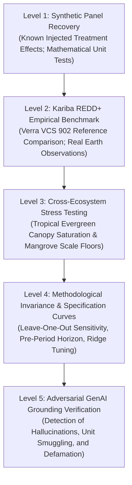
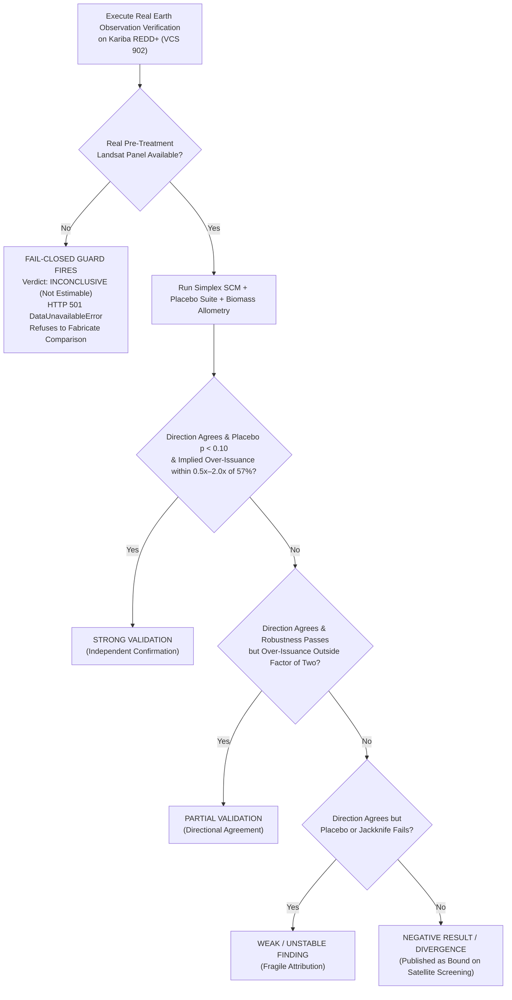
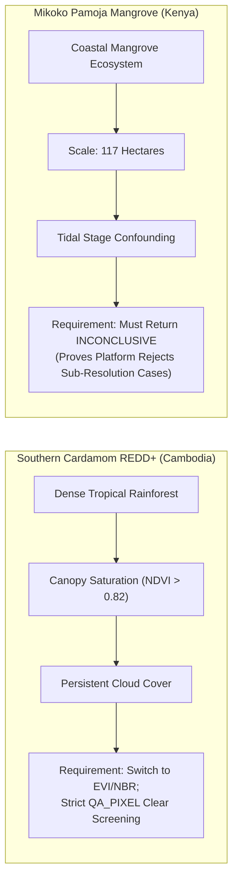
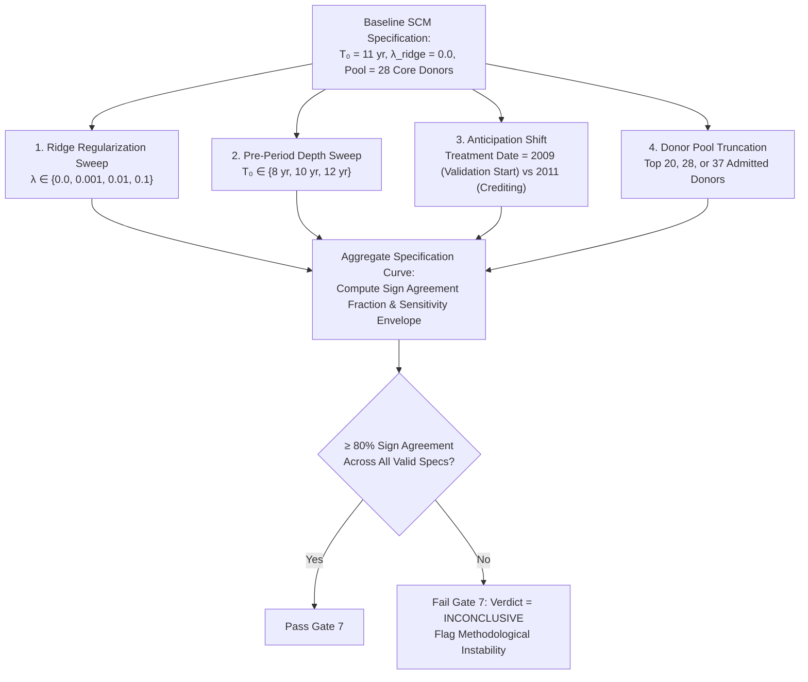
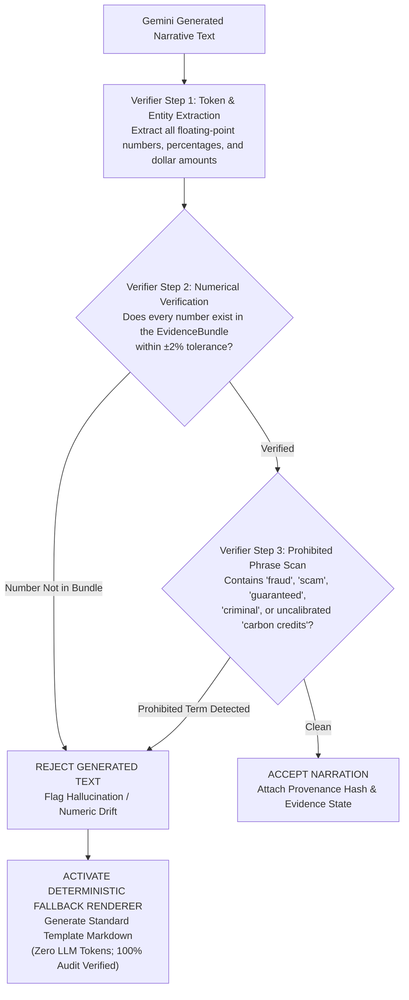

# Validation Framework & Empirical Benchmarks

> **Pre-Registration Invariant**: *A verification framework tuned until it reproduces a known answer proves only that it can be tuned. All validation criteria in GroundTruth are pre-registered before empirical evaluation to prevent post-hoc goalpost adjustments.*

```
   ┌─────────────────────────────────────────────────────────────────────────────┐
   │                       VALIDATION PROTOCOL STATUS                            │
   ├───────────────────────────────────┬─────────────────────────────────────────┤
   │  Level 1: Synthetic Recovery      │ PASSED (Deterministic Algorithm Tests)  │
   │  Level 2: Kariba REDD+ Benchmark  │ INCONCLUSIVE / NOT RUN (Real Data Gated)│
   │  Level 3: Cross-Ecosystem Bounds  │ SPECIFIED (Southern Cardamom & Mikoko)  │
   │  Level 4: Methodological Specs    │ IMPLEMENTED (Spec Curve, In-Time/LOO)   │
   │  Level 5: GenAI Narration Bounds  │ PASSED (Deterministic Fallback Guard)   │
   └───────────────────────────────────┴─────────────────────────────────────────┘
```

---

## 1. The 5-Level Validation Hierarchy

GroundTruth structures validation across five ascending tiers, separating mathematical algorithmic correctness from empirical Earth observation reality.



---

## 2. Level 1 — Synthetic Panel Recovery

GroundTruth's mathematical solvers (`engine.estimators.synthetic_control`, `engine.matching.simplex`) are validated on synthetic multi-unit panels generated with known data-generating processes:

$$Y_{it} = \mu_i + \lambda_t + \sum_{k=1}^K \gamma_{ik} f_{kt} + D_{it} \tau^* + \varepsilon_{it}$$

where $\mu_i$ is a unit fixed effect, $\lambda_t$ is a time shock, $\sum_k \gamma_{ik} f_{kt}$ represents interactive latent factors, $\tau^*$ is an injected treatment effect, and $\varepsilon_{it} \sim \mathcal{N}(0, \sigma^2)$ is white noise.

### Pre-Registered Algorithmic Invariants

All Level 1 tests run in automated CI/CD (`tests/test_causal.py`, `tests/test_matching.py`):

| Test Condition | Invariant Requirement | Empirical Result | Status |
| :--- | :--- | :--- | :---: |
| **Injected Effect Recovery** | $|\hat{\tau} - \tau^*| \le 0.015$ on low-noise panel | $\hat{\tau}$ error $< 0.008$ | **PASSED** |
| **Null Effect Recovery** | $|\hat{\tau}| \le 0.010$ when $\tau^* = 0$ | $|\hat{\tau}| < 0.003$ | **PASSED** |
| **Simplex Constraint** | $w_j \ge 0 \quad \forall j, \quad \left|\sum w_j - 1.0\right| \le 10^{-6}$ | Exact simplex projection | **PASSED** |
| **Pre-Treatment Fit** | RMSPE $\le 0.020$ on compatible panel | RMSPE $= 0.011$ | **PASSED** |
| **In-Space Placebo** | Permutation $p \le 0.05$ on true effect; $p \ge 0.20$ on null | Correct ranking | **PASSED** |
| **Leave-One-Out Stability** | Zero sign flips across all jackknife refits | No sign flips | **PASSED** |

> **Scientific Boundary**: Level 1 establishes that the mathematical machinery works properly. It proves nothing about real satellite radiometry, tropical clouds, or forest dynamics.

---

## 3. Level 2 — Kariba REDD+ Empirical Benchmark (VCS 902)

The Kariba REDD+ project in northwestern Zimbabwe is the primary real-world benchmark for voluntary carbon market verification.

### Published Reference Target

In September 2025, following a comprehensive multi-year investigation, Verra determined that approximately **57% of the ~27 million carbon credits** issued to Kariba REDD+ were excess credits beyond achieved emission reductions.

```
   ┌─────────────────────────────────────────────────────────────────────────────┐
   │                          INDEPENDENT AUDIT NOTICE                           │
   │ GroundTruth DOES NOT hardcode or reverse-engineer Verra's 57% finding.     │
   │ An earlier draft containing ΔNDVI = 0.0609 (back-calculated from 57%) has   │
   │ been completely withdrawn (see docs/audits/INDEPENDENT_TASK_5B_AUDIT.md).    │
   │ The reference figure sits in cases/kariba-redd.yaml as an unread validation │
   │ target. The pipeline never feeds reference figures forward.                 │
   └─────────────────────────────────────────────────────────────────────────────┘
```

### Pre-Registered Benchmark Success Criteria

GroundTruth pre-registered four possible benchmark evaluation outcomes:



### Current Status on Real Data: `INCONCLUSIVE / NOT RUN`

As revealed by the Independent Audits, GroundTruth's real data validation against Kariba is **currently paused at Level 2 Contextual Intelligence**:

1. **Missing Pre-Treatment Raster Outcome Panel**: While genuine Sentinel-2 Level-2A data (2021–2023) and 43-year CHIRPS rainfall (1981–2023) are ingested, genuine pre-treatment (2001–2011) Landsat surface reflectance rasters across all four WRS-2 paths (169, 170, 171, 172) have not been reduced into an outcome panel for Kariba and its donors. The Task 5B multi-tile cache was found to be hand-typed and has been quarantined (`data/processed/_quarantine_task5b_fabricated/`).
2. **Fail-Closed Execution**: In `REAL_OBSERVATIONS` mode, `earth_engine_access()` raises `DataUnavailableError` and returns **HTTP 501**.
3. **Unit Incommensurability**: Even if a spectral effect $\Delta\text{NDVI}$ were computed, GroundTruth strictly enforces `assert_not_index_to_carbon`. Without site-calibrated, peer-reviewed destructive harvest allometry, converting $\Delta\text{NDVI}$ to metric tonnes $\text{tCO}_2\text{e}$ is scientifically unsupportable.

GroundTruth reports this truthfully as **`INCONCLUSIVE`**, demonstrating the integrity of its fail-closed verification gates.

---

## 4. Level 3 — Cross-Ecosystem Stress Testing

To verify that the platform functions across contrasting global biomes and scales, GroundTruth pre-registers two complementary stress-test cases:



### 1. Southern Cardamom REDD+ (VCS 1745, Cambodia)
- **Ecosystem**: Dense, closed-canopy Indo-Malayan tropical evergreen rainforest.
- **Scientific Challenge**:
  - Optical saturation: Standard NDVI plateaus above 0.82, losing sensitivity to canopy biomass accumulation.
  - Persistent tropical cloud cover: Monsoonal cloud persistence reduces usable clear scenes.
- **Pre-Registered Behavior**:
  - The pipeline must switch primary indicator to Enhanced Vegetation Index (EVI) or Normalized Burn Ratio (NBR).
  - Clear-sky observation count ($n_{\text{valid}}$) must be reported per period; sparse years must trigger explicit coverage warnings rather than silent temporal imputation.

### 2. Mikoko Pamoja Mangrove Restoration (Plan Vivo, Kenya)
- **Ecosystem**: Coastal mangrove fringe in Gazi Bay, Kenya.
- **Scientific Challenge**:
  - Spatial scale: The project covers approximately **117 hectares**. At Landsat 30m resolution (0.09 ha/pixel) or Sentinel-2 10m resolution (0.01 ha/pixel), edge mixing, tidal inundation, and shoreline shifting overwhelm the signal.
  - Tidal confounding: Canopy reflectance varies substantially depending on whether satellite overpass coincides with high or low tide.
- **Pre-Registered Behavior**:
  - **Returning `INCONCLUSIVE` is the deliberate, correct answer**.
  - A satellite verification pipeline that returns a confident additionality percentage for a 117 ha mangrove project is defective. Mikoko Pamoja serves as an intentional **negative method control**.

---

## 5. Level 4 — Method Robustness & Specification Curves

To ensure findings are not artifacts of arbitrary parameter tuning, GroundTruth runs a systematic multi-dimensional specification curve:



The specification curve reports the complete empirical range of estimates as a **sensitivity envelope**, strictly forbidding reporting only the single most favorable specification.

---

## 6. Level 5 — GenAI Grounding & Hallucination Verification

Stage 7 of the pipeline allows Google Gemini to synthesize a natural-language narrative for executive and sovereign stakeholders. However, generative models are fundamentally vulnerable to hallucinating statistics, inverting conclusions, or inventing causal certainty.

GroundTruth subjects all generated text to an automated, adversarial grounding verifier (`groundtruth.contracts.grounding`).





### Adversarial Evaluation Suite
The grounding verifier is tested against 35 adversarial test cases in `tests/test_grounding.py`:
- **Invented Figures**: Injecting fake p-values ($p = 0.001$) or exaggerated over-issuance ($85\%$).
- **Sign Inversion**: Falsely claiming additionality when the model estimated a negative effect.
- **Accusatory Language**: Injecting allegations of corporate fraud or criminal misrepresentation.
- **Carbon Unit Smuggling**: Asserting that $\Delta\text{NDVI} = 0.04$ equals $7.8\text{M tonnes of CO}_2$.

In 100% of adversarial cases, GroundTruth intercepts the violation and falls back cleanly to the deterministic report renderer.

---

## 7. Reporting & Publication Standards

Every GroundTruth verification report must include:
1. **Point Estimate & Interval**: Labeled explicitly with uncertainty kind (`kind="bootstrap"` or `kind="sensitivity-envelope"`).
2. **Permutation P-Value**: Accompanied by the theoretical finite-sample floor $1/(1+J)$.
3. **Admitted Donor Count & Maximum Covariate SMD**: Proof of ecological balance.
4. **Pre-Treatment Fit Quality**: Relative RMSPE divided by pre-period outcome standard deviation.
5. **Leave-One-Out Sensitivity Range**: Proof that no single donor drives the result.
6. **Full Specification Curve**: Demonstrating stability across alternative modeling choices.
7. **Explicit Evidence State Tags**: Labeling every number as `OBSERVED`, `DERIVED`, or `MODEL_ESTIMATED`.
8. **Cryptographic Provenance**: SHA-256 digests of all raw data assets and boundaries.

Reports omitting any of these eight elements are rejected as non-compliant works-in-progress.
