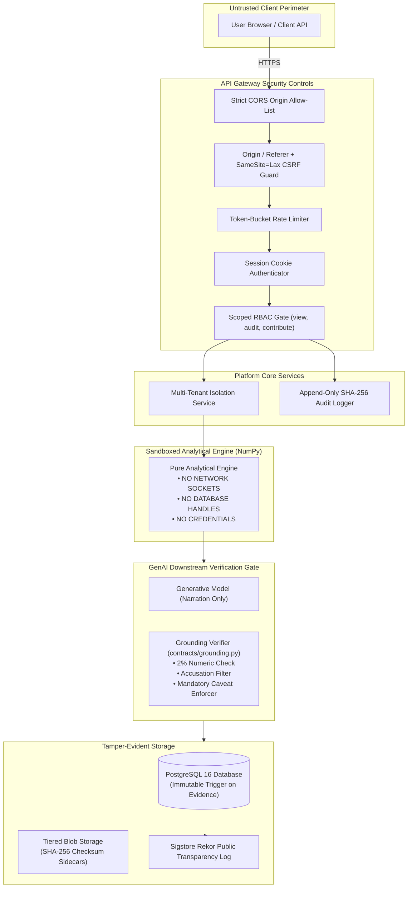
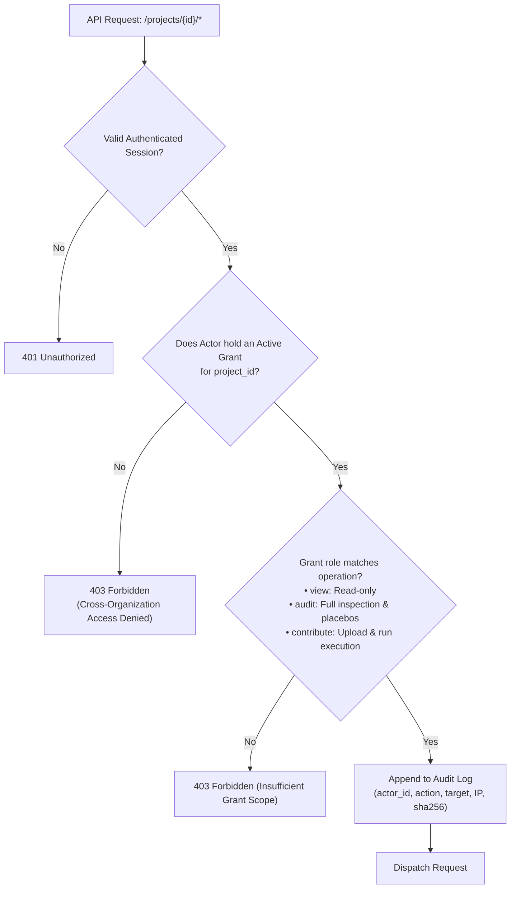
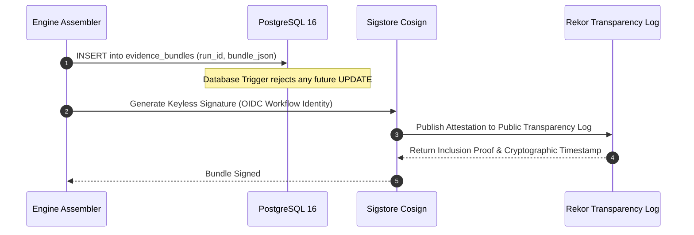

# Security Architecture

**Domain**: Platform Security, Multi-Tenant Isolation, Cryptographic Integrity  
**Implementation**: `groundtruth.platform.auth`, `groundtruth.platform.tenancy`, `groundtruth.provenance`

The primary failure mode GroundTruth 2.0 defends against is not merely conventional data exfiltration or injection attacks. The catastrophic failure mode is **the system producing an ungrounded, fabricated, or mathematically manipulated carbon additionality verdict that misleads regulatory authorities or capital markets**.




---

## 1. Trust Boundaries & Seams

GroundTruth 2.0 establishes four distinct security rings:

### 1.1 The Engine Sandbox (Ring 0)
The analytical engine (`groundtruth.engine`) is architecturally sandboxed by design:
- Opens **zero network sockets**.
- Reads **zero filesystem paths** or environment variables.
- Holds **zero API keys or database connection strings**.
The engine cannot leak a credential or exfiltrate customer data because it never possesses credentials or network capabilities.

### 1.2 The Platform Gateway (Ring 1)
The FastAPI gateway (`groundtruth.platform.api`) terminates client TLS, validates session cookies, enforces tenant organization scoping, and logs append-only audit records.

### 1.3 The Generative Narration Boundary (Ring 2)
The model receives only the verified `EvidenceBundle` and the deterministic report. It is never exposed to raw user documents, untrusted HTML, or unvalidated datasets, removing direct prompt-injection vectors by construction.

### 1.4 Persistent Storage & Audit Log (Ring 3)
Database rows in `evidence_bundles` are guarded by PostgreSQL triggers that reject all `UPDATE` commands. Re-running an analysis creates a new `run_id`, guaranteeing an append-only historical audit trail.

---

## 2. Multi-Tenant Organization Isolation & Scoped Grants

GroundTruth 2.0 strictly enforces tenant boundary separation. A user belongs to one or more Organizations, and receives explicit Grants to individual Projects:



### 2.1 Cross-Organization Isolation
Any attempt to access a project, evidence bundle, or donor candidate matrix belonging to another organization without an explicit grant triggers an immediate HTTP 403 Forbidden error:

```json
{
  "code": "cross_organization_denied",
  "message": "User does not possess an active grant for the requested project.",
  "project_id": "proj_9b8a...",
  "actor_organization": "org_auditor_alpha"
}
```

---

## 3. Secrets Management & Credential Hygiene

- **Strongly Typed `SecretStr`**: All credentials (database passwords, STAC API tokens, cloud storage keys) are wrapped in Pydantic's `SecretStr`. They cannot be serialized into logs or exception traces.
- **`groundtruth doctor` Diagnostic Tool**: Validates whether external credentials are present without displaying string values.
- **Git Commit Immunity**: CI scans all pull requests for committed tokens using pre-commit hooks and SecretLint. If a key is accidentally committed, the key must be **rotated at the upstream provider immediately**, rather than merely scrubbing git history.

---

## 4. Evidence Integrity & Cryptographic Attestation

To guarantee that evidence bundles cannot be altered by rogue administrators or compromised database hosts:



- **Canonical JSON Hashing**: Bundles are serialized according to RFC 8785 (deterministic key sorting, strict float formatting, zero superfluous whitespace) and hashed via SHA-256.
- **Sigstore Cosign Attestation**: Keyless signatures link the published evidence manifest directly to the GitHub Actions workflow identity and git commit SHA that produced it.


