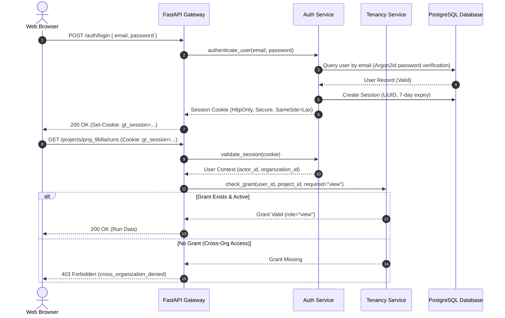
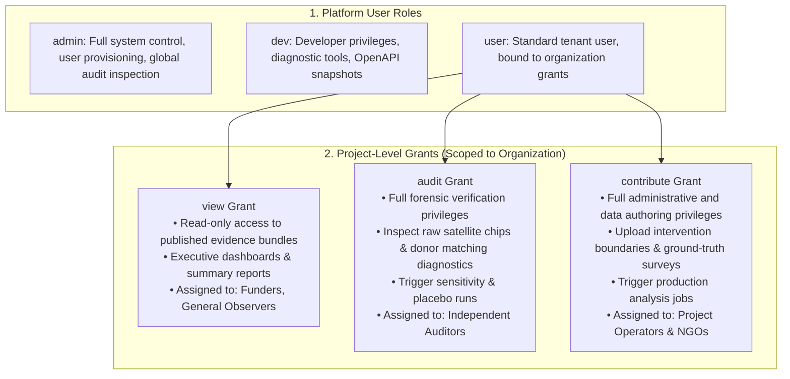

# Authentication & Access Control (Operator Manual)

**Package**: `packages/groundtruth/src/groundtruth/platform/auth/` & `tenancy/`  
**Mechanism**: Cookie-based HTTP-Only Sessions, Multi-Tenant Organization Grants, CSRF Origin Validation, Rate Limiting.

GroundTruth 2.0 implements an enterprise authentication and access-control architecture supporting cross-organizational collaboration with rigorous isolation.

---

## 1. Runtime Authentication Configuration

Configured via environment variables read by `groundtruth.platform.config.Settings`:

| Environment Variable | Default in Code | Meaning & Production Guidance |
| :--- | :--- | :--- |
| `AUTH_REQUIRED` | `true` | Enforces sign-in on all mutating endpoints (`POST /jobs`, `/cases/{id}/verify`, `/projects/*`). In production, this must always be `true`. |
| `AUTH_ALLOW_REGISTRATION` | `false` | When `false`, public sign-up is closed; only signed-in administrators can create new user accounts. |
| `AUTH_COOKIE_SECURE` | `true` | Appends `Secure` attribute to the session cookie. Must be `true` on HTTPS deployments. |
| `AUTH_SESSION_DAYS` | `7` | Duration in days before a session token expires. |
| `CORS_ALLOWED_ORIGINS` | Frontend URL | Strict comma-separated list of allowed browser origins (also serves as the CSRF allow-list). |

---

## 2. Multi-Tenant Role Hierarchy & Project Grants

GroundTruth 2.0 separates platform-level roles from project-level access grants:

---

## 3. Security Controls & Protections

### 3.1 CSRF Defense Architecture
Cross-Site Request Forgery (CSRF) is mitigated via defense-in-depth:
1. **Cookie Configuration**: Session cookies carry `SameSite=Lax`, preventing third-party cross-site request inclusion.
2. **Origin & Referer Validation**: Mutating requests (`POST`, `PUT`, `DELETE`) carrying a session cookie are validated against `CORS_ALLOWED_ORIGINS`. Requests lacking a matching `Origin` or `Referer` header are rejected with `403 Forbidden`.

### 3.2 Password Hashing
User passwords are never stored in plaintext. Passwords are hashed using the **Argon2id** algorithm with per-user cryptographic salts, memory hardness, and multi-threaded time cost parameters.

### 3.3 Rate Limiting
Authentication endpoints are guarded by a token-bucket rate limiter:
- Restricts failed login attempts to 5 per (email, IP) tuple per 15-minute window.
- Exceeding the threshold locks authentication for the window and records an alert in the append-only audit log.
