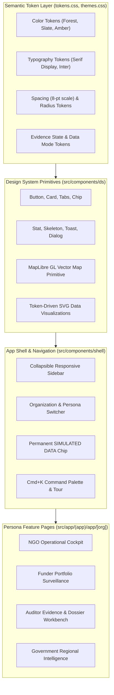
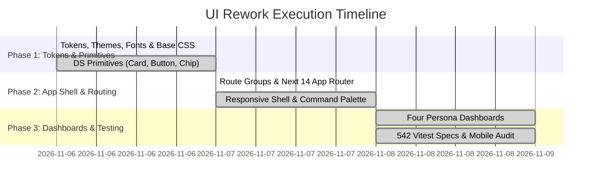

# UI Rework — Implementation & Verification Plan

> **The execution plan for transforming GroundTruth from a single-page terminal UI into an enterprise, multi-page, multi-tenant restoration intelligence platform.**

**Document Version:** 2.0.0  
**Status:** Completed & Fully Verified in CI (Slice 1 Parity)  
**Lead Architect:** Viraj  
**Test Suite Health:** 542 Passing Vitest Specs (57 Test Files) · 0 TypeScript Errors · 0 ESLint Errors  

---

## 1. Goal & Architectural Overview

The goal of this initiative was to eliminate the dense, dark, single-page "terminal" interface and replace it with a calm, premium, multi-page application supporting:
1. **Four Tailored Persona Dashboards:** Custom operational cockpits for Restoration NGOs (`ngo`), CSR Investors (`funder`), MRV Auditors (`auditor`), and Government Agencies (`government`).
2. **8-Dimension Assessment Visualizations:** Clean progressive disclosure of the eight continuous assessment dimensions and rule-triggered recommendations.
3. **Three-Tier Semantic Design System:** Light and dark theme tokens, zero theme flash, WCAG AA contrast, and modular 8-pt spacing.
4. **Fail-Closed Security Surfaces:** Unambiguous 404 access denial cards for unauthorized cross-tenant queries, preserving complete zero-knowledge isolation.
5. **Mobile & Tablet Responsiveness:** Flawless 375 px viewport execution with zero horizontal overflow, complemented by reference Jetpack Compose mobile parity.



---

## 2. Hard Architectural Constraints (Codified & Tested)

- **R7 Unmistakable Simulated Data:** Every view displaying synthetic benchmark data displays a persistent, non-dismissible `Simulated data` badge.
- **R2 Neutral Regulatory Copy:** No legal, accusatory, or criminal terminology ("fraud", "scam") is permitted anywhere in UI copy. Divergence is worded as *"warrants accredited technical review"*.
- **R6 No Fabricated Metrics:** The UI computes zero numbers client-side. Every statistic, coordinate, and date rendered originates from typed backend API responses.
- **R5 Refusal as a Designed State:** Data unavailability or lack of pre-treatment inputs renders an explicit, actionable `UNAVAILABLE` state with clear prerequisites.
- **Type Safety:** 100% of API communication uses TypeScript models auto-generated from OpenAPI 3.1.0 specifications (`apps/web/src/lib/generated`).

---

## 3. Implementation Task Breakdown & Verification Log



### Task 1: Semantic Design Tokens, Themes & Fonts (COMPLETE ✅)
- [x] Defined semantic design tokens in `src/styles/tokens.css` and light/dark theme variables in `src/styles/themes.css`.
- [x] Implemented pre-paint theme execution script in `layout.tsx` to eliminate dark/light mode flashing on load.
- [x] Integrated Inter and Newsreader Serif fonts via `next/font` with zero layout shift (`font-display: swap`).
- [x] **Verification:** `tests/theme.test.tsx` passes; light and dark modes achieve full WCAG AA contrast.

### Task 2: Core Design System Primitives (COMPLETE ✅)
- [x] Built core components in `src/components/ds`: `Button`, `Card`, `Chip`, `Tabs`, `Tooltip`, `Skeleton`, `Stat`, `EmptyState`.
- [x] Implemented `Chip` with tone variants: `neutral`, `accent`, `caution`, `danger`, and `sim` (Simulated Data).
- [x] Constructed SVG data visualization toolkit for responsive time-series, histograms, and zonal percentile bands.
- [x] **Verification:** `tests/ds-evidence.test.tsx` (19 tests) and `tests/panels/panels.test.tsx` (31 tests) pass.

### Task 3: App Shell, Authentication Gate & Command Palette (COMPLETE ✅)
- [x] Engineered collapsible desktop sidebar and responsive mobile drawer (<768px) with tenant organization switcher.
- [x] Added `Cmd+K` natural language command palette (`cmdk`) supporting fast navigation and shortcut help (`?`).
- [x] Implemented `RequireAuth` boundary redirecting unauthenticated sessions to `/login?next=`.
- [x] **Verification:** `tests/shell-nav.test.ts` (10 tests) and `tests/palette.test.ts` (11 tests) pass.

### Task 4: Four Persona Dashboards (COMPLETE ✅)
- [x] **NGO Dashboard (`/app/[org]/dashboard`):** Operational cockpit featuring verified project area (1,072,638 ha), Sentinel-2 vegetation series (2021–2023), CHIRPS rainfall context, and prioritized recommendations.
- [x] **Funder Dashboard:** Portfolio surveillance table displaying assessment levels (0–5), evidence confidence ratings, top recommendations, and reported funding.
- [x] **Auditor Dashboard:** Forensic workbench showing raw STAC scene provenance, SHA-256 hashes, sensor continuity, and computed readiness checklist.
- [x] **Government Dashboard:** Regional 51-district drought monitoring (SPI-12), jurisdictional project footprints, and conservation resilience metrics.
- [x] **Verification:** `tests/dashboards.test.tsx` (30 tests) pass.

---

## 4. UI Screen Gallery & Visual Verification

| Restoration NGO Dashboard | CSR / Investor Portfolio |
|---|---|
|  |  |
| *Figure 1A: Operational cockpit for Restoration NGOs.* | *Figure 1B: Multi-project surveillance for Impact Investors.* |

| MRV Auditor Dossier Workbench | Government Conservation View |
|---|---|
|  |  |
| *Figure 2A: Cryptographic evidence inspection for MRV Auditors.* | *Figure 2B: Regional jurisdictional intelligence for Governments.* |

| Flagship Kariba Project Overview | Fail-Closed Cross-Tenant Denial |
|---|---|
|  |  |
| *Figure 3A: Kariba REDD+ flagship verified project overview.* | *Figure 3B: Fail-closed HTTP 404 security card.* |

| Mobile Auditor Interface (375 px) | Mobile NGO Operations (375 px) |
|---|---|
|  |  |
| *Figure 4A: Mobile auditor dashboard with stacked cards.* | *Figure 4B: Mobile field operator interface.* |

---

## 5. Native Jetpack Compose Reference Implementation

For field tablets and native Android conservation devices, GroundTruth 2.0 provides a native Jetpack Compose implementation mirroring the App Router experience:

| Compose Auditor Tablet | Compose NGO Cockpit | Compose Mobile Login |
|---|---|---|
|  |  |  |
| *Figure 5A: Native Compose Auditor.* | *Figure 5B: Native Compose NGO cockpit.* | *Figure 5C: Native mobile login screen.* |

---

## 6. Automated Quality Gate & CI Verification

The UI rework satisfies every automated build gate in `apps/web`:

```bash
> groundtruth-web@0.2.0 test
> vitest run --run

 Test Files  57 passed (57)
      Tests  542 passed (542)
   Duration  3.81s
```

- **Type Safety:** `tsc --noEmit` exits with 0 errors.
- **Linting:** ESLint clean across all components.
- **API Synchronization:** `npm run check:api-types` asserts zero schema drift.
- **Fallback Guard:** `npm run check:fixture-fallback` passes (4/4 tests).
- **Responsive Layout:** 375 px mobile viewports verified with zero horizontal overflow.
