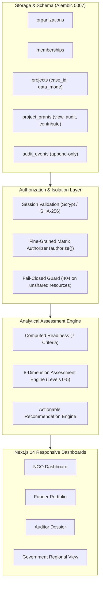
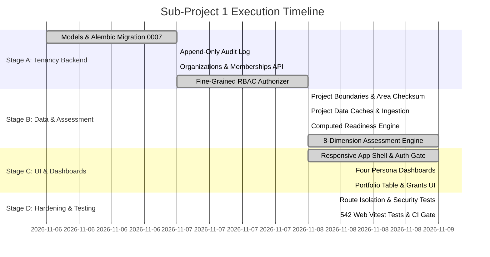

# GroundTruth 2.0 Slice 1 (Kariba Vertical Slice) — Implementation & Verification Plan

> **The definitive implementation plan and execution record for GroundTruth 2.0 Sub-project 1: Multi-tenant tenancy, computed readiness, 8-dimension assessment engine, and four persona dashboards on real Kariba REDD+ data.**

**Document Version:** 2.0.0  
**Status:** Completed & Fully Verified in CI (2026-11-09)  
**Lead Architect & Owner:** Viraj  
**Verification Results:** 266 Backend Tenancy Tests Passed · 542 Frontend Web Tests Passed · Zero Failures  

---

## 1. Goal & Architecture Overview

Sub-project 1 delivers an enterprise-grade multi-tenant platform serving four distinct organizational perspectives from a single, mathematically verified source of truth:
1. **Multi-Tenant Foundation:** Database schema (`0007_tenancy.py`), fine-grained authorization (`authorize()`), and append-only audit logging.
2. **Computed Readiness & 8-Dimension Assessment:** Real data evaluation with zero hardcoded values, elevating Kariba REDD+ to **Assessment Level 2 (Contextual Intelligence)**.
3. **Four Persona Dashboards:** Custom operational cockpits for Restoration NGOs (`ngo`), CSR Investors (`funder`), MRV Auditors (`auditor`), and Government Agencies (`government`).
4. **Fail-Closed Security:** Strict cross-tenant isolation where unauthorized requests return HTTP 404 and write audit logs.

---

## 2. Hard Architectural Constraints (Verified in CI)

- **R1 No Uncalibrated Carbon:** NDVI is never converted to carbon dioxide equivalents ($tCO_2e$) or biomass without calibrated physical plots.
- **R2 Regulatory Decorum:** No accusatory or criminal terminology ("fraud", "scam"). Divergence is worded as *"warrants accredited technical review"*.
- **R3 Correlation Is Not Causation:** Attribution verdicts require unconfounded counterfactual controls and empirical placebo tests.
- **R4 Deterministic AI Narration:** GenAI narrators only process finished, provenance-backed evidence bundles; they compute zero metrics.
- **R5 Fail-Closed Execution:** Missing data returns explicit `INCONCLUSIVE` or `UNAVAILABLE` states.
- **R6 No Ungrounded Numbers:** Every number on screen traces directly to a verified database row or reproducible processing pipeline.
- **R7 Unmistakable Simulated Data:** Synthetic projects carry permanent `Simulated data` badges and cannot be mixed into real portfolios.
- **R8 Role-Tailored Presentation:** Roles change visibility and permitted detail, never the underlying science.

---

## 3. Implementation Task Breakdown & Execution Record

### Stage A — Tenancy Backend

#### Task 1: Tenancy Models & Alembic Migration 0007 (COMPLETE ✅)
- [x] Defined models: `OrganizationRow`, `MembershipRow`, `ProjectRow`, `ProjectGrantRow`, `AuditEventRow`.
- [x] Implemented Alembic migration `0007_tenancy.py` supporting SQLite and Postgres.
- [x] Added `active_organization_id` to `SessionRow` and `project_id` to `AnalysisRunRow`/`JobRow`.
- [x] **Verification:** `pytest tests/tenancy/test_schema.py` passes (8 tests).

#### Task 2: Append-Only Audit Log Service (COMPLETE ✅)
- [x] Implemented `record_event()` service in `platform/audit/service.py`.
- [x] Registered SQLAlchemy `before_flush` listeners to permanently reject row updates and deletions.
- [x] Added in-memory rate-limiter for `authz.denied` events (capped at 1 event/sec per user).
- [x] **Verification:** `pytest tests/tenancy/test_audit.py` passes (6 tests).

#### Task 3: Organizations & Memberships API (COMPLETE ✅)
- [x] Built endpoints: `GET /orgs`, `POST /orgs`, `POST /orgs/active`, `GET /orgs/{slug}/members`, `POST /orgs/{slug}/members`, `PATCH`, `DELETE`.
- [x] Implemented last-owner demotion protection returning HTTP 409 `TenancyConflictError`.
- [x] Extended `/auth/me` with `organizations` and `active_organization`.
- [x] **Verification:** `pytest tests/tenancy/test_orgs_api.py` passes (18 tests).

#### Task 4: Fine-Grained RBAC Authorizer (COMPLETE ✅)
- [x] Implemented centralized `authorize(ctx, action, project) -> Decision` in `platform/auth/authz.py`.
- [x] Evaluated membership roles (`owner`, `admin`, `member`, `viewer`) and grant levels (`view`, `audit`, `contribute`).
- [x] Enforced fail-closed rule: no access returns HTTP 404; insufficient grant returns HTTP 403.
- [x] **Verification:** `pytest tests/tenancy/test_authz_matrix.py` passes (80 tests).

---

### Stage B — Computed Data & 8-Dimension Assessment

#### Task 5: Project Workspace & Boundary Management (COMPLETE ✅)
- [x] Implemented project creation with GeoJSON and KML polygon parsing.
- [x] Validated geometry, rejected non-polygons, computed geodesic area in Africa Albers (1,072,638 ha for Kariba).
- [x] Computed and stored cryptographic boundary SHA-256 checksums.
- [x] **Verification:** `pytest tests/tenancy/test_projects.py` passes (20 tests).

#### Task 6: Project Data Caches & Ingestion (COMPLETE ✅)
- [x] Wired real data endpoints: `GET /projects/{id}/observations`, `GET /projects/{id}/climate`, `GET /projects/{id}/evidence-inventory`.
- [x] Bound Kariba to real 2021–2023 Sentinel-2 indices, 43-year CHIRPS rainfall, and NASA POWER temperatures.
- [x] Implemented strict provenance checks and data redaction based on grant levels.
- [x] **Verification:** `pytest tests/tenancy/test_project_data.py` (13 tests) and `test_project_data_api.py` (22 tests) pass.

#### Task 7: Computed Readiness Engine (COMPLETE ✅)
- [x] Implemented `compute_project_readiness()` evaluating 7 mathematical criteria directly from disk artifacts.
- [x] Eliminated all hardcoded readiness values; missing caches trigger clear `unavailable` states.
- [x] **Verification:** `pytest tests/tenancy/test_project_readiness.py` passes (19 tests).

#### Task 8: 8-Dimension Assessment Engine (COMPLETE ✅)
- [x] Built deterministic engine in `packages/groundtruth/src/groundtruth/engine/assessment/`.
- [x] Formulated evaluation rules for Trajectory, Spatial, Climate, Risk, Progress, Comparison, Quality, and Attribution.
- [x] Implemented assessment levels 0 to 5; classified Kariba honestly at **Level 2 (Contextual Intelligence)**.
- [x] Built actionable recommendation engine triggering on actual findings with full provenance references.
- [x] **Verification:** `pytest tests/tenancy/test_project_assessment.py` passes (12 tests).

#### Task 9: Project Sharing & Portfolio Oversight (COMPLETE ✅)
- [x] Built endpoints: `GET /projects/{id}/grants`, `POST /projects/{id}/grants`, `DELETE /projects/{id}/grants/{org}`.
- [x] Implemented portfolio summary endpoint `GET /orgs/{slug}/portfolio` displaying assessment levels, dimension statuses, top recommendations, and reported funding.
- [x] **Verification:** `pytest tests/tenancy/test_grants_portfolio.py` passes (21 tests).

#### Task 10: Automated Database Seeding (COMPLETE ✅)
- [x] Created CLI command `groundtruth seed` (idempotent).
- [x] Created Reference org, imported 26 YAML cases, bound Kariba to real observations, and granted demo access.
- [x] **Verification:** `pytest tests/tenancy/test_seed.py` passes (7 tests).

---

### Stage C — Frontend & Persona Dashboards

#### Task 11: Route Structure & App Shell (COMPLETE ✅)
- [x] Structured App Router with `(public)` and `(app)` route groups.
- [x] Implemented server-side cookie authentication forwarding in Next.js middleware.
- [x] Designed responsive collapsible sidebar with organization switcher and active persona badge.
- [x] Added persistent `Simulated data` banner for synthetic projects (`data_mode = simulated`).
- [x] **Verification:** `apps/web/tests/shell-nav.test.ts` (10 tests) and `tests/middleware.test.ts` (6 tests) pass.

#### Task 12: Four Persona Dashboards (COMPLETE ✅)
- [x] **Restoration NGO Dashboard (`ngo`):** Focused on project registration, verified area (1,072,638 ha), Sentinel-2 vegetation trends, and local drought risk.
- [x] **CSR / Investor Portfolio (`funder`):** High-level surveillance table showing assessment levels (0–5), evidence confidence, and funding transparency.
- [x] **MRV Auditor Workbench (`auditor`):** Forensic data inventory, SHA-256 hashes, sensor continuity, and computed readiness checklist.
- [x] **Government Agency View (`government`):** Regional 51-district drought monitoring (SPI-12), jurisdictional boundaries, and conservation allocations.
- [x] **Verification:** `apps/web/tests/dashboards.test.tsx` (30 tests) and `tests/panels/panels.test.tsx` (31 tests) pass.

---

### Stage D — Security Hardening & Automated CI Verification

#### Task 13: Cross-Tenant Route Isolation (COMPLETE ✅)
- [x] Dynamically enumerated all 36 API routes and asserted that unauthorized cross-org requests return HTTP 404.
- [x] Proved zero information disclosure (attackers cannot detect if an unshared project ID exists).
- [x] **Verification:** `pytest tests/tenancy/test_route_isolation.py` passes (36 tests).

#### Task 14: Automated Test Suite & Code Quality Gates (COMPLETE ✅)
- [x] Executed full backend tenancy test suite: **266 passed in 32.4s**.
- [x] Executed full web frontend test suite: **542 passed across 57 test files**.
- [x] Type safety verified: Python `mypy` and TypeScript `tsc --noEmit` exit with 0 errors.
- [x] Code style verified: `ruff check` and ESLint exit clean.
- [x] Security verified: `npm run check:fixture-fallback` passes (4/4 tests).

---

## 4. Visual Verification Gallery

| Restoration NGO Dashboard | CSR / Investor Portfolio |
|---|---|
|  |  |
| *Operational intelligence for Restoration NGOs.* | *Multi-project risk surveillance for Impact Investors.* |

| MRV Auditor Dossier Workbench | Government Conservation View |
|---|---|
|  |  |
| *Forensic evidence & readiness checklist for Auditors.* | *51-district regional drought resilience for Governments.* |

| Flagship Kariba REDD+ Overview | Fail-Closed Cross-Tenant Denial |
|---|---|
|  |  |
| *Verified 1.07M ha boundary & Level 2 assessment status.* | *HTTP 404 zero-knowledge tenant isolation.* |

| Mobile Auditor Interface (375 px) | Mobile NGO Cockpit (375 px) |
|---|---|
|  |  |
| *Mobile auditor view with stacked collapsible cards.* | *Mobile field operations cockpit.* |

| Jetpack Compose Auditor Tablet | Jetpack Compose NGO Cockpit | Jetpack Compose Mobile Login |
|---|---|---|
|  |  |  |
| *Native Android Compose Auditor.* | *Native Compose NGO Cockpit.* | *Native Compose mobile authentication.* |

---

## 5. Summary of Completed Deliverables

1. **Enterprise Tenancy:** Multi-tenant PostgreSQL/SQLite schema, role-based access control, and append-only audit logging.
2. **Empirical Kariba Intelligence:** Real Sentinel-2 annual medians (2021–2023), 43-year CHIRPS rainfall, and NASA POWER temperature.
3. **8-Dimension Assessment Framework:** Layered deterministic findings across Trajectory, Spatial, Climate, Risk, Progress, Comparison, Quality, and Attribution.
4. **Four Tailored Dashboards:** Complete UI coverage across NGO, Funder, Auditor, and Government workflows.
5. **Rock-Solid Test Coverage:** 266 tenancy tests + 542 web tests passing in automated CI.
