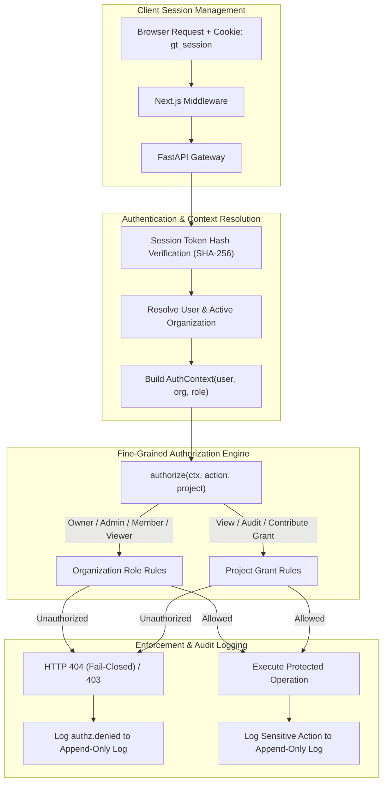
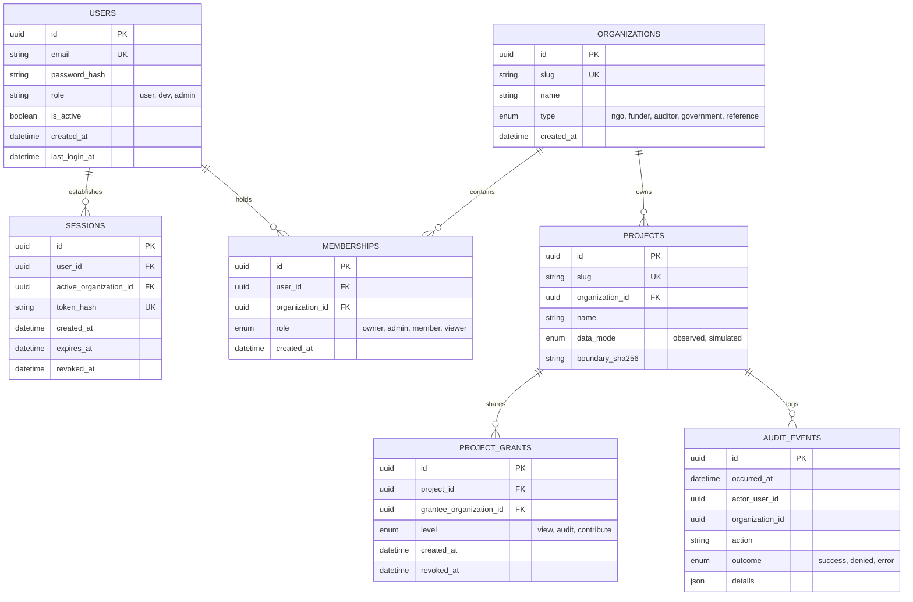

# Authentication & Multi-Tenant Authorization Design Specification

> **The architectural specification for cryptographic session authentication, multi-tenant organization switching, fine-grained RBAC authorization, and append-only audit logging in GroundTruth 2.0.**

**Document Version:** 2.0.0  
**Status:** Approved & Implemented (Alembic 0006 & 0007 Active)  
**Lead Architect:** Viraj  
**Test Suite Verification:** 266 Tenancy Tests Passing · 542 Web Vitest Tests Passing  

---

## 1. Architectural Intent & Scope

GroundTruth 2.0 provides an enterprise multi-tenant security architecture that guarantees complete tenant data isolation, role-based access control (RBAC), and tamper-proof auditability.



### Key Security Objectives:
1. **Self-Sovereign Authentication:** Native email/password authentication using Scrypt key derivation in PostgreSQL; no reliance on third-party identity brokers for core operations.
2. **Fail-Closed Cross-Tenant Isolation:** Unauthorized cross-organization URL requests return an HTTP 404, preventing project existence disclosure.
3. **Cryptographic Tamper-Proof Auditability:** Every sensitive security and evidentiary event is recorded in an append-only database table guarded by database-level triggers.

---

## 2. Multi-Tenant Data Model & Alembic Migrations

The security architecture is implemented across migrations `0006_auth.py` and `0007_tenancy.py`:



---

## 3. Cryptographic Security Standards

### 3.1. Password Hashing (Scrypt)
- **Algorithm:** `hashlib.scrypt` with parameters:
  - CPU/Memory Cost ($N$): $2^{15} = 32,768$
  - Block Size ($r$): $8$
  - Parallelization ($p$): $1$
  - Salt: 16 bytes of cryptographically secure random bytes (`os.urandom(16)`)
  - Key Length: 32 bytes
- **Storage Format:** `scrypt$32768$8$1$<salt_base64>$<hash_base64>`
- **Verification:** Constant-time comparison using `hmac.compare_digest` to prevent timing side-channel attacks.

### 3.2. Session Management & Opaque Tokens
- **Session Tokens:** 32-byte cryptographically secure random tokens generated via `secrets.token_urlsafe(32)`.
- **Database Storage:** The raw token is **never** stored in the database. Only its SHA-256 digest (`token_hash`) is indexed.
- **Cookie Security:**
  - Name: `gt_session`
  - Attributes: `HttpOnly`, `SameSite=Lax`, `Path=/`, `Max-Age=604800` (7 days).
  - Secure flag set conditionally when `AUTH_COOKIE_SECURE=true`.
- **Session Revocation:** Logging out sets `revoked_at` timestamp. Password changes immediately invalidate all active sessions for that user.

### 3.3. Brute-Force & Rate-Limiting Defenses
- **Sliding Window Rate Limiting:** Maximum 5 failed login attempts per `(email, client_ip)` pair within 15 minutes. Excess attempts return HTTP 429 `Too Many Requests`.
- **Constant-Time Rejection:** Unknown email addresses execute a dummy Scrypt computation to ensure uniform execution timing and prevent user enumeration.

---

## 4. Fine-Grained Authorization Matrix (RBAC + Grants)

Access control evaluates both internal organization membership roles and external project grants.

```mermaid
sequenceDiagram
    autonumber
    participant Client as Web Client / Browser
    participant API as FastAPI Router
    participant Authz as Authorizer (authorize())
    participant Audit as Append-Only Audit Service
    participant DB as Postgres / SQLite DB

    Client->>API: GET /projects/{id}/verification (Cookie: gt_session)
    API->>DB: Query Session, User, & Active Org Membership
    DB-->>API: Return User + Active Org (Funder) + Role (Member)
    API->>DB: Query Project & Active Grants for Funder Org
    DB-->>API: Project Owned by Reference Org; Grant = "view"
    API->>Authz: authorize(ctx, Action.VIEW_VERIFICATION, project)
    Authz-->>API: Decision: ALLOWED (Redact Causal Diagnostics)
    API->>Audit: record_event("project.view_verification", outcome="success")
    Audit-->>DB: Append-Only Flush
    API-->>Client: Return Redacted Verification JSON
```

### 4.1. Organization Role Capabilities

| Action | `owner` | `admin` | `member` | `viewer` |
|---|:---:|:---:|:---:|:---:|
| View Organization Dashboard & Project List | ✓ | ✓ | ✓ | ✓ |
| Create New Project & Ingest Boundary | ✓ | ✓ | ✓ | – |
| Trigger Analysis Run | ✓ | ✓ | ✓ | – |
| Manage Members (Add / Change Role / Remove) | ✓ | ✓ | – | – |
| Grant / Revoke Project Access | ✓ | ✓ | – | – |
| View Organization Audit Log | ✓ | ✓ | – | – |
| Delete Organization | ✓ | – | – | – |

*Rule:* An organization must retain at least one active `owner`. Attempting to demote or remove the last owner raises HTTP 409 `TenancyConflictError`.

### 4.2. Project Grant Capabilities

When an organization accesses a project owned by another organization via a grant:

| Project Resource | Owning Organization | `audit` Grant | `contribute` Grant | `view` Grant |
|---|:---:|:---:|:---:|:---:|
| Project Overview & Boundaries | ✓ | ✓ | ✓ | ✓ |
| 8-Dimension Assessment Overview | ✓ | ✓ | ✓ | ✓ |
| Real Observation Series (S2) | ✓ | ✓ | ✓ | ✓ |
| Real Climate Analytics (CHIRPS) | ✓ | ✓ | ✓ | ✓ |
| Full Scene Provenance & Hashes | ✓ | ✓ | ✓ | Redacted |
| Causal Diagnostics (SCM/Placebo) | ✓ | ✓ | – | – |
| Technical Dossier Export | ✓ | ✓ | – | – |
| Monitoring Report Export | ✓ | ✓ | ✓ | ✓ |

*Rule (Fail-Closed Isolation):* A user attempting to access a project without membership in the owning organization or an active project grant receives an HTTP **404 Not Found** (preventing project reconnaissance).


*Figure 1: Fail-closed tenant isolation. Unauthorized cross-tenant queries display an access-denied state without disclosing project existence.*

---

## 5. Append-Only Tamper-Proof Audit Log

The audit system records all security-relevant and evidence-sensitive operations in `audit_events`.

### 5.1. Database-Level Immobility
SQLAlchemy `before_flush` listeners permanently prohibit `UPDATE` or `DELETE` statements on `AuditEventRow`:

```python
@event.listens_for(Session, "before_flush")
def _enforce_append_only_audit(session: Session, flush_context, instances) -> None:
    for instance in session.dirty:
        if isinstance(instance, AuditEventRow):
            raise ProvenanceError("audit_events rows are immutable and cannot be updated")
    for instance in session.deleted:
        if isinstance(instance, AuditEventRow):
            raise ProvenanceError("audit_events rows are immutable and cannot be deleted")
```

### 5.2. Audited Actions
- `auth.login`, `auth.login_failed`, `auth.logout`, `auth.register`, `auth.password_change`
- `org.member_add`, `org.member_remove`, `org.member_role`, `org.switch`
- `project.create`, `project.update`, `project.grant`, `project.revoke`
- `run.start`, `run.cancel`, `export.download`
- `authz.denied` (rate-limited in memory to 1 event per second per user to prevent log saturation attacks)

---

## 6. API Endpoint Contracts

| Path | Auth | Request | Response | Audited |
|---|---|---|---|:---:|
| `POST /auth/register` | Open (if enabled) | `{email, password}` | 201 `UserView` + Cookie | ✓ |
| `POST /auth/login` | Open | `{email, password}` | 200 `UserView` + Cookie | ✓ |
| `POST /auth/logout` | Any | None | 204 No Content | ✓ |
| `GET /auth/me` | Any | None | `{user, organizations, active_organization}` | – |
| `POST /auth/change-password` | Signed-in | `{current_password, new_password}` | 204 No Content | ✓ |
| `GET /orgs` | Signed-in | None | `OrgView[]` | – |
| `POST /orgs` | Signed-in | `{name, type}` | 201 `OrgView` | ✓ |
| `POST /orgs/active` | Signed-in | `{slug}` | 200 `OrgView` | ✓ |
| `GET /orgs/{slug}/members` | Owner / Admin | None | `MemberView[]` | – |
| `POST /orgs/{slug}/members` | Owner / Admin | `{email, role}` | 201 `MemberView` | ✓ |
| `PATCH /orgs/{slug}/members/{id}` | Owner / Admin | `{role}` | 200 `MemberView` | ✓ |
| `DELETE /orgs/{slug}/members/{id}` | Owner / Admin | None | 204 No Content | ✓ |
| `GET /orgs/{slug}/audit` | Owner / Admin | Cursor query | `AuditEventView[]` | – |

---

## 7. Responsive Mobile Authentication & Parity

Authentication is verified across web viewports and native mobile implementations:

| Web Desktop & Mobile Auth Gate | Native Jetpack Compose Auth |
|---|---|
|  |  |
| *Fail-closed tenant boundary protection.* | *Native Jetpack Compose mobile authentication.* |

---

## 8. Verification & Test Suite Evidence

The authentication and authorization architecture is backed by comprehensive CI test suites:

- **Schema & Migrations:** `tests/tenancy/test_schema.py` (8 tests) verifies upgrade/downgrade cycles and check constraints.
- **Audit Immobility:** `tests/tenancy/test_audit.py` (6 tests) verifies append-only enforcement and rate limiting.
- **Organization API:** `tests/tenancy/test_orgs_api.py` (18 tests) verifies membership workflows and last-owner protection.
- **RBAC Matrix:** `tests/tenancy/test_authz_matrix.py` (80 tests) asserts all role × action and grant × capability permutations.
- **Route Isolation:** `tests/tenancy/test_route_isolation.py` (36 tests) verifies HTTP 404 return across all endpoints for unauthorized users.
