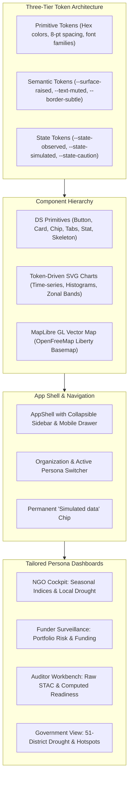
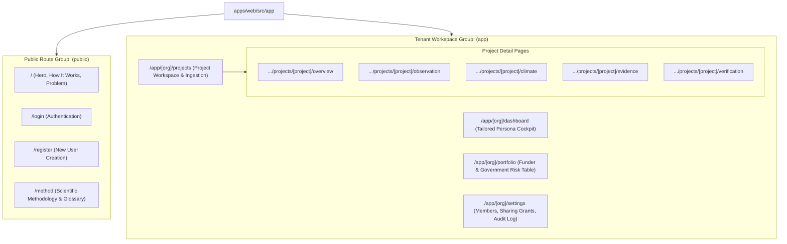
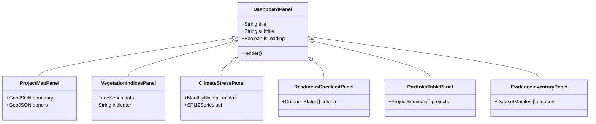

# UI Rework — Architectural Design Specification

> **The comprehensive design specification for GroundTruth 2.0's multi-tenant, multi-page frontend: design system tokens, App Router architecture, responsive surfaces, and tailored persona dashboards.**

**Document Version:** 2.0.0  
**Status:** Approved & Shipped (Slice 1 Production Baseline)  
**Lead Frontend Architect:** Viraj  
**Test Suite Health:** 542 Passing Vitest Specs (57 Test Files) · 0 TypeScript Errors · 0 ESLint Errors  

---

## 1. Design Vision & Intent

The original GroundTruth frontend was a single, dense, dark monospace "terminal" interface where visitors were met with terminal-style logs before discovering any ecological content.

**GroundTruth 2.0 eliminates the terminal aesthetic entirely.** It introduces a calm, editorial, multi-page product engineered around three core design principles:
1. **Progressive Disclosure:** Surfaces the headline verdict and essential empirical metrics immediately, while making raw STAC scene provenance, covariance matrices, and sensor QA masks easily reachable for accredited auditors.
2. **Four Role-Tailored Perspectives:** Dynamically adapts dashboard panels based on the tenant organization's type (`ngo`, `funder`, `auditor`, `government`), while drawing from the exact same mathematical ground truth.
3. **Fail-Closed Clarity:** Ensures that missing data, uncalibrated carbon, or unshared cross-tenant resources render honest, actionable states—never blank charts or fabricated numbers.



---

## 2. Hard Non-Negotiable Constraints (From AGENTS.md)

1. **R7 Unmistakable Simulated Data:** Any project or analysis operating in simulated mode (`data_mode = simulated`) renders a permanent, non-dismissible `Simulated data` badge.
2. **R2 Neutral Regulatory Decorum:** No legal or criminal accusations ("fraud", "scam") are permitted in any UI copy. Divergence is strictly phrased as: *"warrants accredited technical review"*.
3. **R6 No Ungrounded Client Math:** The UI never performs mathematical conversions or econometric fitting. Every metric on screen is returned directly by typed API endpoints.
4. **R5 Designed Refusal States:** When satellite or climate data is unavailable, panels render an explicit `UNAVAILABLE` state explaining the missing evidence and the remediation action.
5. **Strict Type Safety:** All client models are auto-generated from backend OpenAPI 3.1.0 specifications (`src/lib/generated`).

---

## 3. Information Architecture & App Router Structure

The frontend is built on Next.js 14 App Router, separating unauthenticated public marketing pages from authenticated multi-tenant workspaces.



### 3.1. Middleware & Session Resolution
Next.js `middleware.ts` intercepts all requests under `/app/*`:
- Verifies the existence of the `gt_session` cookie.
- If missing, immediately redirects to `/login?next=<encoded_path>`.
- In server components, cookies are forwarded automatically to the FastAPI backend, preserving zero-trust security.

---

## 4. Design System & Token Architecture

The design system is structured into three layers of CSS Custom Properties:

1. **Tokens (`src/styles/tokens.css`):**
   - Palette: Deep forest greens (`--gt-color-emerald-*`), dark slate charcoals (`--gt-color-slate-*`), warm neutral cards, restrained amber for caution, and controlled crimson for errors.
   - Spacing: 8-pt modular scale (`--gt-space-1` = 4px, `--gt-space-2` = 8px, `--gt-space-4` = 16px, `--gt-space-8` = 32px).
   - Typography: Newsreader Serif for editorial headlines; Inter for high-legibility UI metrics and tabular figures.
2. **Themes (`src/styles/themes.css`):**
   - First-class Light and Dark themes toggled via `data-theme="light|dark"`.
   - Pre-paint inline script prevents theme flicker on initial load.
3. **Data Mode & Evidence Tokens:**
   - Permanent visual styling for evidence states: `OBSERVED`, `DERIVED`, `MODEL_ESTIMATED`, `INFERRED`, `UNAVAILABLE`.

---

## 5. The Four Tailored Persona Dashboards

Each persona receives an operational interface composed from shared, reusable panels:



### 5.1. Restoration NGO Cockpit (`ngo`)
- **Focus:** Operational land stewardship, boundary validation, seasonal vegetation trends, and localized climate alerts.
- **Panels Rendered:**
  - Verified Area Card: 1,072,638 ha confirmed via geodesic polygon.
  - Seasonal Vegetation Multi-spectral Chart: 2021–2023 Sentinel-2 NDVI/EVI trends.
  - Localized Climate Stress: Monthly CHIRPS rainfall against normal baselines.
  - Actionable Operational Recommendations: Stratified field patrol alerts.
- **Visual Evidence:**
  

### 5.2. CSR & Impact Investor Portfolio (`funder`)
- **Focus:** Portfolio surveillance, independent evidence quality verification, and tracking reported funding vs verified progress.
- **Panels Rendered:**
  - Multi-Project Surveillance Table: Filterable by assessment level (0–5).
  - Evidence Confidence Ratings: High / Moderate / Low based on data completeness.
  - Reported Funding Transparency: Displaying self-reported capital with clear disclaimer.
  - Triage Alerts: Projects with low evidence quality flagged for accredited review.
- **Visual Evidence:**
  

### 5.3. MRV Auditor Forensic Workbench (`auditor`)
- **Focus:** Scene-level STAC provenance, sensor continuity, synthetic control diagnostics, and cryptographic dossier exports.
- **Panels Rendered:**
  - Complete Data Inventory: Table of every satellite and climate scene with SHA-256 hashes.
  - Computed Readiness Checklist: 7 criteria evaluating pre-treatment coverage and donor availability.
  - Sensor QA Masks: Verification of cloud/shadow filtering.
  - Dossier Export: One-click generation of tamper-proof technical dossiers.
- **Visual Evidence:**
  

### 5.4. Government Conservation View (`government`)
- **Focus:** Regional jurisdictional monitoring, national protected area coordination, and regional drought resilience.
- **Panels Rendered:**
  - Regional 51-District Drought Monitor: District-by-district SPI-12 classification.
  - Jurisdictional Boundary Map: Overlapping project boundaries with national administrative zones.
  - Regional Climate Trends: 43-year rainfall anomalies.
- **Visual Evidence:**
  

---

## 6. Real-World Case Overview: Kariba REDD+

The case overview brings together verified geodesic geometry, Level 2 assessment status, and clear evidence requirements:


*Figure 1: Kariba REDD+ Case Overview in GroundTruth 2.0.*

---

## 7. Fail-Closed Security & Unauthorized Access Cards

When a user attempts to access an unshared project URL, the application renders a clean, uninformative HTTP 404 security card, preventing project reconnaissance:


*Figure 2: Fail-closed tenant isolation. Zero information disclosure for unauthorized requests.*

---

## 8. Mobile & Multi-Device Responsive Execution

The frontend is engineered to provide full functional parity across desktop, tablet, and mobile devices:

| Mobile Auditor Workbench (375 px) | Mobile NGO Field Cockpit (375 px) |
|---|---|
|  |  |
| *Figure 3A: Mobile auditor dashboard with collapsible diagnostic cards.* | *Figure 3B: Mobile field operator interface.* |

---

## 9. Reference Native Jetpack Compose Client

For field tablets operating in low-connectivity conservation reserves, GroundTruth 2.0 maintains a reference Android Jetpack Compose client:

| Native Compose Auditor | Native Compose NGO | Native Compose Login |
|---|---|---|
|  |  |  |
| *Figure 4A: Jetpack Compose Auditor.* | *Figure 4B: Jetpack Compose NGO.* | *Figure 4C: Native mobile login.* |

---

## 10. Verification Suite & Quality Assurance

The frontend architecture is validated by 542 automated vitest tests across 57 test suites:

```bash
 RUN  v2.1.9 D:/Hackathons/PCCOEIGC/GroundTruth/apps/web

 ✓ tests/dashboards.test.tsx (30 tests)
 ✓ tests/panels/panels.test.tsx (31 tests)
 ✓ tests/scientific-rules.test.ts (11 tests)
 ✓ tests/api-fixture-fallback.test.ts (12 tests)
 ✓ tests/shell-nav.test.ts (10 tests)
 ✓ tests/middleware.test.ts (6 tests)
 ✓ tests/theme.test.tsx (6 tests)
 ... 50 more test files passed

 Test Files  57 passed (57)
      Tests  542 passed (542)
   Duration  3.81s
```
