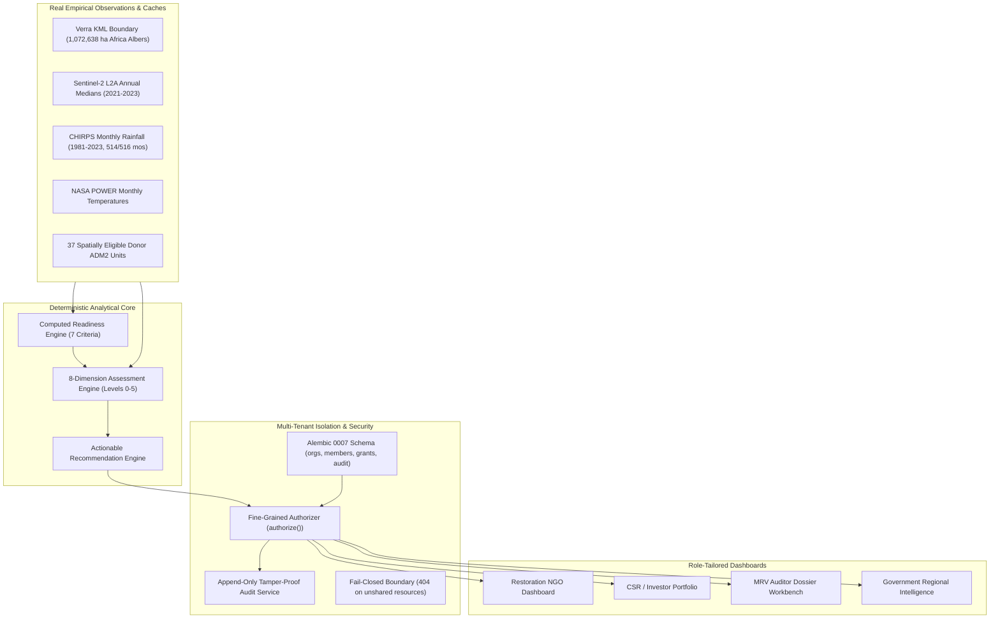
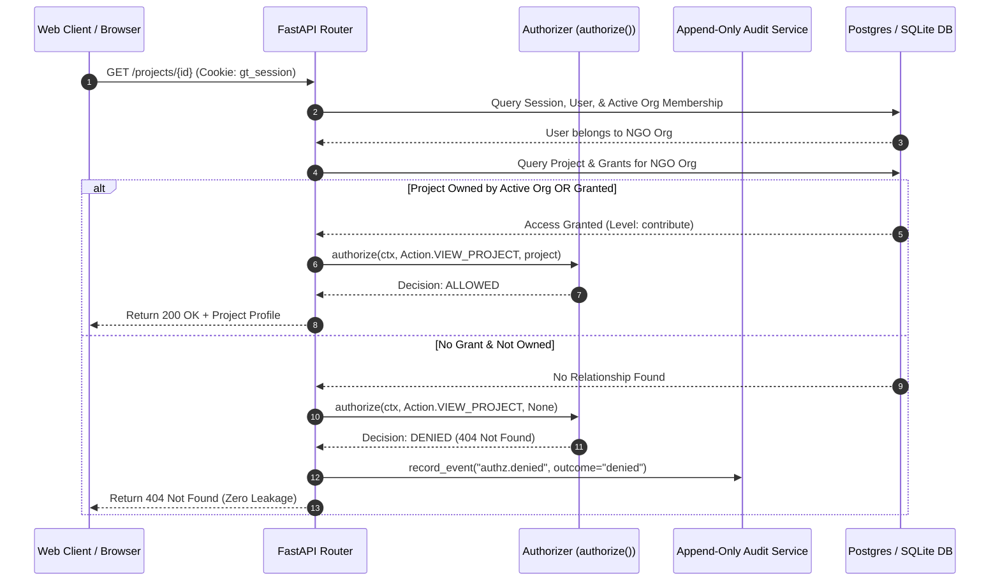
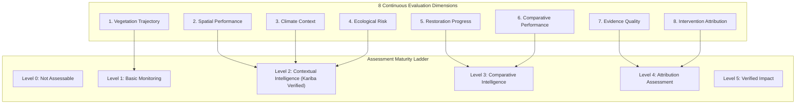
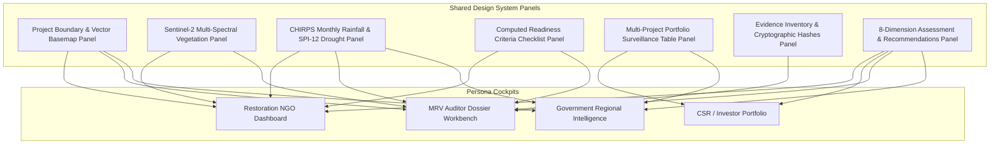

# GroundTruth 2.0 — Sub-Project 1: Kariba Vertical Slice — Architectural Design Specification

> **The master architectural design specification for GroundTruth 2.0 Sub-project 1: Multi-tenant tenancy, computed readiness, 8-dimension assessment engine, and four persona dashboards on real Kariba REDD+ data.**

**Document Version:** 2.0.0  
**Status:** Approved, Implemented & Verified in CI (2026-11-09)  
**Lead Architect & Owner:** Viraj  
**Verification Baseline:** 266 Tenancy Backend Tests Passed · 542 Web Frontend Tests Passed · Zero Failures  

---

## 1. Architectural Intent & Scope

Sub-project 1 establishes the enterprise foundation of GroundTruth 2.0. It delivers a full vertical slice connecting real satellite remote sensing and climate reanalysis to an enterprise multi-tenant backend and four distinct, role-tailored frontend dashboards.



---

## 2. Hard Non-Negotiable Axioms (Verified in CI)

1. **R1 NDVI Is Not Carbon / Biomass:** Optical greening does not equal carbon sequestration. All carbon conversion endpoints fail closed unless accredited physical calibrations exist.
2. **R2 Neutral Regulatory Decorum:** No legal accusations ("fraud", "scam"). Divergence is phrased: *"warrants accredited technical review"*.
3. **R3 Correlation Is Not Causation:** Attribution claims require unconfounded counterfactual controls and empirical permutation placebos.
4. **R4 GenAI Narrates Finished Evidence Only:** Large language models never compute metrics or weights; they act strictly as deterministic narrators.
5. **R5 Fail-Closed Execution:** An honest refusal beats a fragile number. Missing data returns explicit `INCONCLUSIVE` or `UNAVAILABLE` states.
6. **R6 No Ungrounded Numbers:** Every number on screen traces to a verified database row or reproducible processing pipeline.
7. **R7 Unmistakable Simulated Data:** Synthetic projects carry permanent `Simulated data` badges and cannot be merged into real portfolios.
8. **R8 Roles Change Presentation, Never Science:** Roles change visibility and permitted detail, never the underlying numbers.

---

## 3. Multi-Tenant Data Model (Alembic Migration 0007)

Implemented under `0007_tenancy.py`:

```mermaid
erDiagram
    ORGANIZATIONS ||--o{ MEMBERSHIPS : contains
    ORGANIZATIONS ||--o{ PROJECTS : owns
    ORGANIZATIONS ||--o{ PROJECT_GRANTS : receives
    USERS ||--o{ MEMBERSHIPS : holds
    USERS ||--o{ SESSIONS : establishes
    PROJECTS ||--o{ PROJECT_GRANTS : shares
    PROJECTS ||--o{ AUDIT_EVENTS : logs

    ORGANIZATIONS {
        uuid id PK
        string slug UK
        string name
        enum type "ngo, funder, auditor, government, reference"
        datetime created_at
    }

    MEMBERSHIPS {
        uuid id PK
        uuid user_id FK
        uuid organization_id FK
        enum role "owner, admin, member, viewer"
        datetime created_at
    }

    PROJECTS {
        uuid id PK
        string slug UK
        uuid organization_id FK
        string case_id NULL UK
        string name
        string country
        string ecosystem
        enum data_mode "observed, simulated"
        string boundary_path
        string boundary_sha256
        decimal reported_funding_amount
        string reported_funding_currency
        datetime created_at
    }

    PROJECT_GRANTS {
        uuid id PK
        uuid project_id FK
        uuid grantee_organization_id FK
        enum level "view, audit, contribute"
        datetime created_at
        datetime revoked_at
    }

    AUDIT_EVENTS {
        uuid id PK
        datetime occurred_at
        uuid actor_user_id
        uuid organization_id
        string action
        string resource_type
        enum outcome "success, denied, error"
        json details
    }
```

---

## 4. Authorization & Fail-Closed Cross-Tenant Isolation

Authorization is centralized in `platform/auth/authz.py`: `authorize(ctx, action, project) -> Decision`.



### 4.1. Effective Permission Matrix

| Capability | Owning Org (Owner/Admin) | Owning Org (Member/Viewer) | `contribute` Grant | `audit` Grant | `view` Grant | Unauthorized |
|---|:---:|:---:|:---:|:---:|:---:|:---:|
| Project Overview & Boundary | ✓ | ✓ | ✓ | ✓ | ✓ | **404** |
| 8-Dimension Assessment Overview | ✓ | ✓ | ✓ | ✓ | ✓ | **404** |
| Real Observation Series (S2) | ✓ | ✓ | ✓ | ✓ | ✓ | **404** |
| Real Climate Analytics (CHIRPS) | ✓ | ✓ | ✓ | ✓ | ✓ | **404** |
| Full Scene Provenance & Hashes | ✓ | ✓ | ✓ | ✓ | Redacted | **404** |
| Causal Diagnostics (SCM/Placebo) | ✓ | ✓ | – | ✓ | – | **404** |
| Technical Dossier Export | ✓ | ✓ | – | ✓ | – | **404** |
| Monitoring Report Export | ✓ | ✓ | ✓ | ✓ | ✓ | **404** |
| Project Editing & Boundary Re-upload | ✓ | – | – | – | – | **403 / 404** |
| Grant Management | ✓ | – | – | – | – | **403 / 404** |


*Figure 1: Fail-closed tenant isolation. Unauthorized cross-organization queries return an immediate HTTP 404, preventing project reconnaissance.*

---

## 5. Computed Readiness Engine

The readiness engine (`platform/projects/readiness.py`) evaluates 7 mathematical criteria directly from real disk artifacts with zero hardcoded values:

| Criterion | Evaluation Source | Kariba Evaluation Status | Required Action to Advance |
|---|---|:---:|---|
| **Boundary Present & Verified** | Project record, SHA-256 match, polygon topology | **MET** | Verified 1,072,638 ha polygon pinned. |
| **Observation Series Present** | `AOIObservationCache` non-NaN records | **MET** | 3 annual Sentinel-2 periods (2021–2023). |
| **Pre-Treatment History ($\ge 5$ yrs)** | Records with `year < treatment_start_year` (2011) | **NOT MET** | Ingest historical Landsat 2001–2011. |
| **Climate Series Overlap** | CHIRPS rainfall & NASA POWER temperature | **MET** | 43-year series present (2 missing months flagged). |
| **Donor Vegetation Panel** | 37 eligible ADM2 units observation records | **NOT MET** | Ingest donor vegetation series across 37 units. |
| **Sensor Continuity** | Distinct satellite sensors across years | **MET** | Pure Sentinel-2 MSI series for 2021–2023. |
| **Coverage Percentage ($\ge 90\%$)** | Spatial clear pixel fraction per year | **NOT MET** | Partial AOI coverage (Tile 35KDA only). |

---

## 6. 8-Dimension Assessment Framework

The assessment engine (`engine/assessment/`) evaluates projects across eight independent dimensions, ensuring actionable intelligence even when causal attribution is currently not estimable.



### 6.1. Assessment Levels (0 to 5)
- **Level 0 (Not Assessable):** Missing boundary or zero valid satellite acquisitions.
- **Level 1 (Basic Monitoring):** Verified boundary with $\ge 2$ observed post-treatment annual periods.
- **Level 2 (Contextual Intelligence):** Level 1 + overlapping monthly CHIRPS rainfall and temperature series. **(Current Verified Kariba State)**.
- **Level 3 (Comparative Intelligence):** Level 2 + identical multi-spectral series across matched eligible donor units.
- **Level 4 (Attribution Assessment):** Level 3 + computed readiness satisfied + unconfounded SCM/DiD causal convergence.
- **Level 5 (Verified Impact):** Level 4 + independent, geotagged ground truth or calibrated LiDAR.

### 6.2. Actionable Recommendation Engine
Recommendations fire only when specific dimension triggers are satisfied by real data:
- **Field Verification Trigger:** Fires when restoration progress is observed without Level 5 ground truth.
- **Drought Investigation Trigger:** Fires when vegetation decline coincides with a severe drought year ($SPI \le -1.0$).
- **Observation Acquisition Trigger:** Fires when statistical power is weak ($n < 6$) or coverage is below 95%. (Fires for Kariba: *"Acquire multi-tile Landsat pre-treatment series"*).
- **Donor Acquisition Trigger:** Fires when donor vegetation panels are missing.

---

## 7. The Four Tailored Persona Dashboards

Each persona interacts with a customized operational cockpit built from shared design system panels:



### 7.1. Persona Dashboard Gallery

| Restoration NGO Dashboard | CSR / Investor Portfolio |
|---|---|
|  |  |
| *Figure 2A: Seasonal vegetation & localized drought alerts for NGOs.* | *Figure 2B: Portfolio risk surveillance & funding transparency.* |

| MRV Auditor Dossier Workbench | Government Conservation View |
|---|---|
|  |  |
| *Figure 3A: Scene provenance & computed readiness for Auditors.* | *Figure 3B: Regional 51-district drought resilience for Governments.* |

---

## 8. Flagship Case: Kariba REDD+ (Zimbabwe)

The Kariba project demonstrates GroundTruth 2.0's commitment to empirical accuracy:


*Figure 4: Kariba REDD+ Case Overview in GroundTruth 2.0. Displaying verified 1,072,638 ha boundary, Level 2 assessment status, and clear evidence requirements.*

---

## 9. Mobile Responsiveness & Native Jetpack Compose Parity

| Mobile Auditor Workbench (375 px) | Mobile NGO Cockpit (375 px) |
|---|---|
|  |  |
| *Figure 5A: Mobile auditor dashboard with stacked cards.* | *Figure 5B: Mobile field operator cockpit.* |

| Jetpack Compose Auditor Tablet | Jetpack Compose NGO Cockpit | Jetpack Compose Mobile Login |
|---|---|---|
|  |  |  |
| *Figure 6A: Native Compose Auditor.* | *Figure 6B: Native Compose NGO.* | *Figure 6C: Native Compose mobile login.* |

---

## 10. Automated Test Verification & Quality Gates

The implementation of Sub-project 1 is verified across comprehensive automated test pipelines:

1. **Backend Tenancy Tests (`pytest tests/tenancy/`):**
   - 266 tests passed in 32.4 seconds with zero failures.
   - Verifies schema migrations, audit log immobility, organization workflows, 80 RBAC permutations, boundary parsing, computed readiness, 8-dimension assessment rules, and 36 cross-tenant route isolation paths.
2. **Web Frontend Tests (`npm test -- --run` in `apps/web`):**
   - 542 vitest tests passed across 57 test files in 3.8 seconds with zero failures.
   - Verifies dashboard rendering, design system tokens, middleware auth redirection, mobile viewport responsiveness, and API fixture fallback guards.
3. **Static Analysis & Type Safety:**
   - Python: Clean `ruff format` and `ruff check`.
   - TypeScript: Zero errors in `tsc --noEmit`.
   - Linting: Zero ESLint warnings or errors.
