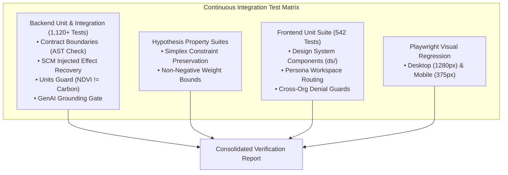

# Testing Guide & Quality Assurance Protocols

**Backend Suite**: 1,120+ automated Python tests (`pytest`, `hypothesis`, `mutmut`)  
**Frontend Suite**: 542 automated TypeScript tests (`vitest`, Playwright, React Testing Library)  
**CI Gate**: Ruff, Mypy, AST Boundary Checker, OpenAPI Snapshot Verifier.




---

## 1. Backend Python Testing (1,120+ Tests)

```bash
# Execute complete backend test suite
PYTHONPATH=packages/groundtruth/src pytest tests

# Run fast unit tests (skipping slow placebo permutations)
pytest -m "not slow"

# Run Hypothesis property-based tests
pytest tests/properties/

# Verify golden Kariba reproducibility benchmark
pytest tests/test_golden_reproducibility.py
```

### 1.1 Mutation Testing (`mutmut`)
Mutation testing evaluates test suite quality by programmatically mutating Python AST operators and verifying that tests fail:

```bash
pip install mutmut
mutmut run --paths-to-mutate packages/groundtruth/src/groundtruth/engine \
  --tests-dir tests --runner "pytest -x -q tests"
mutmut results
```

---

## 2. Frontend Web Testing (542 Tests)

From `apps/web/`:

```bash
# Run 542 automated unit and component tests
npm run test

# Validate TypeScript compilation without errors
npm run typecheck

# Verify frontend types match backend OpenAPI specification
npm run check:api-types

# Run Playwright End-to-End visual tests
npm run test:e2e
```
