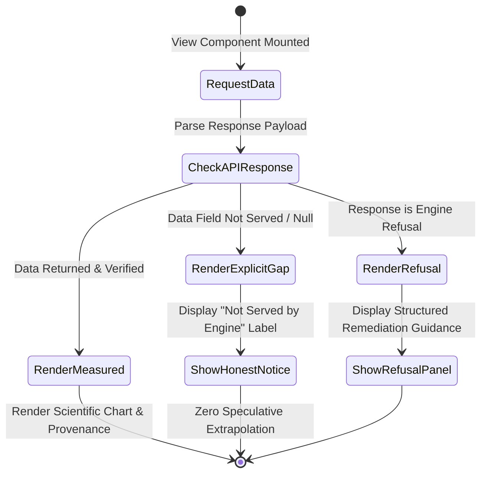

# UI Data Gaps & Scientific Transparency

**Standard**: Non-Negotiable Presentation Invariant (R6)  
**Core Rule**: If the analytical engine or API does not serve a real measurement, the user interface **states so explicitly** rather than computing, interpolating, or inventing values.

---

## 1. Documented UI Data Gaps & Honest States

### 1.1 Counterfactual Playground (`src/features/case/playground`)
- **Scrubbing Intervention Years**: True live counterfactual scrubbing requires re-solving the simplex quadratic program for each candidate year. When moving the intervention year marker to an uncomputed year, the UI shifts the marker line and shading, but explicitly displays:
  > *"Counterfactual path is computed for the declared intervention boundary (2011). Re-running the econometric estimator is required to generate counterfactuals for alternative years."*
- **Leave-One-Out Donor Toggling**: When a user toggles a donor off in the interactive playground, the UI sums the weights of deactivated donors and offers a *"Re-run analysis with these exclusions"* button, rather than attempting to guess the re-weighted synthetic trajectory in the browser.

### 1.2 Real-Data Observations & Readiness Gaps
- **Real-Data Attribution**: In `REAL_OBSERVATIONS` mode, when pre-treatment Landsat 5/7 surface reflectance mosaics are incomplete or sensor harmonization is pending validation, the UI displays:
  > *"ATTRIBUTION VERDICT: INCONCLUSIVE (not estimable from available real data)"*
- It never substitutes simulated benchmark numbers under a real-data label.

### 1.3 Geospatial Boundary & Donor Mapping (`src/features/case/map`)
- When viewing candidate donor districts, only features with verified geometries from `kariba-donors.geojson` are rendered.
- If donor boundary geometries are pending cloud ingestion, the map falls back to an honest vector boundary view of the treated project AOI ($1,072,638\text{ ha}$) rather than displaying synthetic bounding boxes.
