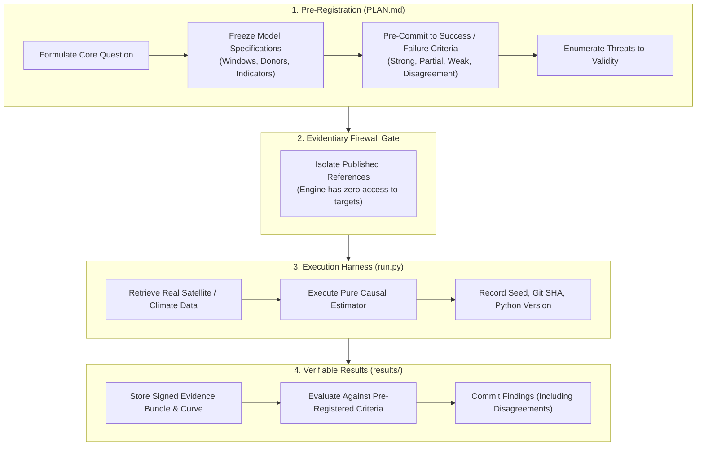

# Scientific Experiments & Validation Harnesses (`experiments`)

This directory houses the formal, pre-registered econometric validation harnesses and empirical benchmarks for GroundTruth 2.0.

In accordance with rigorous scientific practices, GroundTruth requires that all validation experiments be **pre-registered with frozen criteria** before running analyses against empirical or benchmark data. Tuning parameters until an estimator reproduces a published number does not validate an estimator—it proves only that an estimator can be overfitted.

---

## Experiment Inventory

| Experiment Directory | Core Scientific Question | Status | Key Artifacts |
| :--- | :--- | :--- | :--- |
| [`estimator_recovery/`](estimator_recovery/) | Does the synthetic control estimator recover a known ground-truth treatment effect across latent factor panels? | **Completed** | `results/recovery.json` `run.py` |
| [`kariba_benchmark/`](kariba_benchmark/) | Does an independent satellite-based causal estimate of Kariba REDD+ agree with the published 57% over-crediting correction? | **Pre-Registered** | `PLAN.md` `results/` |
| [`specification_curve/`](specification_curve/) | Does the estimated causal sign and magnitude survive across alternative defensible specifications? | **Pre-Registered** | `PLAN.md` `results/` |
| [`genai_grounding_eval/`](genai_grounding_eval/) | Given verified evidence bundles, how often does a language model invent ungrounded numbers or legal allegations? | **Pre-Registered** | `PLAN.md` `results/` |

---

## The Pre-Registration & Validation Lifecycle

To prevent researcher degrees of freedom and p-hacking, every experiment adheres to a strict four-phase lifecycle:

---

## Non-Negotiable Experimental Rules

1. **Pre-Register All Criteria (`PLAN.md`)**:
   * Success criteria, acceptable factor-of-two tolerances, and statistical power thresholds must be committed to git before executing the pipeline on real observations.
2. **Commit Negative Results**:
   * If an independent estimate contradicts a published finding, or if in-space placebos yield high $p$-values ($p > 0.10$), the result must be published in full. A negative result is an essential scientific finding about the operational limits of satellite causal screening.
3. **Zero Fabrication Mandate (Task 5/5B Audit Findings)**:
   * Synthetic test fixtures and mock runs must never be stored in `results/` masquerading as real-world benchmarks. `results/` directories remain strictly empty until real Earth observation data is processed through an un-tampered pipeline.
4. **Complete Environmental Telemetry**:
   * Every result file written to `results/` records the global pseudo-random seed, package version, exact git commit SHA, operating system architecture, and satellite retrieval timestamps.
5. **Strict Units Guard (`assert_not_index_to_carbon`)**:
   * Benchmark comparisons are evaluated strictly in the units of observation (e.g., fractional canopy change, NDVI differences, hectares of baseline forest) until an audited biomass allometric conversion layer is applied.

---

## Overview of Active Experiments

### 1. Estimator Recovery (`estimator_recovery/`)
* **Objective**: Verifies econometric estimator recovery across synthetic data generating processes (DGPs) with known latent time and unit factors.
* **Findings (`results/recovery.json`)**:
  * Evaluated across 20 replicates for multiple pre-treatment lengths ($T_0 \in \{5, 8, 10, 12\}$) and noise levels ($\sigma \in \{0.01, 0.02, 0.05\}$).
  * Injected true effect: $+0.050$.
  * Recovered mean estimate with 10 pre-periods: **$+0.05048$** (bias $< 0.0005$, sign coverage: $100\%$).
  * Proves mathematical correctness of the convex quadratic programming solver under classical synthetic control assumptions.

### 2. Kariba REDD+ Benchmark (`kariba_benchmark/`)
* **Objective**: Compares an independent satellite synthetic control estimate of Kariba REDD+ (VCS 902) against Verra's 2025 published finding that 57% of issued credits were in excess of achieved reductions.
* **Protocol**: Pre-registered analysis window (2001–2010 pre-period; 2011–2022 post-period) using 50 donor units across Zimbabwe, Zambia, and Mozambique Miombo woodlands, excluding 10 km leakage belts.

### 3. Specification Curve Multiverse (`specification_curve/`)
* **Objective**: Tests whether the estimated treatment effect sign and magnitude survive across 40+ alternative, defensible model specifications (varying indicator choices, donor caps, ridge penalties, and pre-period windows).

### 4. GenAI Grounding Evaluation (`genai_grounding_eval/`)
* **Objective**: Measures the rate at which large language models hallucinate ungrounded figures or use prohibited legal language when generating audit narratives from certified evidence bundles.
