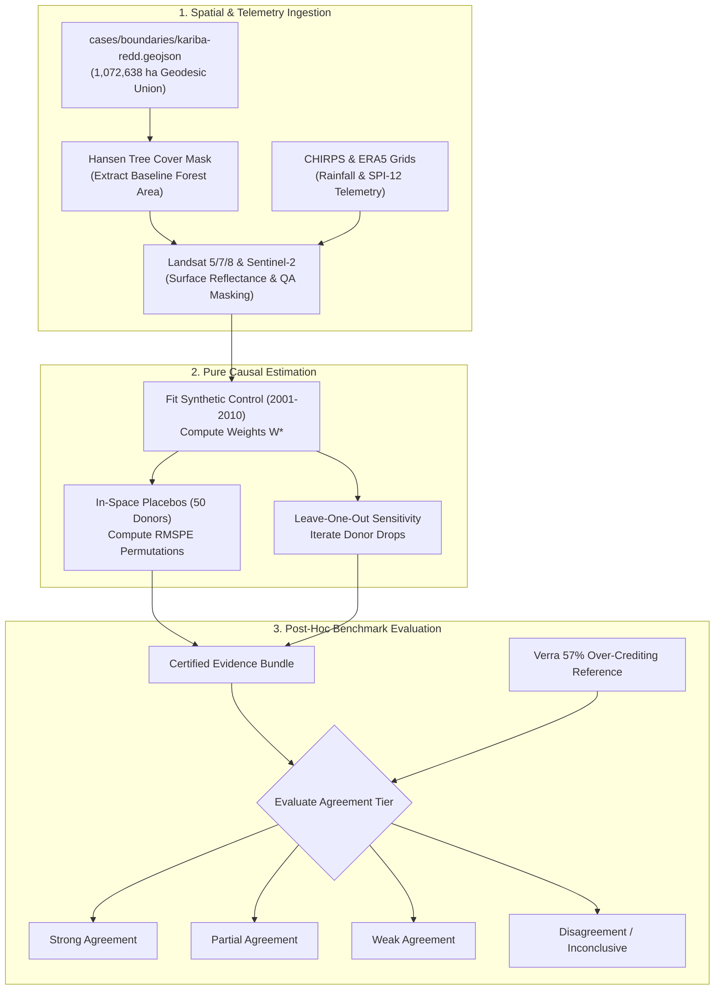

# Kariba REDD+ Benchmark — Pre-Registered Protocol

**Benchmark Target**: Kariba REDD+ Project (Verra VCS 902, Zimbabwe)  
**Status**: Pre-registered protocol. All specifications, parameters, and outcome thresholds are frozen in advance of executing the empirical estimation on real satellite and climate telemetry.

---

## 1. Scientific Objective

To evaluate whether an independent, satellite-based econometric Synthetic Control estimate of the Kariba REDD+ project's incremental avoided deforestation agrees in direction and relative magnitude with the published independent investigation findings published by Verra in September 2025.

---

## 2. Published Reference Target (Firewalled)

Following an extensive forensic investigation concluded in September 2025, Verra determined that approximately **57% of the ~27 million carbon credits** issued to the Kariba REDD+ project were in excess of the actual emission reductions achieved by the project.

* **Source**: Official Verra investigation determination, as reported by *Carbon Herald* and *Climate Home News* (September 2025).
* **Evidentiary Firewall Rule**: This reference figure is recorded in `cases/kariba-redd.yaml` under `known_reference`. **The computational pipeline has zero access to this figure during estimation.** It is consumed strictly by post-hoc evaluation scripts in `experiments/kariba_benchmark/` after the causal run is complete and cryptographically signed.

---

## 3. Fixed Model Specification

All parameters are locked prior to running empirical evaluation:

| Parameter | Frozen Value | Scientific Rationale |
| :--- | :--- | :--- |
| **Primary Indicator** | NDVI (Annual Median Composite) | Robust against seasonal cloud noise; standard vegetation index for dry forest. |
| **Secondary Indicators** | EVI (Enhanced Vegetation Index), Hansen GFC Tree Cover | Cross-checks canopy saturation and structural tree canopy loss. |
| **Pre-Treatment Baseline** | 2001 – 2010 (10 annual observations) | Long pre-period required to evaluate Synthetic Control pre-treatment fit (RMSE). |
| **Post-Treatment Period** | 2011 – 2022 (12 annual observations) | Covers official VCS crediting launch through public monitoring period. |
| **Treatment Intervention Date ($T_0$)** | 2011 (Crediting Start) | Official crediting start date registered with Verra. |
| **Anticipation Sensitivity Date** | 2009 (Validation Inception) | Tests whether project anticipation or initial feasibility work altered baseline trends. |
| **Donor Search Region** | Miombo woodland biome in Zimbabwe, Zambia, and Mozambique | Restricts candidates to ecologically comparable Southern African dry miombo ecosystems. |
| **Donor Pool Candidate Count** | Up to 50 admitted from 80+ candidates | Ensures sufficient degrees of freedom while maintaining convex hull overlap. |
| **Spatial Leakage Belt** | 10.0 km exclusion ring | All land within 10 km of the project perimeter is excluded to satisfy SUTVA. |
| **Matching Covariates** | CHIRPS rainfall ($mm$), SRTM elevation ($m$), slope ($^\circ$), road distance ($km$), population density | Matches environmental suitability and anthropogenic deforestation pressure. |
| **Primary Estimator** | Synthetic Control Method (Convex Quadratic Program) | Optimizes donor weights $W^*$ to minimize pre-treatment mean squared prediction error. |
| **Secondary Cross-Check** | Difference-in-Differences (Two-Way Fixed Effects) | Independent econometric cross-check across untreated donor pool. |
| **Statistical Inference** | In-space placebo test permutations | Computes pre/post RMSPE ratio distribution across all 50 donors to yield exact permutation $p$-values. |
| **Robustness Checks** | Leave-One-Out (Jackknife) & In-Time Placebo (2006 fake intervention) | Asserts that findings do not depend on any single donor or spurious time trends. |

---

## 4. Benchmark Workflow



---

## 5. Pre-Registered Outcome Criteria

The empirical results will be categorized into one of four mutually exclusive, pre-committed outcomes:

```mermaid
flowchart TD
    Run([Completed Empirical Run]) --> CheckDirection{Estimated Effect Implies Over-Crediting?}
    
    CheckDirection -- No --> D1[Disagreement / INCONCLUSIVE]
    CheckDirection -- Yes --> CheckInference{Placebo p < 0.10 & LOO Stable?}
    
    CheckInference -- No --> D2[Weak Agreement]
    CheckInference -- Yes --> CheckMagnitude{Implied Over-Issuance within Factor of 2 of 57%?<br/>[28.5% to 100%]}
    
    CheckMagnitude -- Yes --> D3[Strong Agreement]
    CheckMagnitude -- No --> D4[Partial Agreement]
```

1. **Strong Agreement**:
   * The independent estimate implies substantial baseline over-crediting.
   * In-space placebo test yields $p < 0.10$.
   * Estimated trajectory sign is stable across all leave-one-out iterations.
   * Implied excess credit volume falls within a factor of two of the published 57% figure (between $28.5\%$ and $100\%$).
2. **Partial Agreement**:
   * Treatment effect direction indicates over-crediting, and placebo tests pass ($p < 0.10$), but magnitude falls outside a factor of two.
3. **Weak Agreement**:
   * Direction agrees with published findings, but placebo test fails ($p \ge 0.10$) or sign flips under leave-one-out jackknife testing.
4. **Disagreement**:
   * Direction indicates the project achieved its claimed baseline deforestation avoidance, or the pipeline returns `INCONCLUSIVE` due to cloud contamination or poor pre-treatment fit ($\text{RMSE} > 0.30 \times \sigma$).

---

## 6. Threats to Validity & Mitigation Controls

| Identified Threat | Impact on Estimate | Mitigation & Audit Control |
| :--- | :--- | :--- |
| **Sensor Transitions** | Transitioning across Landsat 5 TM, Landsat 7 ETM+, Landsat 8 OLI, and Sentinel-2 MSI introduces artificial spectral step changes. | Sensor harmonization using Roy et al. polynomial cross-calibration coefficients; test across both NDVI and EVI. |
| **Rainfall Dominance** | Miombo woodland vegetation reflection is overwhelmingly driven by inter-annual rainfall. | CHIRPS monthly rainfall matching is load-bearing; execute a rainfall-only synthetic control placebo check. |
| **Intervention Anticipation** | On-the-ground activities or community awareness may have begun prior to official 2011 crediting. | Sensitivity run with treatment date shifted to 2009 (project validation launch). |
| **Convex Hull Support** | The project footprint (~1.07M ha total parcel, ~785k ha forest) is exceptionally large. | Admitting 50+ regional administrative donors across three countries ensures balanced convex support. |
| **Spatial Leakage** | Logging or charcoal burning displaced outside the project area could contaminate donors. | 10.0 km buffer ring strictly excluded; SUTVA violations geometrically audited. |

---

## 7. Commitments & Reporting

1. **Mandatory Publication**: All four potential outcomes (including complete disagreement) will be published in `results/`. A disagreement is an informative finding regarding the limits of satellite causal screening.
2. **Frozen Specification**: The parameters above will not be adjusted or retuned after observing empirical results. Any secondary exploration will be reported as an auxiliary point on a specification curve, never as a replacement headline.
3. **No Unaudited Carbon Conversion**: All primary comparisons are reported strictly in terms of observed vegetation indicators (NDVI, fractional canopy area) until an audited biomass model is incorporated.
