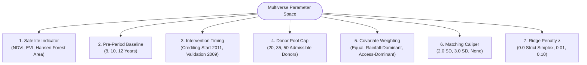
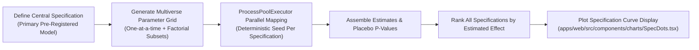
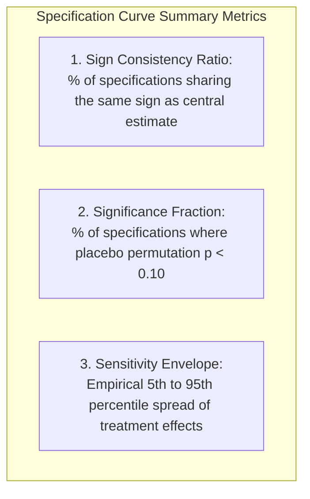

# Multiverse Specification Curve Analysis — Pre-Registered Protocol

**Experiment**: Multiverse Specification Curve Robustness Evaluation  
**Status**: Pre-registered protocol. All analytical dimensions, discrete variation values, and sensitivity metrics are fixed in advance of execution.

---

## 1. Scientific Objective

To determine whether the sign, magnitude, and statistical significance of an estimated project intervention effect survive across the multiverse of equally defensible analytical choices, or whether the finding is an artifact of a single idiosyncratic model specification.

---

## 2. Why a Specification Curve Matters

In observational remote sensing and econometric causal inference, researchers face numerous arbitrary but defensible choices: which vegetation index to prioritize, how many pre-treatment baseline years to include, which regularization penalty to apply, and how strictly to constrain the donor pool. 

Reporting only a single "headline" estimate introduces substantial risk of conscious or unconscious researcher bias (p-hacking). By executing and displaying all defensible combinations on a **Specification Curve**, GroundTruth provides complete transparency into model sensitivity.

---

## 3. The 7 Dimensions of Analytical Variation

The multiverse sweep varies seven orthogonal modeling dimensions around a pre-registered central specification:

| Dimension | Discrete Values Evaluated | Rationale |
| :--- | :--- | :--- |
| **1. Indicator** | `NDVI`, `EVI`, `Hansen Forest Cover` | Tests sensitivity to canopy greenness vs structural forest canopy fraction. |
| **2. Pre-Period Length** | `8 years`, `10 years`, `12 years` | Evaluates whether pre-treatment fit depends on a specific historical rainfall epoch. |
| **3. Intervention Date** | `Crediting Start (2011)`, `Validation Inception (2009)` | Controls for policy anticipation and early conservation leakage. |
| **4. Donor Pool Cap** | `20 donors`, `35 donors`, `50 donors` | Checks stability against donor degrees of freedom and convex hull sparsity. |
| **5. Covariate Weights** | `Equal`, `Rainfall-Emphasized`, `Accessibility-Emphasized` | Tests sensitivity to climate drivers vs anthropogenic deforestation pressure. |
| **6. Distance Caliper** | `2.0 SD`, `3.0 SD`, `None (Unconstrained)` | Restricts donor pool to units within Mahalanobis covariate distance bounds. |
| **7. Regularization $\lambda$** | `0.0 (Pure Simplex)`, `0.01`, `0.10` | Evaluates L2 ridge shrinkage on synthetic control weights. |

---

## 4. Execution Workflow

1. **Central Specification**: Marked explicitly on all charts as the primary benchmark, but not privileged during reporting.
2. **Parallel Estimation**: Each specification runs through `groundtruth.compute.executor.ProcessPoolBackend` with seeds deterministically derived from `(master_seed, specification_index)`.
3. **Artifact Persistence**: Complete multiverse estimates, placebo $p$-values, and parameter combinations are saved to `results/multiverse_specifications.json`.

---

## 5. Metrics & Reporting Standards

The resulting multiverse analysis is rendered as an interactive dual-panel chart:
* **Upper Panel**: Scatter plot of estimated treatment effects across all specifications, ordered from lowest to highest, accompanied by 90% confidence/credible intervals.
* **Lower Panel (Dashboard Grid)**: Indicator matrix displaying which discrete choices produced each estimate.

### Reporting Invariants
1. **The Sensitivity Envelope is NOT a Confidence Interval**: The spread from the 5th to the 95th percentile represents researcher specification uncertainty, not sampling error. It is explicitly labeled as a **Sensitivity Envelope**.
2. **Never Drop Sign-Flipping Models**: Specifications that flip the estimated effect sign or yield null findings are highlighted as known vulnerabilities of the project or data source. Under no circumstances may contradictory specifications be removed from the curve.
