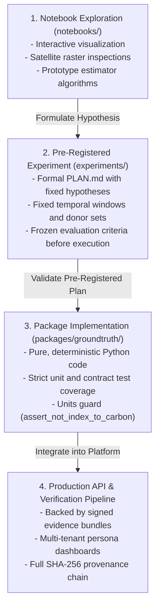

# Exploratory Scientific Notebooks (`notebooks`)

This directory is designated for exploratory data analysis, prototype model development, and preliminary econometric investigations.

Because GroundTruth 2.0 provides auditable, legally defensible, and methodologically sound verification signals, **Jupyter notebooks are treated strictly as experimental sandboxes, never as the authoritative source of truth**.

---

## The Exploration-to-Production Promotion Lifecycle

No number, graph, or finding produced inside a notebook may be cited in production verification reports, whitepapers, or customer documentation without traversing the formal promotion lifecycle:



---

## Mandatory Repository Rules for Notebooks

1. **Zero Committed Outputs**:
   * Notebook outputs (cell execution results, embedded PNGs, HTML tables) must be completely stripped before committing to git (`Clear All Outputs`).
   * Committing cell outputs inflates git diffs, risks leaking sensitive API tokens, and risks presenting stale exploratory figures as verified empirical findings.
2. **Deterministic Reproducibility**:
   * All pseudo-random number generators must be seeded explicitly (`np.random.default_rng(42)`).
   * Dependencies must be imported exclusively from `packages/groundtruth` or root virtual environment packages; ad-hoc local `pip install` commands within notebook cells are prohibited.
3. **No Direct Production Citations**:
   * If an econometric finding or spatial insight is worth sharing, it must be codified into a pre-registered experiment in `experiments/` with an accompanying `PLAN.md`.
4. **Data Isolation & Quarantine**:
   * Notebooks must respect data boundary rules: real satellite caches (`data/processed/stac_cache`) must not be polluted with synthetic fixtures, and quarantined datasets must never be ingested.
5. **Enforce Scientific Guardrails**:
   * Any prototype estimator explored in a notebook must adhere to the core principles: **NDVI is not carbon**, **observed change is not causal effect**, and **model divergence is not fraud**.

---

## Environment Setup & Developer Workflow

### 1. Register Kernel with Repository Environment
To run notebooks using the GroundTruth development virtual environment:
```bash
# From repository root
pip install ipykernel jupyterlab

# Register kernel
python -m ipykernel install --user --name=groundtruth --display-name="Python (groundtruth)"
```

### 2. Launching Jupyter Lab
```bash
jupyter lab notebooks/
```

### 3. Pre-Commit Output Stripping
To ensure notebook outputs are never accidentally committed, use `nbstripout`:
```bash
# Install nbstripout filter in local git repository
pip install nbstripout
nbstripout --install
```

Alternatively, manually clear outputs in Jupyter:
`Edit` $\to$ `Clear All Outputs` prior to staging files with `git add`.
