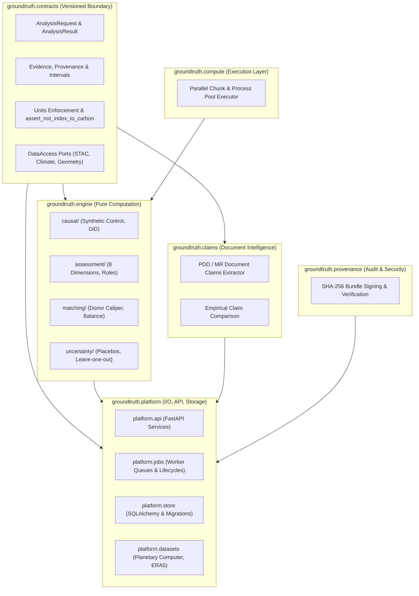
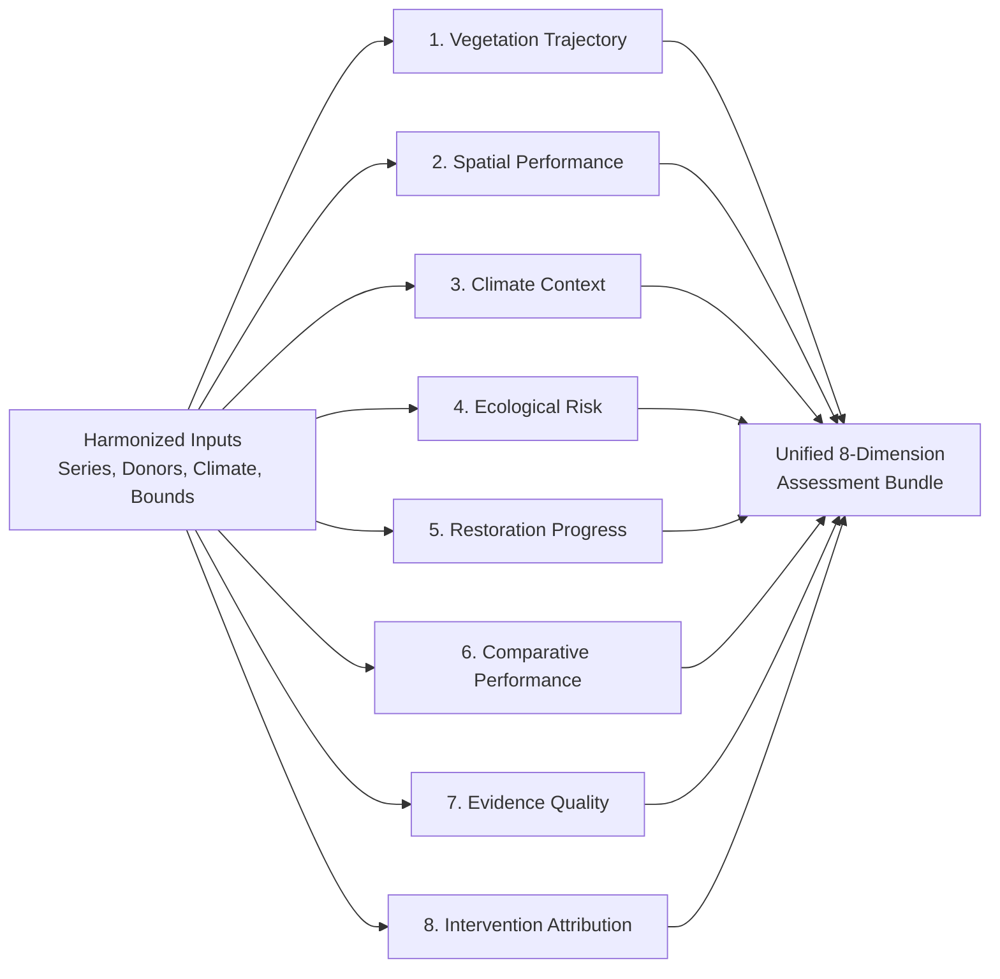
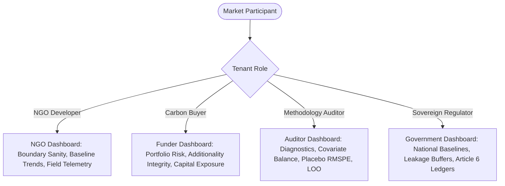

# `groundtruth` (Core Python Package)

`groundtruth` is the foundational computational and scientific library powering the GroundTruth 2.0 platform. Engineered as a clean, modular Python distribution, it provides mathematical implementations of causal econometric estimators, Earth observation data harmonization protocols, multi-tenant platform services, and cryptographic provenance guarantees.

The package is partitioned into cleanly bounded subpackages with formal contracts, ensuring strict separation of concerns between pure computational mathematics, versioned schema definitions, and platform infrastructure.

---

## Subpackage Architecture & Dependency Graph



### Subpackage Ownership & Responsibilities

| Subpackage | Contents & Responsibilities | I/O Permitted? |
| :--- | :--- | :---: |
| `groundtruth.contracts` | Formal, versioned domain schemas (`AnalysisRequest`, `AnalysisResult`, `Evidence`, `Provenance`), unit vocabularies, error codes, and abstract `DataAccess` ports. | **No** |
| `groundtruth.engine` | Pure mathematical and econometric engine. Implements Synthetic Control (convex quadratic programming), Difference-in-Differences, in-space placebos, the 8 assessment dimensions, and uncertainty estimation. | **No** |
| `groundtruth.compute` | Concurrency backends (Serial, `ProcessPoolExecutor`, Dask) providing deterministic parallel mapping over spatial raster windows and placebo donor suites. | **No** |
| `groundtruth.provenance`| Cryptographic hash generation, SHA-256 bundle signing, signature verification, and immutable provenance graph creation. | **No** |
| `groundtruth.claims` | Natural language and tabular parser for registry Project Design Documents (PDD) and Monitoring Reports (MR), extracting developer claims for empirical comparison. | **Yes** (File/PDF parsing) |
| `groundtruth.platform` | External adapter layer: FastAPI web service, background worker execution, PostgreSQL/SQLite persistence, STAC API clients, and geodesic boundary calculations. | **Yes** (Network & DB) |
| `groundtruth.observability`| OpenTelemetry tracing, Prometheus metric exports, and structured JSON logging. | **Yes** |

---

## Non-Negotiable Scientific Principles

GroundTruth 2.0 enforces four scientific axioms throughout the codebase:

### 1. NDVI is Not Carbon (`assert_not_index_to_carbon`)
Normalized Difference Vegetation Index (NDVI) is a normalized spectral reflectance ratio; carbon is an ecological mass stock measured in tons of $\text{CO}_2$ equivalent ($t\text{CO}_2e$). Converting an index directly to carbon credits without an audited, species-specific, peer-reviewed allometric biomass model is scientifically invalid.

The function `groundtruth.contracts.units.assert_not_index_to_carbon` enforces this invariant fail-closed:
```python
def assert_not_index_to_carbon(source_unit: str, target_unit: str) -> None:
    if unit_family(source_unit) is UnitFamily.INDEX and is_carbon_unit(target_unit):
        raise ValueError(
            f"Refusing to convert {source_unit!r} directly to {target_unit!r}: a spectral "
            "index is not a carbon stock. Route the conversion through an explicit biomass "
            "model (see docs/science/causal-inference.md, 'NDVI is not carbon')."
        )
```

### 2. Observed Change is Not Causal Effect
A project's forest canopy may green simply because of regional rainfall surges, macroeconomic currency devaluations halting logging, or natural seasonal cycles. Measuring before-and-after greenness without an un-treated counterfactual yields biased, spurious impact claims.

GroundTruth constructs an econometric **Synthetic Control**—a convex combination of un-treated reference areas matching pre-intervention covariate paths—to isolate true additionality from regional environmental drift.

### 3. Model Divergence is Not Fraud
A divergence between a project's reported baseline and GroundTruth's independent counterfactual estimate indicates baseline over-crediting or measurement uncertainty. It triggers accredited, independent re-review; it is never an accusation of bad faith or fraud. All copy, tooltips, and status badges strictly adhere to this rule.

### 4. Task 5/5B Audit Findings: Zero Fabrication & Evidentiary Isolation
In response to Task 5/5B independent audit recommendations:
* All fabricated test fixtures are strictly quarantined in `data/processed/_quarantine_task5b_fabricated/`.
* Real Earth-observation caches (`data/processed/stac_cache`, `data/processed/climate_cache`) are isolated from synthetic generators.
* The analytical engine has zero access to project claim baselines (`known_reference`) during estimation, preventing confirmation bias or circular fitting.

---

## The 8 Assessment Dimensions (Spec Section 6A)

The engine evaluates projects across eight independent analytical dimensions (`groundtruth.engine.assessment.dimensions`):



1. **Vegetation Trajectory (`vegetation_trajectory`)**: Evaluates multi-year annual median NDVI/EVI trends using non-parametric Theil-Sen regression and Mann-Kendall monotonic trend tests.
2. **Spatial Performance (`spatial_performance`)**: Analyzes spatial canopy heterogeneity, edge-effect fragmentation, and within-perimeter spatial variance.
3. **Climate Context (`climate_context`)**: Contextualizes vegetation dynamics against monthly CHIRPS precipitation, ERA5 temperature, and 12-month Standardized Precipitation Index (SPI-12) to detect drought or rainfall shocks.
4. **Ecological Risk (`ecological_risk`)**: Identifies structural ecological vulnerabilities, including canopy saturation limits, persistent wildfire frequency, and road-access deforestation vectors.
5. **Restoration Progress (`restoration_progress`)**: For reforestation and ARR projects, benchmarks vegetation recovery velocity against expected reference recovery curves.
6. **Comparative Performance (`comparative_performance`)**: Benchmarks the treated project against regional donor units without econometric weighting to establish raw regional context.
7. **Evidence Quality (`evidence_quality`)**: Audits temporal continuity, cloud obscuration percentages, sensor transitions (Landsat 5/7/8 to Sentinel-2), and missing monthly telemetry.
8. **Intervention Attribution (`intervention_attribution`)**: The primary causal evaluation: fits the Synthetic Control counterfactual, computes in-space placebo permutations, tests leave-one-out sensitivity, and computes add-one permutation $p$-values.

---

## The 5 Standardized Evidence States

Every empirical value returned by `packages/groundtruth` is tagged with an immutable evidence state:

| Evidence State | Description | Example |
| :--- | :--- | :--- |
| `OBSERVED` | Measured directly by physical remote sensing instruments or meteorological stations. | Sentinel-2 Level-2A surface reflectance, CHIRPS precipitation. |
| `DERIVED` | Computed deterministically via mathematical formulae without statistical estimation. | NDVI index value $(NIR - Red) / (NIR + Red)$, geodesic area. |
| `MODEL_ESTIMATED` | Produced by statistical, econometric, or machine learning optimization models. | Synthetic control donor weights $W^*$, Theil-Sen trend slope, counterfactual trajectory. |
| `INFERRED` | A reasoned qualitative or semi-quantitative conclusion. | Ecological risk category, attribution verdict (`CONSISTENT`, `DIVERGENT`). |
| `UNAVAILABLE` | Evidence is absent or failed quality assurance. Never guessed or filled in. | Sensor data obscured by persistent cloud cover, missing climate station months. |

---

## The 4 Market Personas

The platform supports four distinct persona paradigms:



---

## Installation & Developer Setup

### 1. Installation
Install from the repository root in editable mode:
```bash
# Core package with API, GenAI, and development tooling
pip install -e "packages/groundtruth[api,genai,dev]"
```

### 2. Running Test Suites
```bash
# Run complete Python test suite (fast unit + contract checks)
pytest

# Run with coverage report
pytest --cov=groundtruth --cov-report=term-missing

# Verify OpenAPI snapshot stability
pytest tests/test_openapi_snapshot.py
```

### 3. Code Quality & Linting
```bash
# Run Ruff linter and code formatter
ruff check packages/groundtruth
ruff format --check packages/groundtruth

# Run static type checking with Mypy
mypy packages/groundtruth
```
