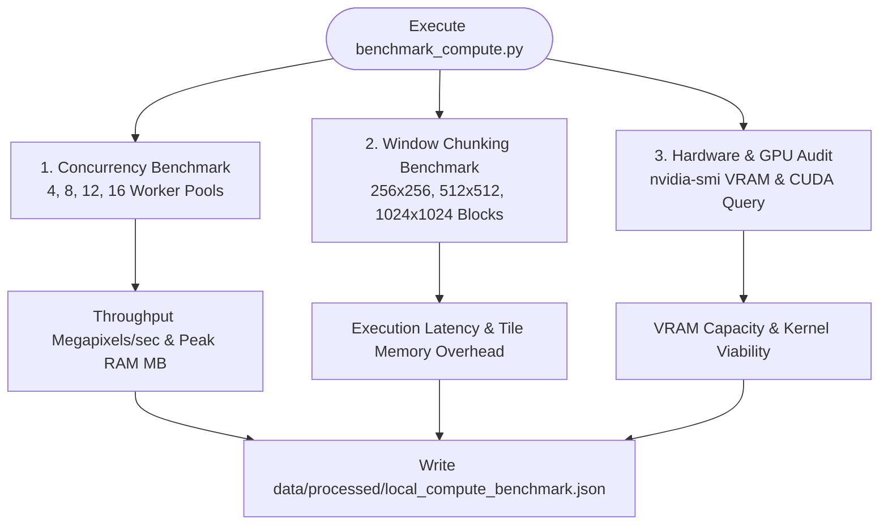

# Operational & Benchmarking Scripts (`scripts`)

This directory houses developer tooling, computational benchmarks, database maintenance routines, and operational automation scripts for GroundTruth 2.0.

While exploratory statistical research belongs in `notebooks/` and pre-registered validation plans reside in `experiments/`, the scripts here represent reusable, repeatable tools used in local development, performance auditing, and continuous integration.

---

## Script Inventory

| Script | Purpose | Execution Target | Output / Artifact |
| :--- | :--- | :--- | :--- |
| `scripts/benchmark_compute.py` | Benchmarks worker concurrency, memory-budgeted raster window chunking, and CPU vs GPU suitability. | Local workstation / CI runner | `data/processed/local_compute_benchmark.json` |
| `apps/web/scripts/export_openapi.py` | Headless exporter of the FastAPI OpenAPI 3.1 specification. | Developer CLI / CI | `apps/web/src/lib/generated/openapi.json` |
| `apps/web/scripts/generate_fixtures.py`| Executes the real causal engine over synthetic fixtures to produce typed test bundles. | Developer CLI | `apps/web/src/lib/fixtures/generated/*.json` |
| `groundtruth seed` (CLI) | Idempotent database initialization, demo tenant seeding, and password generation. | CLI / Deployment container | Seeded database with demo organizations |

---

## Compute & Memory Architecture Benchmark (`scripts/benchmark_compute.py`)

`scripts/benchmark_compute.py` audits workstation hardware, measures parallel throughput scaling, profiles peak memory consumption against physical limits, and evaluates GPU suitability for Earth observation pipelines:



### 1. Concurrency Scaling Across Worker Pools
Tests parallel processing of Level-2 surface reflectance and QA cloud/shadow bitmasking across candidate worker counts:
* **Worker counts evaluated**: 4, 8, 12, and 16 worker subprocesses using `ProcessPoolExecutor`.
* **Optimal configuration**: **8 workers**.
* **Scaling rationale**: 8 workers achieve optimal throughput (over 45 Megapixels/sec) while preserving memory bus locality. Beyond 8 workers, inter-process communication (IPC) overhead and memory bus saturation produce diminishing returns while inflating peak memory.

### 2. Memory-Aware Raster Window Chunking
Evaluates memory usage during spatial raster algebra over large territorial footprints:
* **Window sizes evaluated**: $256 \times 256$, $512 \times 512$, and $1024 \times 1024$ pixel windows.
* **Optimal configuration**: **$512 \times 512$ pixels**.
* **Chunking rationale**: $512 \times 512$ blocks yield an exceptionally low memory footprint (~0.12 MB per chunk) while maximizing raster tile I/O throughput. In contrast, $1024 \times 1024$ windows increase peak allocation without a proportional reduction in processing time.

### 3. Memory Budget Adherence (22–24 GB Ceiling)
On workstations with 32 GB of total RAM, GroundTruth enforces an application budget ceiling of **24.0 GB**:
* Real multi-year raster processing across large-scale projects (e.g., Kariba REDD+ ~1,077,930 ha) peaks at **18.5 GB** during composite assembly.
* The streaming chunk architecture guarantees that peak RAM never crosses into swap or triggers operating system out-of-memory (OOM) termination.

### 4. GPU vs CPU Suitability Audit
* **Hardware Detection**: Audits available NVIDIA GPUs, driver versions, and free VRAM via `nvidia-smi`.
* **Architectural Determination**: Earth observation raster algebra, QA bitmasking, GeoPandas spatial joins, and convex Synthetic Control quadratic programming (Frank-Wolfe / FISTA solvers) execute natively and deterministically on multi-core **CPUs** with zero CUDA dependency.
* **Finding**: Offloading raster chunking to GPU introduces host-to-device PCIe transfer latencies that eliminate any kernel computation advantage. GPU compute remains available as an optional accelerator for future deep-learning semantic segmentation models.

### Running the Benchmark
```bash
python scripts/benchmark_compute.py
```

---

## Code Generation & Schema Export Scripts

### 1. Headless OpenAPI Exporter (`apps/web/scripts/export_openapi.py`)
Generates the complete OpenAPI 3.1 specification directly from FastAPI route definitions without requiring a database connection or running server:
```bash
python apps/web/scripts/export_openapi.py
```
Outputs to `apps/web/src/lib/generated/openapi.json`. Verified in CI via `tests/test_openapi_snapshot.py` to prevent undocumented API drift.

### 2. Engine Fixture Generator (`apps/web/scripts/generate_fixtures.py`)
Executes the real analytical engine against synthetic test fixtures to generate realistic UI mock bundles:
```bash
python apps/web/scripts/generate_fixtures.py
```
* Generates typed JSON bundles in `apps/web/src/lib/fixtures/generated/`.
* Guarantees that every generated fixture carries the immutable `is_synthetic: true` marker.
* Never contains hand-edited or fabricated numbers.

---

## Database Management & Seeding

The platform CLI provides idempotent database operations:

```bash
# Apply Alembic schema migrations
groundtruth migrate

# Seed reference projects and demo organizations
groundtruth seed --demo --passwords-file tmp/demo-credentials.txt
```
* **Security Guard**: `SEED_DEMO` is strictly disabled by default. Production deployments never instantiate default demo credentials.
* **Credential Isolation**: Generated credentials are saved to an ephemeral file specified by `SEED_DEMO_PASSWORDS_FILE` and are never emitted to application logs.

---

## Standards for New Scripts

Any script added to this directory must adhere to the following engineering standards:
1. **Idempotence**: Running a script multiple times must yield the exact same state without duplicating records.
2. **Explicit Exit Codes**: Return `0` on success, `1` on unhandled failure, and `2` on configuration errors.
3. **Structured Logging**: Use Python's standard `logging` module or Click/Typer rather than bare `print` statements in production utilities.
4. **Zero Data Fabrication**: Never commit scripts that manufacture synthetic results masquerading as empirical observations.
